# Rate Limiting: Algorithms, Design, and Trade-offs

## What is Rate Limiting?

**Rate limiting** is a technique to control the number of requests a client can make to an API within a specified time period. It's a form of **throttling** - a protective mechanism that enforces a maximum quota per client.

Instead of allowing unlimited requests, a rate limiter answers these questions:
- "Can this request proceed?" - Yes, the quota still has remaining capacity
- "Should this request be blocked?" - Yes, the quota is exhausted and must wait for the refill period

**Example:** An API might allow 100 requests per hour per user. The 101st request is rejected with an HTTP 429 status.

---

## Why Rate Limiting Matters

### Problem: Abuse and Resource Exhaustion

Without rate limiting:

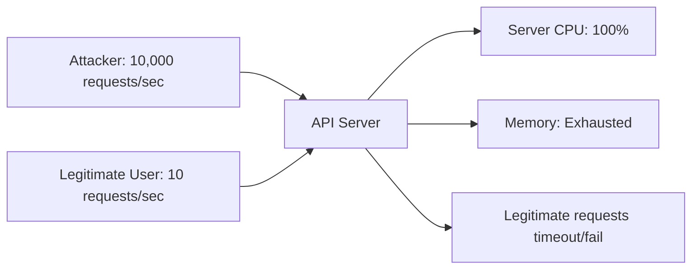

One malicious or misbehaving client can starve resources for everyone else.

### Benefits

| Benefit | Impact |
|---------|--------|
| **Availability** | Protects service from being overwhelmed by a single client |
| **Fair Usage** | Ensures all users get a fair share of API capacity |
| **Cost Control** | Prevents unexpected infrastructure bills (DDoS, runaway clients) |
| **Security** | Mitigates brute-force attacks (password guessing, token enumeration) |
| **Compliance** | Helps enforce SLA commitments (e.g., "paid tier = 500 req/hr, free = 100 req/hr") |

---

## Rate Limiting Algorithms

### 1. Token Bucket Algorithm

The **token bucket** is the most popular algorithm (used by AWS API Gateway, Stripe, GitHub). It models a bucket that fills with tokens over time.

#### How It Works

1. A bucket has a fixed **capacity** (e.g., 100 tokens)
2. Tokens are **refilled** at a constant rate (e.g., 100 tokens per 1 hour)
3. Each request **consumes 1 token**
4. If the bucket has tokens → request succeeds, decrement tokens
5. If the bucket is empty → request is rejected until tokens refill

#### Visualized Over Time

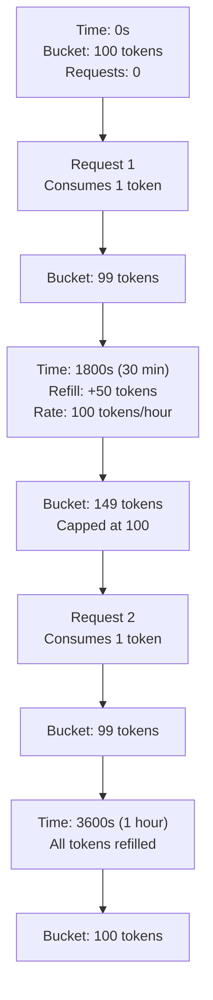

#### Lifecycle Example

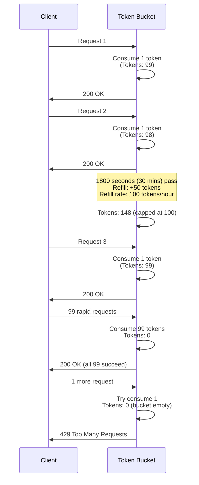

#### Key Properties

| Property | Value |
|----------|-------|
| **Burst capacity** | Yes - the algorithm allows bursts up to the bucket capacity |
| **Fairness** | Fair - every client has their own separate bucket |
| **Refill model** | Greedy (continuous) or fixed intervals |
| **Implementation complexity** | Medium - you need to track tokens and last refill time |
| **Distributed cost** | Moderate - requires storing one integer per client |

#### Advantages

- This algorithm allows controlled bursts of requests (for example, 100 tokens per hour but all at once if needed).
- The refill happens smoothly as tokens accumulate continuously over the time period.
- The mental model is simple and intuitive - think of a bucket with a faucet filling it.
- This is an industry standard algorithm proven in production at major companies.

#### Disadvantages

- Clients can abuse the burst by using all tokens immediately, which starves later requests.
- The algorithm has no awareness of downstream capacity and doesn't adapt if the backend is struggling.

---

### 2. Leaky Bucket Algorithm

The **leaky bucket** is another time-honored approach. Think of a bucket with a hole in the bottom.

#### How It Works

1. Requests are **enqueued** into a bucket with fixed capacity
2. Requests are **processed** (leak out) at a constant rate (e.g., 2 req/sec)
3. If the bucket is full → new requests are rejected
4. Otherwise, requests wait in line until the "leak" processes them

#### Visualized

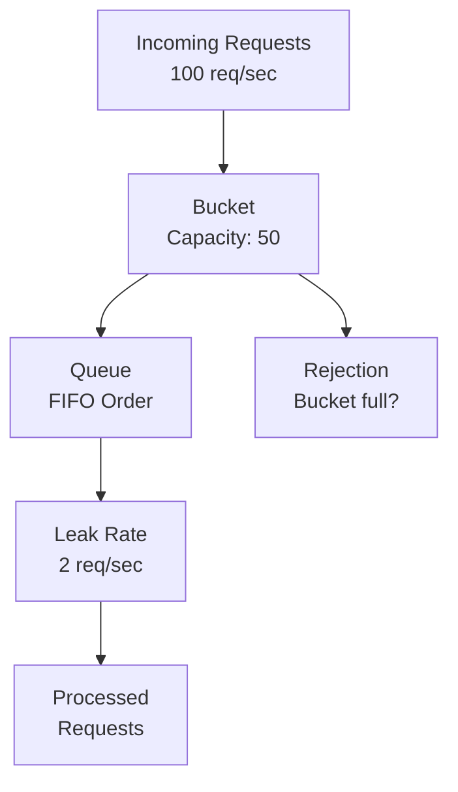

#### Example Timeline

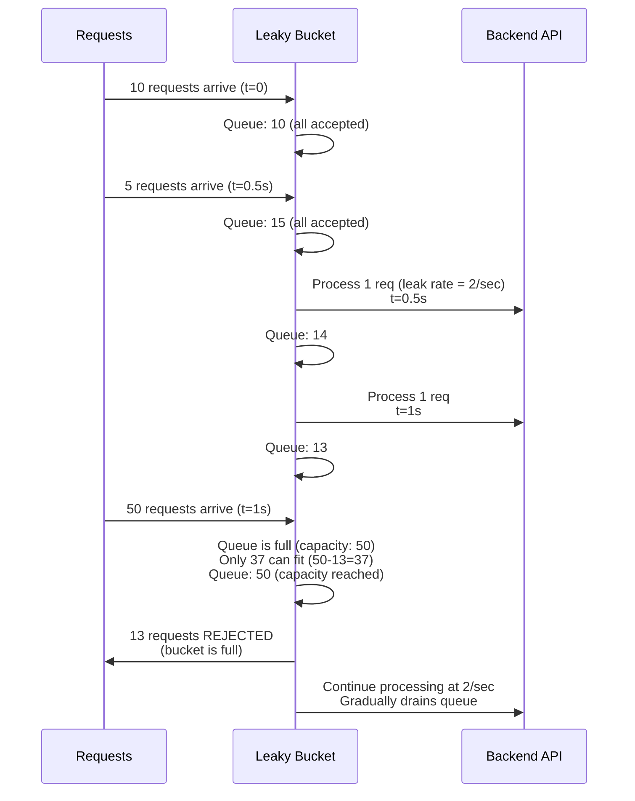

#### Key Properties

| Property | Value |
|----------|-------|
| **Burst capacity** | No - the output rate is constant regardless of queue size |
| **Fairness** | FIFO - requests are processed in arrival order |
| **Refill model** | Fixed output rate (leak rate) |
| **Implementation complexity** | High - you need a queue and background worker process |
| **Distributed cost** | High - the entire queue must be stored and synchronized |

#### Advantages

- This algorithm prevents bursts because the output is always smooth and predictable.
- The latency is predictable because the queueing discipline is known and consistent.
- The processing order is fair because FIFO prevents starvation of waiting requests.

#### Disadvantages

- This is complex to implement because it requires queue management and a background worker process.
- There is high state overhead because the queue grows as requests are rejected or queued.
- This approach is not ideal for HTTP APIs because clients may timeout while waiting in the queue.
- It is hard to distribute across multiple servers because queue state must be synchronized.

---

### 3. Sliding Window Counter Algorithm

The **sliding window** counts requests in a moving time window.

#### How It Works

1. Define a **time window** (e.g., 1 hour)
2. Count all requests **within the current window**
3. If count ≥ limit → reject; else → accept
4. As time progresses, old requests **slide out** of the window

#### Visualized

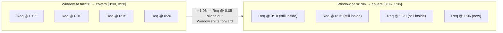

#### Example Timeline

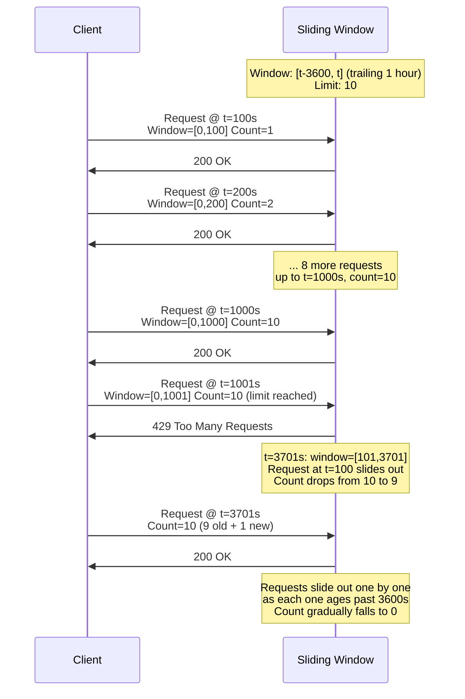

#### Key Properties

| Property | Value |
|----------|-------|
| **Burst capacity** | Possible at window boundaries |
| **Fairness** | Fair within the window |
| **Refill model** | Hard reset when window expires |
| **Implementation complexity** | Low-Medium - you need to track timestamps of requests |
| **Distributed cost** | Low - you just need a list of request timestamps |

#### Advantages

- This algorithm is simple to understand because you simply count requests within a time window.
- Memory usage is low because you only store recent request timestamps, not all historical data.
- Enforcement is accurate because the hard limit applies within the exact time window.

#### Disadvantages

- There is a boundary issue called the cliff effect - the limit suddenly resets when the window expires.
- Bursts at boundaries can occur because two full limits are possible within twice the window time.
- There is timestamp overhead because you must store every single request timestamp.

---

### 4. Fixed Window Counter Algorithm

The **fixed window** is the simplest: divide time into buckets and count per bucket.

#### How It Works

1. Divide time into **fixed intervals** (e.g., 1-hour buckets)
2. Count requests in **current interval**
3. If count ≥ limit → reject; else → accept
4. When the interval boundary passes → **reset counter** to 0

#### Visualized

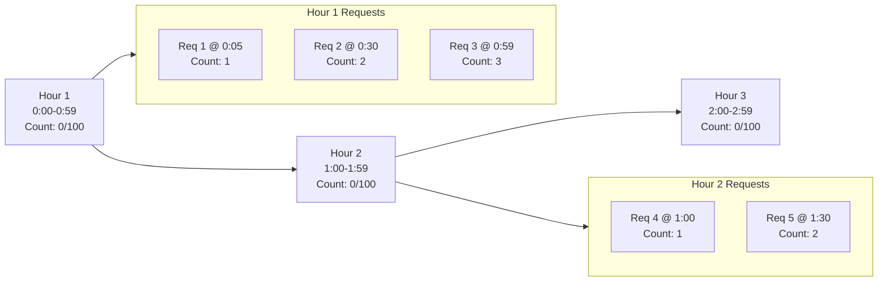

#### Example Timeline

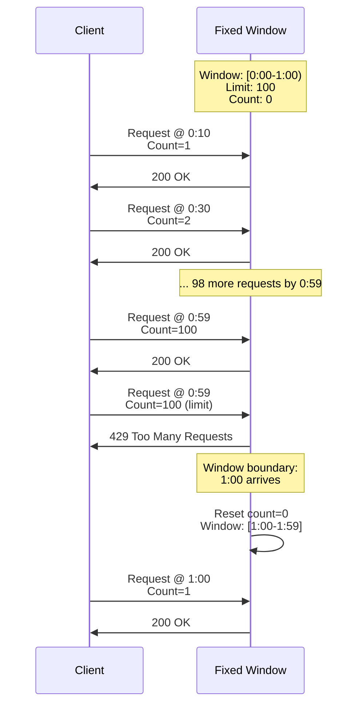

#### Key Properties

| Property | Value |
|----------|-------|
| **Burst capacity** | High at boundaries (2x limit possible) |
| **Fairness** | Fair within interval |
| **Refill model** | Hard reset at interval boundary |
| **Implementation complexity** | Very Low - just one counter and a timestamp |
| **Distributed cost** | Minimal - you only need to store one counter value |

#### Advantages

- This algorithm is trivial to implement because you only need one counter and a reset time.
- The state overhead is minimal because you store a single integer per client.
- The performance is efficient with fast lookup and update operations.

#### Disadvantages

- The cliff effect occurs when there is an abrupt reset at the boundary.
- Double-spend at boundaries is a real problem because a user can consume twice the limit in a short time:
    - Hour 1: 100 requests by 0:59:59
    - Hour 2: 100 requests from 1:00:00
    - Total in 2 seconds: 200 requests!

---

## Algorithm Comparison

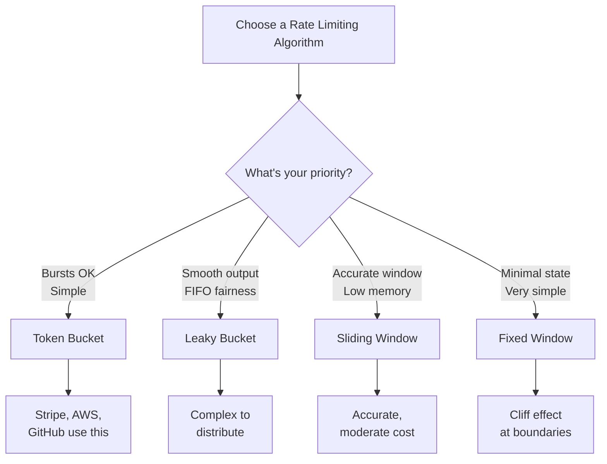

| Algorithm | Complexity | Accuracy | Burst | Distributed | Best For |
|-----------|-----------|----------|-------|-------------|----------|
| **Token Bucket** | Medium | High | Yes | Easy | General-purpose APIs |
| **Leaky Bucket** | High | Very High | No | Hard | Real-time systems, video streaming |
| **Sliding Window** | Medium | Very High | No | Medium | Payment APIs, analytics |
| **Fixed Window** | Low | Medium | High burst | Very Easy | Simple services, prototyping |

---

## Real-World Examples

### Example 1: GitHub API Rate Limits

GitHub uses **token bucket**:
- **Unauthenticated**: 60 requests/hour
- **Authenticated**: 5,000 requests/hour per user
- **Premium**: Unlimited

Each request consumes 1 token. The bucket refills continuously over the hour.

**Why token bucket?**
- This algorithm allows power users to make 5,000 requests at once if needed through burst capability.
- The smooth refill mechanism prevents cliff effects that would frustrate users.
- The approach is fair to all users because each user has their own separate bucket.

### Example 2: Payment Gateway (Stripe)

Stripe uses **sliding window**:
- Track requests in a **moving 1-second window**
- Limit: 100 requests/second per API key

**Why sliding window?**
- Payments require precision timing - there should be no sudden burst from a fixed window reset.
- This algorithm prevents double-charges and race conditions that could occur with other approaches.
- High accuracy is required for payment systems to maintain trust and compliance.

### Example 3: CDN Traffic Shaping (Leaky Bucket variant)

A CDN uses **leaky bucket**:
- Incoming requests are queued
- Egress bandwidth is constant (e.g., 1 Mbps per client)

**Why leaky bucket?**
- This algorithm prevents traffic spikes from overwhelming the origin server.
- The load is smooth and predictable, making it easier to plan infrastructure.
- It is easy to manage origin connection pools because the load is constant and controlled.

### Example 4: DDoS Mitigation (Fixed Window)

A basic DDoS protection service uses **fixed window**:
- Track requests per IP per minute
- Block if > 10,000 requests/minute

**Why fixed window?**
- This algorithm is very fast to implement and deploy in an emergency.
- It is lightweight with minimal state overhead on the system.
- Bursts at boundaries are acceptable because DDoS protection is already an imperfect defense.

---

## Distributed Rate Limiting

When you have **multiple servers**, a single in-memory bucket is not sufficient. Consider this scenario:

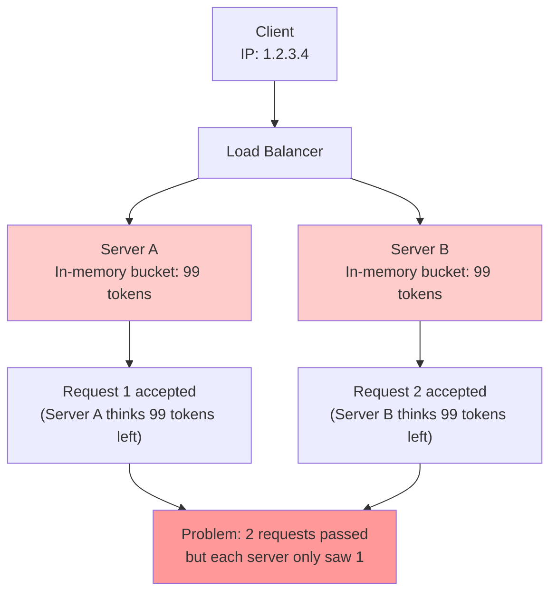

**Problem:** Client hits both servers' limits concurrently - total requests exceed 100!

### Solution: Centralized State Store

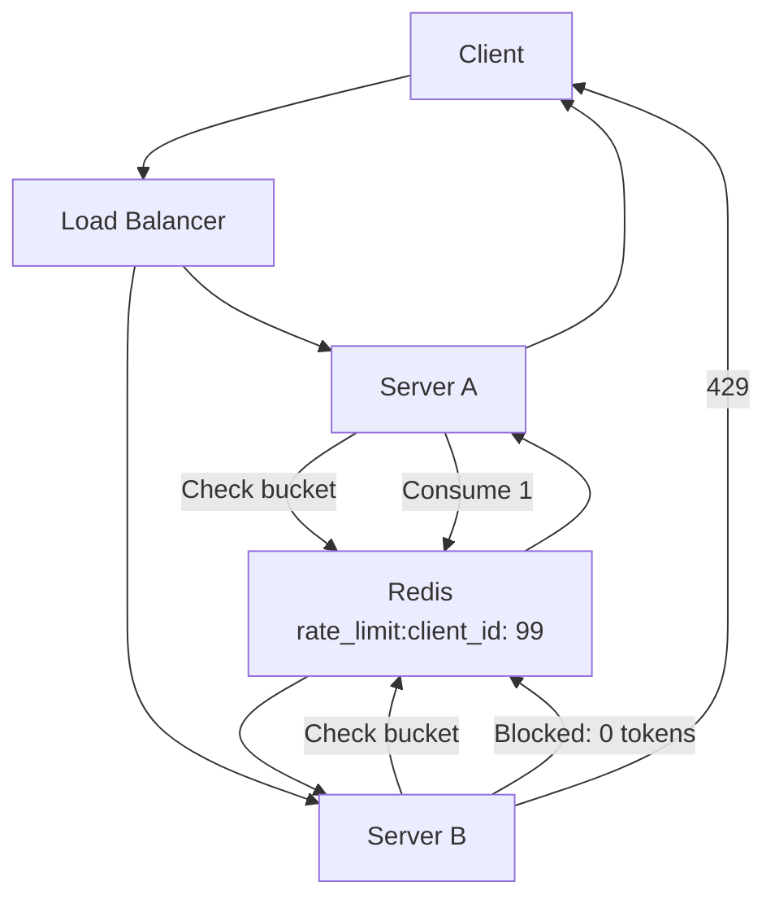

**How it works:**

1. Each server queries **Redis** (central bucket store)
2. Server performs **atomic compare-and-swap** (CAS):
    - Read current tokens
    - If > 0: decrement and confirm
    - If = 0: abort (already consumed)
3. Only one server's CAS succeeds per request
4. Token state is **consistent across all servers**

#### Trade-off: Latency

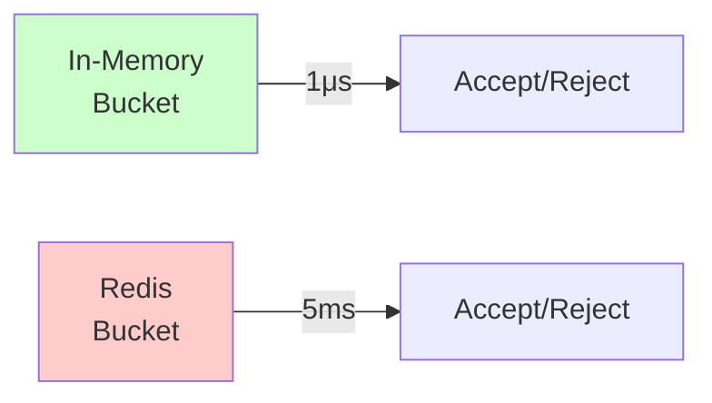

- **In-memory**: less than 1 microsecond latency
- **Redis**: approximately 1 to 5 milliseconds latency (network round-trip)

For most APIs, 5ms latency is acceptable. However, high-frequency trading or gaming applications might need in-memory buckets to avoid this overhead.

---

## Trade-offs and Considerations

### 1. Burst vs. Smoothness

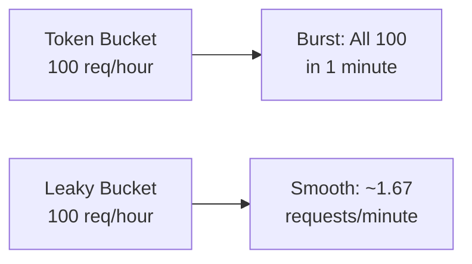

You should choose based on your expected workload pattern:
- **Bursty traffic** (e.g., job queues): Token bucket is better suited for unpredictable bursts.
- **Smooth traffic** (e.g., sensor data): Leaky bucket is better for consistent, continuous streams.

### 2. Accuracy vs. Simplicity

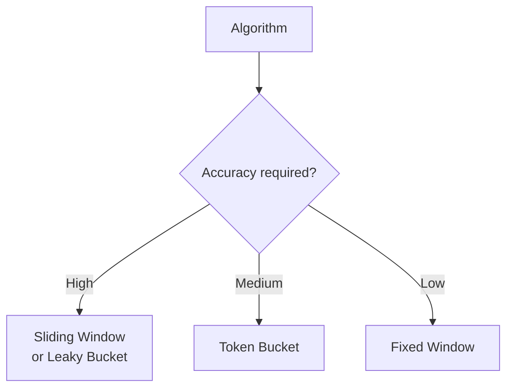

- Payment systems use sliding window for high accuracy requirements.
- General APIs use token bucket for a balance of simplicity and fairness.
- DDoS protection uses fixed window for speed and minimal overhead.

### 3. Single Server vs. Distributed

| Scenario | Approach |
|----------|----------|
| Single server, < 1000 req/s | In-memory bucket |
| Multiple servers, < 10,000 req/s | Redis with TTL |
| Multiple regions | Geo-replicated Redis + eventual consistency |
| Ultra-low latency required | In-memory with sync to Redis |

### 4. Response Behavior

When rate limit is exceeded, APIs typically respond:

```json
HTTP 429 Too Many Requests

{
  "error": "Too Many Requests",
  "message": "Rate limit exceeded",
  "retry_after": 3600
}

Headers:
X-RateLimit-Limit: 100
X-RateLimit-Remaining: 0
X-RateLimit-Reset: 1704067200
Retry-After: 3600
```

**Key headers:**
- `Retry-After` - this header tells the client how many seconds to wait before retrying the request.
- `X-RateLimit-Remaining` - this header shows how many tokens are left in the current window.
- `X-RateLimit-Reset` - this header contains the Unix timestamp when the next refill will occur.

---

## Summary

| Aspect | Token Bucket | Leaky Bucket | Sliding Window | Fixed Window |
|--------|------|------|------|------|
| **Complexity** | Medium | High | Medium | Low |
| **Burst Tolerance** | Yes | No | No | Yes (boundary) |
| **Accuracy** | High | Very High | Very High | Medium |
| **Distributed Cost** | Low | High | Medium | Very Low |
| **Common Use Case** | APIs | Real-time | Payments | DDoS |
| **Industry Adoption** | Very High | Low | High | Medium |

**Recommendation for most APIs:** Start with token bucket because it provides a good balance of simplicity, accuracy, and burst tolerance. Then evaluate sliding window if accuracy becomes critical, or fixed window if simplicity is the paramount concern.

---

## References

- Stripe Rate Limiting: https://stripe.com/en-in/blog/rate-limiters
- AWS API Gateway: https://docs.aws.amazon.com/apigateway/latest/developerguide/api-gateway-request-throttling.html
- Bucket4j Documentation: https://github.com/vladimir-bukhtoyarov/bucket4j
- Google Cloud: https://cloud.google.com/architecture/rate-limiting-strategies-techniques
