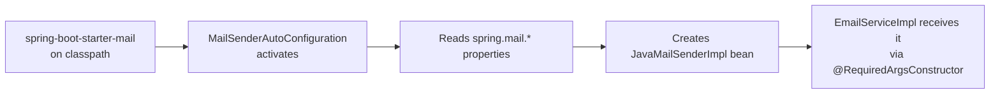
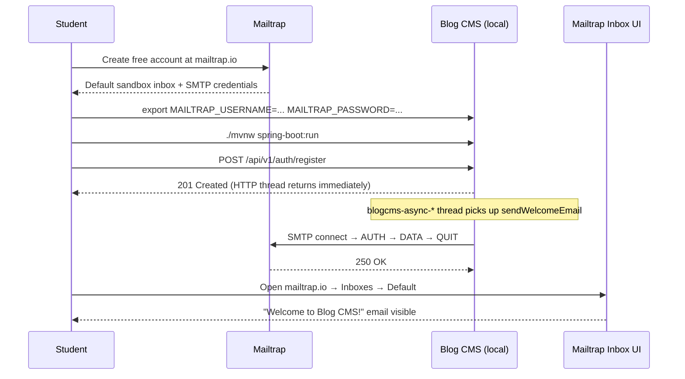

# Commit 41 — Async Email Service with Real Mailtrap SMTP

## 1. Overview

This commit introduces a fully asynchronous email service for the Blog CMS backed
by real SMTP delivery via [Mailtrap](https://mailtrap.io) sandbox. Four new files
form the core feature: an `EmailType` enum, an `EmailRequest` DTO, an `EmailService`
interface, and `EmailServiceImpl`. A stub `Comment` entity is added so the
comment-notification method signature compiles. A Flyway migration (`V7`) creates
the `comments` table so Hibernate's `ddl-auto=validate` does not reject the new
entity at startup.

`AuthServiceImpl` is updated to fire a welcome email after a user registers.
Because `sendWelcomeEmail` is `@Async`, the HTTP request thread returns its
response immediately — the SMTP call runs on a `blogcms-async-*` background thread
managed by the `ThreadPoolTaskExecutor` configured in commit 40.

`EmailServiceImpl` injects Spring's `JavaMailSender` and sends `SimpleMailMessage`
objects to Mailtrap's sandbox SMTP server. Emails never reach real inboxes —
Mailtrap captures them in a browser UI where they can be inspected during
development.

A new tutorial file (`docs/tutorial/commit-41-background-jobs-tutorial.md`) explains
the entire `@Async` mechanism from first principles, with Mermaid diagrams.

---

## 2. Why This Was Needed

Emails are inherently slow operations. A real SMTP call can take hundreds of
milliseconds (or longer if the provider is congested). Blocking the HTTP request
thread for that duration degrades throughput under any load.

Additionally, email delivery failure should never cause a registration to fail —
the user account exists regardless. Decoupling email dispatch via `@Async` is the
correct architectural choice for this kind of side-effect.

The welcome email is also a pedagogical milestone: it demonstrates that the async
thread pool configured in commit 40 is wired into real application behaviour, not
just a configuration exercise.

---

## 3. Decisions Made

### 3.1 Real SMTP via Mailtrap vs local simulation

- **Option A (chosen) — real SMTP via Mailtrap sandbox:** Add
  `spring-boot-starter-mail`, configure `spring.mail.*` properties pointing at
  Mailtrap, inject `JavaMailSender`, send `SimpleMailMessage`. *Chosen because:*
  the code path is identical to production email delivery; students see actual
  emails in the Mailtrap inbox UI immediately; Mailtrap's sandbox accepts mail
  without forwarding it to real recipients, so there is no risk of emailing
  real users from dev seed data.

- **Option B — structured log + `Thread.sleep`:** Emit a log line and sleep 2
  seconds to mimic latency. *Rejected because:* no real email is delivered, so
  students cannot verify end-to-end behaviour. Moving to real SMTP later would
  require removing simulation code rather than simply configuring credentials.

- **Option C — full local stack (MailHog in Docker):** Run a local fake SMTP
  server. *Rejected because:* adds a Docker dependency; harder to share with
  students who do not have Docker set up; Mailtrap is free and hosted.

### 3.2 SimpleMailMessage vs MimeMessage

- **`MimeMessage` + `MimeMessageHelper`:** Supports HTML bodies, inline images,
  and attachments. *Rejected because:* this project sends plain-text notifications;
  adding HTML templating (Thymeleaf, Freemarker) would introduce a second concern
  that distracts from the mail-sending lesson.

- **`SimpleMailMessage` (chosen):** Plain-text only, four fields (`from`, `to`,
  `subject`, `text`), one-line send call. *Chosen because:* matches the complexity
  of the emails being sent and is the easiest entry point for students new to
  `JavaMailSender`.

### 3.3 Credentials via environment variables

Hardcoding SMTP credentials in `application.properties` would expose them in
version control. The pattern already established for `JWT_SECRET` is followed
here: `${MAILTRAP_USERNAME:your_mailtrap_username}` uses a default placeholder
that keeps the app startable without credentials (with a logged error on first
send) while allowing real values to be injected at runtime.

### 3.4 Placing `EmailType` and `EmailRequest` in `dto/` not `dto/request/`

`EmailRequest` is an internal DTO constructed by service code, not by Spring MVC
deserialising user input. The `dto/request/` package convention is for user-facing
request bodies that carry `@Valid` Bean Validation annotations. Placing an internal
DTO there would be misleading. The `dto/` root package is the correct home for
supporting types.

### 3.5 Stub `Comment` entity vs a String parameter

The task specifies `sendCommentNotification(User postAuthor, Comment comment)` as
the interface contract. A real project will eventually build a full comment feature;
the entity belongs in the domain model now so the interface signature is semantically
correct. Using a `String commentBody` parameter would create a migration burden later
(changing the interface signature breaks callers).

### 3.6 Where to catch exceptions in `EmailServiceImpl`

- **Option A — catch inside `doSend` only:** Catches SMTP exceptions but not
  exceptions from building the `EmailRequest` (e.g., a null pointer). *Rejected.*
- **Option B (chosen) — catch at top of every public method:** Each method wraps
  its entire body in `try/catch(Exception e)`. *Chosen:* guarantees that no
  exception ever propagates out of an `@Async void` method regardless of where it
  originates.

---

## 4. New Concepts Introduced

### 4.1 `spring-boot-starter-mail` and auto-configuration

When `spring-boot-starter-mail` is on the classpath, Spring Boot's
`MailSenderAutoConfiguration` activates automatically. It reads properties
prefixed with `spring.mail.*` and constructs a `JavaMailSenderImpl` bean — no
`@Bean` method is needed in your own code.



### 4.2 `JavaMailSender` and `SimpleMailMessage`

`JavaMailSender` is a Spring interface that abstracts the Jakarta Mail API. The
key method used here is:

```java
void send(SimpleMailMessage simpleMessage) throws MailException;
```

`SimpleMailMessage` is a plain value object:

```java
SimpleMailMessage message = new SimpleMailMessage();
message.setFrom("noreply@blog-cms.local");
message.setTo(user.getEmail());
message.setSubject("Welcome to Blog CMS!");
message.setText("Hi Alice, ...");
mailSender.send(message);
```

Spring wraps all Jakarta Mail checked exceptions into unchecked `MailException`
subclasses — you do not need to declare `throws MessagingException`.

### 4.3 STARTTLS

Mailtrap requires STARTTLS (`spring.mail.properties.mail.smtp.starttls.enable=true`).
STARTTLS upgrades a plain TCP connection to TLS after the initial handshake — the
connection starts unencrypted on port 2525, then both sides switch to an encrypted
channel. Setting `starttls.required=true` means the connection is rejected if the
server does not offer STARTTLS — a safety guard against accidentally sending
credentials in plain text.

### 4.4 `@Async` and Spring AOP proxies

`@EnableAsync` in `AsyncConfig` activates an aspect that wraps every Spring bean
whose methods carry `@Async` in a proxy. When the proxy's method is called, it
submits the real method body to a thread pool and returns immediately to the caller.

The caller must hold a reference to the interface (or Spring proxy), not
`new EmailServiceImpl()`. In `AuthServiceImpl`, `private final EmailService
emailService` is injected by Spring — every call passes through the proxy.

### 4.5 `@Async("taskExecutor")` — named executor

`@Async` without a name falls back to Spring's `SimpleAsyncTaskExecutor`, which
creates a **new OS thread per call** — no pooling. Naming the executor
(`"taskExecutor"`) routes every call to the bounded `ThreadPoolTaskExecutor`
configured in `AsyncConfig`.

### 4.6 Flyway migration for `comments` table

`spring.jpa.hibernate.ddl-auto=validate` means Hibernate compares its entity model
to the actual database schema at startup and throws if they differ. A new JPA entity
without a matching table causes a startup failure. `V7__create_comments_table.sql`
creates the table before the application starts.

---

## 5. Files Changed

### `pom.xml` (modified)

Added `spring-boot-starter-mail` after the Redis starter. No version specified —
the Spring Boot parent POM manages the version.

```xml
<!-- Spring Mail — JavaMailSender + SMTP integration -->
<dependency>
    <groupId>org.springframework.boot</groupId>
    <artifactId>spring-boot-starter-mail</artifactId>
</dependency>
```

### `src/main/resources/application.properties` (modified)

Appended Mailtrap SMTP block:

```properties
# Mailtrap SMTP (sandbox — for development/teaching only)
spring.mail.host=sandbox.smtp.mailtrap.io
spring.mail.port=2525
spring.mail.username=${MAILTRAP_USERNAME:your_mailtrap_username}
spring.mail.password=${MAILTRAP_PASSWORD:your_mailtrap_password}
spring.mail.properties.mail.smtp.auth=true
spring.mail.properties.mail.smtp.starttls.enable=true
spring.mail.properties.mail.smtp.starttls.required=true
```

### `src/main/java/com/studylink/blogcms/dto/EmailType.java` (new)

Enum with four values: `WELCOME`, `PASSWORD_RESET`, `COMMENT_NOTIFICATION`,
`WEEKLY_DIGEST`. Lives in `dto/` because it is a domain-level type, not a layer
artifact.

### `src/main/java/com/studylink/blogcms/dto/EmailRequest.java` (new)

Internal DTO: `to`, `subject`, `body`, `type`. Lombok `@Getter @Builder
@NoArgsConstructor @AllArgsConstructor`. No Bean Validation — not user-facing.

### `src/main/java/com/studylink/blogcms/service/EmailService.java` (new)

Interface with four method signatures. Importing `Comment`, `Post`, `User` from
`entity/` keeps the contract semantically rich.

### `src/main/java/com/studylink/blogcms/service/impl/EmailServiceImpl.java` (new)

Key pattern — every public method follows this structure:

```java
@Override
@Async("taskExecutor")
public void sendWelcomeEmail(User user) {
    try {
        String body = "Hi " + user.getName() + ",\n\n"
                + "Welcome to Blog CMS! Your account has been created successfully.\n\n"
                + "Happy reading!\n"
                + "The Blog CMS Team";

        EmailRequest request = EmailRequest.builder()
                .to(user.getEmail())
                .subject("Welcome to Blog CMS!")
                .body(body)
                .type(EmailType.WELCOME)
                .build();

        log.info("[EMAIL] Preparing WELCOME email for user id={} name={}", user.getId(), user.getName());
        doSend(request);   // builds SimpleMailMessage, calls mailSender.send()
    } catch (Exception e) {
        log.error("[EMAIL] Failed to send WELCOME email to {}: {}", user.getEmail(), e.getMessage(), e);
    }
}
```

The private `doSend` helper:

```java
private void doSend(EmailRequest request) {
    log.info("[EMAIL] Sending type={} to={} subject=\"{}\" thread={}",
            request.getType(), request.getTo(), request.getSubject(),
            Thread.currentThread().getName());

    SimpleMailMessage message = new SimpleMailMessage();
    message.setFrom(FROM_ADDRESS);
    message.setTo(request.getTo());
    message.setSubject(request.getSubject());
    message.setText(request.getBody());

    mailSender.send(message);   // real SMTP connection to Mailtrap

    log.info("[EMAIL] Sent successfully: type={} to={}", request.getType(), request.getTo());
}
```

### `src/main/java/com/studylink/blogcms/entity/Comment.java` (new)

Minimal entity: `id`, `post` (ManyToOne), `author` (ManyToOne), `body`, `isDeleted`,
`createdAt`, `updatedAt`. Follows the standard entity template.

### `src/main/resources/db/migrations/V7__create_comments_table.sql` (new)

```sql
CREATE TABLE comments (
    id         BIGSERIAL PRIMARY KEY,
    post_id    BIGINT    NOT NULL REFERENCES posts(id),
    user_id    BIGINT    NOT NULL REFERENCES users(id),
    body       TEXT      NOT NULL,
    is_deleted BOOLEAN   NOT NULL DEFAULT FALSE,
    created_at TIMESTAMP NOT NULL DEFAULT NOW(),
    updated_at TIMESTAMP NOT NULL DEFAULT NOW()
);
CREATE INDEX idx_comments_post_id ON comments(post_id);
CREATE INDEX idx_comments_user_id ON comments(user_id);
```

### `src/main/java/com/studylink/blogcms/service/impl/AuthServiceImpl.java` (modified)

Before:
```java
private final UserService userService;
private final PasswordEncoder passwordEncoder;
private final JwtUtil jwtUtil;
```

After:
```java
private final UserService userService;
private final PasswordEncoder passwordEncoder;
private final JwtUtil jwtUtil;
private final EmailService emailService;  // added
```

Before (inside `register`):
```java
user = userService.createUser(user);
return buildAuthResponse(user);
```

After:
```java
User savedUser = userService.createUser(user);
emailService.sendWelcomeEmail(savedUser);   // fire-and-forget
return buildAuthResponse(savedUser);
```

### `docs/tutorial/commit-41-background-jobs-tutorial.md` (new)

Full `@Async` tutorial with Mermaid diagrams covering proxy mechanics,
self-invocation, return types, error handling, testing patterns, how to set up
Mailtrap credentials, and a common pitfalls table.

---

## 6. How Students Set Up Mailtrap



Step by step:

1. Create a free account at [mailtrap.io](https://mailtrap.io).
2. Navigate to **Email Testing → Inboxes → My Inbox → SMTP Settings**.
3. Select **Spring Boot** from the integration dropdown — Mailtrap shows the exact
   property block with your credentials pre-filled.
4. Copy the **Username** and **Password** values.
5. Set environment variables:
   ```bash
   export MAILTRAP_USERNAME=<paste username>
   export MAILTRAP_PASSWORD=<paste password>
   ./mvnw spring-boot:run
   ```
6. Register a new user:
   ```bash
   curl -s -X POST http://localhost:8082/api/v1/auth/register \
     -H "Content-Type: application/json" \
     -d '{"name":"Alice","email":"alice@example.com","password":"Secret123!"}'
   ```
7. Switch to the Mailtrap inbox tab — the welcome email should appear within a
   few seconds.

**What happens if credentials are not set?** The app starts normally. The first
email attempt throws `MailAuthenticationException`, which is caught and logged at
ERROR level. The HTTP response is unaffected — registration still returns 201.

---

## 7. Testing Checklist

| What to test | How to test | Expected result |
|---|---|---|
| Compilation | `./mvnw compile -q` | No errors |
| App starts without credentials | Run without env vars set | App starts; first email attempt logs `MailAuthenticationException` at ERROR; registration still returns 201 |
| Welcome email on registration | Set env vars, `POST /api/v1/auth/register` with a new email | 201 response received immediately; welcome email appears in Mailtrap inbox |
| Welcome email content | Check Mailtrap inbox | Subject "Welcome to Blog CMS!", body greets user by name |
| Async behaviour | Check log timestamps | HTTP response timestamp precedes `[EMAIL] Sent successfully` — proves async |
| Email runs on background thread | Check thread name in log | Log shows `thread=blogcms-async-1` (not the Tomcat `http-nio-*` thread) |
| Flyway V7 migration applies | Restart app against a fresh database | App starts; `comments` table exists; Hibernate validate passes |
| No simulation code | Grep `EmailServiceImpl` for `Thread.sleep` | Zero matches |
