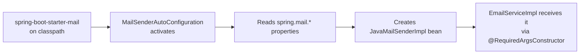
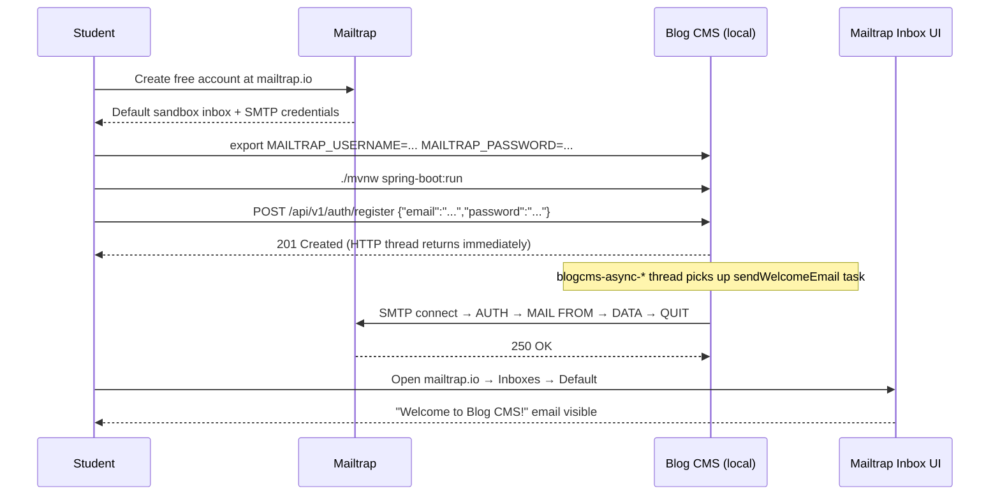

# Commit 42 — Replace Simulated Email with Real Mailtrap SMTP via JavaMailSender

## 1. Overview

This commit replaces the fake email simulation in `EmailServiceImpl` with real
SMTP delivery backed by [Mailtrap](https://mailtrap.io) sandbox. Previously,
every "send" was a `Thread.sleep(2000)` call followed by a log line — nothing
left the process. Now, Spring's `JavaMailSender` connects to Mailtrap's SMTP
server over STARTTLS and delivers an actual email to a sandboxed inbox you can
inspect in the browser.

The four email methods (`sendWelcomeEmail`, `sendPasswordResetEmail`,
`sendCommentNotification`, `sendWeeklyDigest`) all remain `@Async` — the HTTP
thread is still never blocked. The only thing that changed is what happens on
the background thread: instead of sleeping, it opens a TCP connection and talks
SMTP.

---

## 2. Why This Was Needed

Commit 41 established the async email infrastructure: thread pool, `@Async`
annotations, error handling, and the `EmailService` interface. The simulation
was deliberately chosen for that commit so students could understand async
mechanics without needing external credentials.

Once the pattern was solid, the next natural step was to prove that the same
code wires up to real email delivery with minimal changes — swap one dependency,
inject one new bean, replace `Thread.sleep` with `mailSender.send(message)`.
That is the teaching point of this commit: **the async plumbing does not change
at all; only the delivery mechanism does.**

---

## 3. Decisions Made

### SimpleMailMessage vs MimeMessage

- **Option A: `MimeMessage` + `MimeMessageHelper`** — supports HTML, inline images,
  attachments. Requires more setup boilerplate.
  *Rejected because:* this is a teaching project with plain-text emails. Adding
  HTML templating (Thymeleaf, Freemarker) would introduce a second concern that
  distracts from the mail-sending lesson.

- **Option B: `SimpleMailMessage` (chosen)** — plain-text only, minimal API.
  Set `from`, `to`, `subject`, `text` and call `mailSender.send(message)`.
  *Chosen because:* matches the complexity of the emails being sent and keeps
  the code readable for students encountering `JavaMailSender` for the first time.

### Mailtrap vs other sandbox services

- **Option A: Gmail with app password** — sends to real inboxes, rate-limited,
  requires Google account setup.
  *Rejected because:* risk of emailing real users from seeded dev data.

- **Option B: MailHog / GreenMail (local Docker)** — fully local, no signup.
  *Rejected because:* adds Docker dependency; harder to share a visible inbox
  UI with students following along.

- **Option C: Mailtrap sandbox (chosen)** — free tier, hosted, full SMTP protocol,
  browser inbox, Spring Boot integration guide built in.
  *Chosen because:* zero risk of real email delivery, easy signup, students can
  see their emails in the Mailtrap UI immediately after registering.

### Credentials via environment variables

Hardcoding SMTP credentials in `application.properties` would expose them in
version control. The pattern already established for `JWT_SECRET` is followed
here: `${MAILTRAP_USERNAME:your_mailtrap_username}` uses a default placeholder
that makes the app start without the variable set (with degraded functionality)
while allowing real values to be injected at runtime. This is the standard
twelve-factor app approach.

---

## 4. New Concepts Introduced

### `spring-boot-starter-mail` and auto-configuration

Spring Boot's auto-configuration system scans the classpath for known
libraries. When `spring-boot-starter-mail` is on the classpath, the class
`MailSenderAutoConfiguration` activates automatically. It reads properties
prefixed with `spring.mail.*` from `application.properties` and constructs
a `JavaMailSenderImpl` bean — no `@Bean` method needed in your own code.



When you declare `private final JavaMailSender mailSender;` in `EmailServiceImpl`
and annotate the class with `@RequiredArgsConstructor`, Lombok generates a
constructor that takes a `JavaMailSender` parameter. Spring's dependency
injection fills that parameter with the auto-configured `JavaMailSenderImpl`
bean.

### `JavaMailSender` and `JavaMailSenderImpl`

`JavaMailSender` is a Spring interface that abstracts the Jakarta Mail (formerly
JavaMail) API. The key method used here is:

```java
void send(SimpleMailMessage simpleMessage) throws MailException;
```

`JavaMailSenderImpl` (Spring's implementation) holds the host, port, username,
password, and SMTP properties. It opens a connection per send, authenticates,
delivers the message, and closes. Spring wraps all Jakarta Mail checked
exceptions into unchecked `MailException` subclasses — you do not need to
declare `throws MessagingException` everywhere.

### `SimpleMailMessage`

A plain value object representing a single email:

```java
SimpleMailMessage message = new SimpleMailMessage();
message.setFrom("noreply@blog-cms.local");
message.setTo(user.getEmail());
message.setSubject("Welcome to Blog CMS!");
message.setText("Hi Alice, ...");
mailSender.send(message);
```

No MIME headers, no HTML, no attachments. When plain text is all you need,
`SimpleMailMessage` is the minimal correct tool.

### STARTTLS

Mailtrap requires STARTTLS (`spring.mail.properties.mail.smtp.starttls.enable=true`).
STARTTLS upgrades a plain TCP connection to TLS after the initial handshake —
the connection starts unencrypted on port 2525, then the client sends `STARTTLS`
and both sides switch to an encrypted channel. This is different from SMTPS
(port 465), which wraps the entire connection in TLS from the start.

Setting `starttls.required=true` means the connection is rejected if the server
does not offer STARTTLS — a safety guard against accidentally sending credentials
in plain text.

---

## 5. Files Changed

### `pom.xml`

Added `spring-boot-starter-mail` after the Redis starter:

```xml
<!-- Spring Mail — JavaMailSender + SMTP integration -->
<dependency>
    <groupId>org.springframework.boot</groupId>
    <artifactId>spring-boot-starter-mail</artifactId>
</dependency>
```

No version specified — the Spring Boot parent POM manages the version, consistent
with every other Spring Boot starter in this project.

### `src/main/resources/application.properties`

Appended Mailtrap SMTP block at the end of the file:

```properties
# Mailtrap SMTP (sandbox — for development/teaching only)
spring.mail.host=sandbox.smtp.mailtrap.io
spring.mail.port=2525
spring.mail.username=${MAILTRAP_USERNAME:your_mailtrap_username}
spring.mail.password=${MAILTRAP_PASSWORD:your_mailtrap_password}
spring.mail.properties.mail.smtp.auth=true
spring.mail.properties.mail.smtp.starttls.enable=true
spring.mail.properties.mail.smtp.starttls.required=true
```

The `${ENV_VAR:default}` syntax means: use the environment variable if set;
otherwise fall back to the literal default string. This keeps the app startable
without credentials while making the misconfiguration obvious in logs.

### `src/main/java/.../service/impl/EmailServiceImpl.java`

**Before (key shape):**

```java
@RequiredArgsConstructor
public class EmailServiceImpl implements EmailService {

    private void simulateSend(EmailRequest request) {
        log.info("[EMAIL] type={} to={} ...", ...);
        Thread.sleep(2000);          // fake SMTP latency
        log.info("[EMAIL] Sent successfully: ...");
    }

    @Async("taskExecutor")
    public void sendWelcomeEmail(User user) {
        try {
            EmailRequest request = EmailRequest.builder()...build();
            log.info("[EMAIL] Preparing WELCOME email ...");
            simulateSend(request);   // no network, no real email
        } catch (Exception e) { log.error(...); }
    }
    // ... three more methods, same pattern
}
```

**After (key shape):**

```java
@RequiredArgsConstructor
public class EmailServiceImpl implements EmailService {

    private final JavaMailSender mailSender;   // injected by Spring auto-config

    private void doSend(EmailRequest request) {
        log.info("[EMAIL] Sending type={} to={} ...", ...);

        SimpleMailMessage message = new SimpleMailMessage();
        message.setFrom(FROM_ADDRESS);
        message.setTo(request.getTo());
        message.setSubject(request.getSubject());
        message.setText(request.getBody());

        mailSender.send(message);              // real SMTP connection to Mailtrap

        log.info("[EMAIL] Sent successfully: type={} to={}", ...);
    }

    @Async("taskExecutor")
    public void sendWelcomeEmail(User user) {
        try {
            EmailRequest request = EmailRequest.builder()...build();
            log.info("[EMAIL] Preparing WELCOME email ...");
            doSend(request);                   // network call, real delivery
        } catch (Exception e) { log.error(...); }
    }
    // ... three more methods, same pattern
}
```

The `@Async("taskExecutor")` annotations, try/catch structure, `EmailRequest`
builder pattern, and `@Slf4j` logging all remain identical. The only difference
is `simulateSend` → `doSend` and the addition of the `JavaMailSender` field.

### `docs/tutorial/commit-41-background-jobs-tutorial.md`

Section 7 ("Why Simulate Before Real SMTP") was updated to:

1. Acknowledge that the simulation approach was valid during early development.
2. State that the project has moved to real Mailtrap SMTP as of commit 42.
3. Explain what Mailtrap is and why it is suitable for a teaching project.
4. Add a step-by-step guide for students to get credentials and verify emails in
   the Mailtrap inbox.
5. Explain the graceful fallback behaviour when credentials are absent.

---

## 6. How Students Set This Up



Step by step:

1. Go to [mailtrap.io](https://mailtrap.io) and create a free account.
2. Navigate to **Email Testing → Inboxes → My Inbox → SMTP Settings**.
3. From the integration dropdown, select **Spring Boot** — Mailtrap shows the
   exact property block with your credentials pre-filled.
4. Copy the **Username** and **Password** values.
5. Set environment variables in your terminal:
   ```bash
   export MAILTRAP_USERNAME=<paste username>
   export MAILTRAP_PASSWORD=<paste password>
   ```
6. Start the app: `./mvnw spring-boot:run`
7. Register a new user via the Postman collection or curl:
   ```bash
   curl -s -X POST http://localhost:8082/api/v1/auth/register \
     -H "Content-Type: application/json" \
     -d '{"name":"Alice","email":"alice@example.com","password":"Secret123!"}'
   ```
8. Switch to your Mailtrap inbox tab — the welcome email should appear within
   a few seconds.

---

## 7. Testing Checklist

| What to test | How to test | Expected result |
|---|---|---|
| Compilation | `./mvnw compile -q` | No errors |
| App starts without credentials | Run without `MAILTRAP_USERNAME`/`MAILTRAP_PASSWORD` set | App starts; first email attempt logs `MailAuthenticationException` at ERROR, HTTP response unaffected |
| Welcome email on registration | Set env vars, `POST /api/v1/auth/register` with a new email | 201 response received immediately; welcome email appears in Mailtrap inbox |
| Welcome email content | Check Mailtrap inbox | Subject "Welcome to Blog CMS!", body greets user by name |
| Async behaviour | Add log timestamps around the register call | HTTP response timestamp precedes "[EMAIL] Sent successfully" timestamp — proves async |
| Password reset email | Call `POST /api/v1/auth/forgot-password` if endpoint exists | Email with subject "Password Reset Request" and reset URL in body |
| Comment notification | Post a comment on someone else's post | Post author receives "New comment on your post: ..." email |
| Weekly digest | Invoke `sendWeeklyDigest` directly via a test or admin endpoint | Email lists post titles, one per line |
| No simulation code | Grep for `Thread.sleep` in `EmailServiceImpl` | Zero matches |
