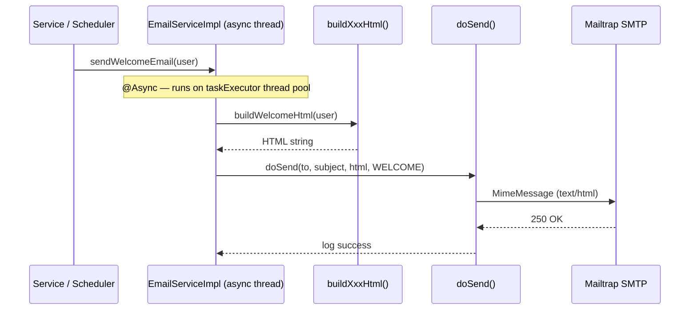

# Commit 43 — HTML Email Templates using MimeMessage

## 1. Overview

This commit upgrades `EmailServiceImpl` from sending plain-text emails via `SimpleMailMessage` to sending rich HTML emails via `MimeMessage` and `MimeMessageHelper`. All four email types (welcome, password reset, comment notification, weekly digest) now render a consistent, branded layout: dark navy header, white body, indigo accent colour, rounded CTA button, and a light-grey footer. The HTML is produced by private `buildXxxHtml(...)` methods that live directly inside `EmailServiceImpl` — no external template engine (e.g., Thymeleaf) is involved. Every byte of HTML that lands in the user's inbox is visible in a single Java source file.

---

## 2. Why This Was Needed

Plain-text emails are functional but look unprofessional. Modern email clients expect `text/html` content. The previous `SimpleMailMessage` approach had two limitations:

1. **No HTML support.** `SimpleMailMessage` only sets a `text/plain` body. There is no API to switch it to HTML.
2. **Poor readability.** Multi-line string concatenation spread across four service methods made the "email template" hard to reason about.

The upgrade gives each email type a dedicated builder method (`buildWelcomeHtml`, `buildPasswordResetHtml`, etc.) that returns a complete, self-contained HTML string. The central `doSend` method then hands that string to `MimeMessageHelper` with `isHtml = true`.

---

## 3. Decisions Made

### Decision A — Template engine (Thymeleaf / Freemarker) vs inline HTML strings

- **Thymeleaf** — industry standard for server-side HTML rendering in Spring apps. Requires adding `spring-boot-starter-thymeleaf` (already on the classpath for some projects), creating `.html` files in `resources/templates/`, and wiring a `TemplateEngine` bean. *Rejected because:* it scatters the email definition across two files (the Java method and the template file) and introduces a dependency that this project does not otherwise need. For a teaching project the goal is for a student to open one file and see the complete picture.
- **Inline HTML strings (chosen)** — the full HTML is built inside `private buildXxxHtml(...)` methods in `EmailServiceImpl` itself. No extra dependency, no separate template file. A student reading the class sees the Java logic, the HTML structure, and the SMTP dispatch all in the same place. The trade-off is verbosity — Java text blocks (`"""..."""`) introduced in Java 15 keep this manageable.

### Decision B — `MimeMessageHelper` vs manually constructing `MimeMessage`

- **Manual `MimeMessage` construction** — `MimeMessage` is part of the Jakarta Mail API (`jakarta.mail`). You can set body content directly via `mimeMessage.setContent(html, "text/html; charset=UTF-8")`. *Rejected because:* it requires handling character encoding, from-address parsing, and MIME part assembly by hand.
- **`MimeMessageHelper` (chosen)** — Spring's thin wrapper around `MimeMessage`. It accepts a plain `String` body and a boolean `isHtml` flag, handles UTF-8 encoding, and sets the correct `Content-Type` header automatically. This is the Spring idiom — consistent with how the rest of this project uses Spring abstractions over raw APIs.

### Decision C — `doSend` signature change

The previous signature was `doSend(EmailRequest request)` where `EmailRequest` bundled `to`, `subject`, `body`, and `type`. The new signature is `doSend(String to, String subject, String htmlBody, EmailType type)`.

*Reason:* The `EmailRequest` DTO was acting as a pure internal carrier with no validation or transport logic. Now that each public method builds its own HTML string before calling `doSend`, passing a DTO just to immediately unpack it adds noise. Primitive parameters make the intent explicit at the call site. The `EmailRequest` DTO and `EmailType` enum are left in the codebase unchanged — they are still valid types and removing them would be a separate refactor.

### Decision D — HTML escaping user-supplied strings

User names, post titles, and comment bodies are interpolated directly into HTML. Without escaping, a user named `<script>alert(1)</script>` would inject JavaScript into the email. A private `escapeHtml(String)` utility method replaces the five characters that must always be escaped (`&`, `<`, `>`, `"`, `'`). A full library like Apache Commons Text was not added — the five-replacement chain is sufficient for content interpolated into HTML text nodes and attributes.

---

## 4. New Concepts Introduced

### MIME — Multipurpose Internet Mail Extensions

Originally email could only carry 7-bit ASCII text. MIME is an internet standard (RFC 2045–2049) that extends email to carry:

- Multiple body parts (text + HTML alternative, plus attachments)
- Non-ASCII character sets (UTF-8)
- Binary content encoded as Base64

A MIME email has a `Content-Type` header that tells the client what to do with the body. For a simple HTML email this is:

```
Content-Type: text/html; charset=UTF-8
```

### `MimeMessage` vs `SimpleMailMessage`

| Feature | `SimpleMailMessage` | `MimeMessage` |
|---|---|---|
| Body content type | `text/plain` only | Any MIME type (`text/html`, `multipart/*`, etc.) |
| Character encoding | Limited | Full UTF-8 / Base64 support |
| Attachments | No | Yes (via `MimeMultipart`) |
| Spring abstraction | `SimpleMailMessage` is Spring's own | `MimeMessage` is from Jakarta Mail; Spring wraps it with `MimeMessageHelper` |

### `MimeMessageHelper`

`MimeMessageHelper` (package `org.springframework.mail.javamail`) is a Spring convenience class that wraps a `MimeMessage` and provides a clean API:

```java
MimeMessage mimeMessage = mailSender.createMimeMessage();
MimeMessageHelper helper = new MimeMessageHelper(mimeMessage, "UTF-8");
helper.setFrom("noreply@blog-cms.local");
helper.setTo("user@example.com");
helper.setSubject("Hello");
helper.setText("<h1>Hello!</h1>", true); // second arg = isHtml
mailSender.send(mimeMessage);
```

The second argument to `setText` is the `isHtml` boolean. When `true`, the helper sets `Content-Type: text/html; charset=UTF-8` on the message part. When `false` (the default), it sets `text/plain`.

The `"UTF-8"` argument to the constructor is the character encoding applied to the entire message. Without it, non-ASCII characters in subjects or bodies may be garbled.

### Java Text Blocks (`"""..."""`)

Text blocks, introduced as a standard feature in Java 15, allow multi-line string literals without `+` concatenation or `\n` escape sequences. The content starts after the opening `"""` and a newline, and ends at the closing `"""`. Incidental indentation (the whitespace common to all lines) is stripped automatically:

```java
String html = """
        <h1>Hello</h1>
        <p>World</p>
        """;
// html = "<h1>Hello</h1>\n<p>World</p>\n"
```

This project already uses Java 21 so text blocks are fully available. They make the inline HTML templates readable without resorting to an external file.

### Inline CSS in email HTML

Web browsers support `<style>` blocks and external stylesheets. Most email clients (Gmail, Outlook, Apple Mail) do not — or they strip `<style>` tags for security reasons. The safe approach is to put all CSS as `style="..."` attributes directly on every HTML element. This is called **inline CSS** and is the standard practice for HTML email:

```html
<!-- Correct for email -->
<p style="font-size:15px;color:#475569;line-height:1.7;">...</p>

<!-- Unreliable in email clients -->
<style>.body-text { font-size: 15px; }</style>
<p class="body-text">...</p>
```

All four templates in this commit use only inline styles.

---

## 5. Files Changed

### `src/main/java/com/studylink/blogcms/service/impl/EmailServiceImpl.java`

Complete rewrite. Key structural changes:

**Before — `doSend` used `SimpleMailMessage` and `EmailRequest` DTO:**

```java
private void doSend(EmailRequest request) {
    SimpleMailMessage message = new SimpleMailMessage();
    message.setFrom(FROM_ADDRESS);
    message.setTo(request.getTo());
    message.setSubject(request.getSubject());
    message.setText(request.getBody());
    mailSender.send(message);
}
```

**After — `doSend` uses `MimeMessage` + `MimeMessageHelper`, takes primitive args:**

```java
private void doSend(String to, String subject, String htmlBody, EmailType type) {
    log.info("[EMAIL] Sending type={} to={} subject=\"{}\" thread={}",
            type, to, subject, Thread.currentThread().getName());
    try {
        MimeMessage mimeMessage = mailSender.createMimeMessage();
        MimeMessageHelper helper = new MimeMessageHelper(mimeMessage, "UTF-8");
        helper.setFrom(FROM_ADDRESS);
        helper.setTo(to);
        helper.setSubject(subject);
        helper.setText(htmlBody, true); // true = isHtml → Content-Type: text/html
        mailSender.send(mimeMessage);
        log.info("[EMAIL] Sent successfully: type={} to={}", type, to);
    } catch (MessagingException e) {
        log.error("[EMAIL] SMTP failure: type={} to={} error={}", type, to, e.getMessage(), e);
    } catch (Exception e) {
        log.error("[EMAIL] Unexpected failure: type={} to={} error={}", type, to, e.getMessage(), e);
    }
}
```

**New shared layout helpers (`htmlHeader`, `htmlFooter`, `ctaButton`):**

```java
private String htmlHeader() {
    return """
            <!DOCTYPE html>
            <html lang="en">
            ...
            <table role="presentation" ... width="600"
                   style="background-color:#ffffff;border-radius:12px;
                          box-shadow:0 4px 24px rgba(0,0,0,0.08);">
              <!-- dark navy header bar -->
              <tr>
                <td style="background-color:#1e293b;padding:28px 40px;text-align:center;">
                  <span style="color:#ffffff;font-size:22px;font-weight:700;">Blog CMS</span>
                </td>
              </tr>
              <tr><td style="padding:40px 40px 32px;">
            """;
}
```

**Sample template builder — `buildWelcomeHtml`:**

```java
private String buildWelcomeHtml(User user) {
    String body = """
            <h2 style="margin:0 0 16px;font-size:24px;color:#1e293b;font-weight:700;">
              Welcome to Blog CMS, %s! &#127881;
            </h2>
            <p style="...">
              We're thrilled to have you here. Your account is all set up and ready to go.
            </p>
            ...
            %s
            """.formatted(escapeHtml(user.getName()), ctaButton("Start Exploring", APP_BASE_URL));

    return htmlHeader() + body + htmlFooter();
}
```

Note the pattern: `htmlHeader() + body + htmlFooter()`. Every template builder follows this convention — the shared structural chrome is assembled around a unique body block.

**Each public method now follows this pattern:**

```java
@Override
@Async("taskExecutor")
public void sendWelcomeEmail(User user) {
    try {
        log.info("[EMAIL] Preparing WELCOME email for user id={} name={}", user.getId(), user.getName());
        String html = buildWelcomeHtml(user);                           // build HTML
        doSend(user.getEmail(), "Welcome to Blog CMS!", html, EmailType.WELCOME); // send
    } catch (Exception e) {
        log.error("...", user.getId(), e.getMessage(), e);
    }
}
```

The outer `try/catch` guards against failures in HTML building (e.g., a null pointer from a missing User field) before `doSend`'s own internal `try/catch` handles SMTP failures.

---

## 6. Email Flow Diagram



---

## 7. Testing Checklist

| What to test | How to test | Expected result |
|---|---|---|
| Welcome email renders HTML | Register a new user via `POST /api/v1/auth/register`, open Mailtrap inbox | Email displays dark navy header, white card, indigo "Start Exploring" button |
| Password reset email renders HTML | Call `POST /api/v1/auth/forgot-password` with a valid email | Email shows "Reset Your Password" heading, yellow warning note below button |
| Comment notification email renders HTML | Post a comment on someone else's post (logged in as a different user) | Post author receives email with commenter name, post title, italic blockquote with indigo left border |
| Weekly digest email renders HTML | Trigger the weekly digest scheduler or call it directly in a test | Email shows post cards with indigo left border and bold post title |
| HTML escaping works | Register a user with name `<b>Test</b>` | Welcome email shows literal `&lt;b&gt;Test&lt;/b&gt;` — not bold, no injection |
| Async behaviour | Check that the HTTP response for registration returns before Mailtrap receives the email | Response arrives immediately; email appears in Mailtrap within a few seconds |
| SMTP failure is logged, not thrown | Temporarily break SMTP credentials | Application logs `[EMAIL] SMTP failure:` at ERROR level; HTTP request succeeds normally |
| Subject lines are correct | Check Mailtrap email subject | Welcome: "Welcome to Blog CMS!", Password Reset: "Reset Your Blog CMS Password", Comment: "New comment on your post: <title>", Digest: "Your Weekly Blog Digest" |
