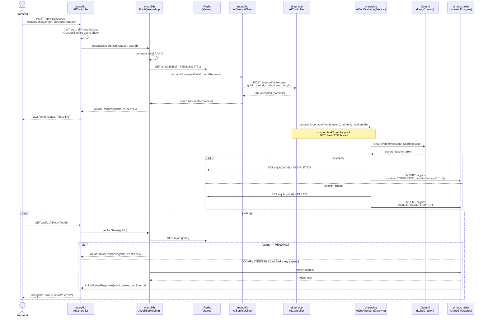

# Commit 54 — Async `/excerpt` Flow: Monolith ↔ blogcms-ai-service

## Overview

This commit converts `POST /api/v1/ai/excerpt` from a synchronous, in-process
call into an asynchronous dispatch handled by a separate service
(`blogcms-ai-service`). The frontend now gets a `jobId` back immediately and
polls a status endpoint for the result, instead of blocking on the request
until Gemini responds.

This is the first endpoint migrated under the LangChain4j microservice plan
(`plans/ai-microservice-langchain4j.md`) and the first proof that the async
job design in `docs/learnings/ai-service-async-boundary-design.md` actually
works end-to-end, not just on paper.

---

## Problem / Motivation

Before this commit, `AIController.generateExcerpt()` called
`AIServiceImpl.generateExcerpt()` directly, which called Gemini via Spring
AI's `ChatClient` and blocked the request thread for the full round trip
(typically 1–3 seconds, longer under load or Gemini-side slowness).

Extracting AI calls into a separate service only fixes anything if the
*waiting* also moves off the monolith's request thread — a separate service
still called synchronously just adds network overhead without buying back
any thread capacity (this was "Design 1" in the learnings doc, and it was
rejected for exactly this reason). The fix has to be end-to-end async:
dispatch immediately, do the work elsewhere, let the client poll.

---

## Decision

### Why dispatch-and-poll instead of a webhook back to the monolith

Two ways for `blogcms-ai-service` to report a finished job were considered:
a webhook call back to a monolith endpoint, or a direct write into
infrastructure the monolith also reads. Direct writes (Redis + `ai_jobs`)
were chosen — simpler, fewer moving parts, and the "ai_jobs is R/W on the AI
service, read-only on the monolith" ownership rule makes a webhook's
retry/idempotency handling unnecessary. Full reasoning in the learnings doc's
"Webhook vs direct Redis write" section.

### Why two persistence layers (Redis *and* Postgres) instead of one

Redis alone is cheap to poll but not safe to lose a finished result to if a
client polls late (TTL expiry). Postgres alone means every poll — including
the common case where the job is still running — costs a DB round trip.
Redis holds the bare status for the fast/common case; `ai_jobs` holds the
durable payload as a fallback once Redis has forgotten about it.

### Why `suggestTags`-style category-agnostic endpoints first

`/excerpt` needs no `categoryId` — it doesn't need to reach into the
monolith's `CategoryRepository` at all before dispatching. That made it the
right endpoint to prove the async plumbing on without also having to solve
category-name resolution at the same time. That's a deliberate sequencing
choice, not a coincidence — see the "what's next" note at the bottom.

---

## Request Flow

---

## DTOs — what each one does and why it exists

Three classes describe what is, at the wire level, really only **two**
distinct JSON shapes — because the monolith → AI-service hop crosses a
Maven-project boundary with no shared JAR between them, so each side needs
its own class to serialize/deserialize the same bytes.

| DTO | Lives in | Direction | Shape | Why it exists |
|---|---|---|---|---|
| `ExcerptRequest` | monolith | FE → monolith | `{content, maxLength}` | The public contract — pre-dates this migration (doc 50), untouched by it. The frontend never sees a `jobId`; it doesn't exist yet at this point. |
| `AIJobExcerptRequest` | monolith | monolith → AI service (**built here**) | `{jobId, userId, content, maxLength}` | What `AIJobServiceImpl` constructs and `AIServiceClient` serializes. Adds exactly the two fields the public request doesn't have: `jobId` (generated server-side, needed to correlate the async result) and `userId` (from the JWT-authenticated principal, needed because `ai_jobs.user_id` is `NOT NULL` and the AI service has no other way to know who asked). |
| `ExcerptDispatchRequest` | AI service | monolith → AI service (**received here**) | `{jobId, userId, content, maxLength}` | Same JSON as `AIJobExcerptRequest`, deserialized on the other side of the wire. `jobId`/`userId` are nullable here (not `@NotNull`) specifically so this endpoint can still be curl-tested directly without a monolith in front of it — see its class comment. |
| `AIJobResponse` | monolith | monolith → FE (dispatch ack) | `{jobId, status}` | The immediate `202` body. Deliberately generic — not `ExcerptJobResponse` — because `/outline`, `/post`, etc. return the exact same envelope shape once migrated; only what eventually lands in `result` differs per job type. |
| `AIJobStatusResponse` | monolith | monolith → FE (poll result) | `{jobId, status, result, error}` | The poll response. `result` is a raw JSON *string*, not a typed field — for excerpt it's `{"excerpt": "..."}`, for a future `/suggest-tags` it'll be `{"tags": [...]}`. Keeping it untyped here is what lets one status endpoint serve every job type without a per-type response class. |

**Why not just reuse `ExcerptRequest` as the outbound DTO too?** It's missing
`jobId`/`userId`, and bolting those onto it (via a wrapper `Map` or mutating
the public DTO) would blur "what the frontend sends" with "what crosses the
service boundary" — the exact coupling `dto/ai/` was created to avoid in the
first place (doc 49). A five-minute question-and-answer on this exact point
is preserved in `plans/ai-microservice-langchain4j.md`'s DTO discussion if
the reasoning needs revisiting.

---

## Changes Made

### `blogcms-ai-service` (new service, not previously documented here since it
lives in a separate repo — summarized for context)

| File | Purpose |
|---|---|
| `config/SecurityConfig.java`, `security/InternalApiKeyFilter.java` | Shared-secret header auth (`X-Internal-Api-Key`), not JWT — only the monolith calls this service |
| `config/LangChain4jConfig.java` | `GoogleAiGeminiChatModel` bean — native Gemini API key, no OpenAI-compat detour |
| `config/AsyncConfig.java` | Dedicated thread pool (`taskExecutor`) for job work |
| `service/AIServiceImpl.java` | `generateExcerpt()` — ported 1:1 from the monolith's `AIServiceImpl`: identical system prompt text, identical user-prompt template, identical `maxLength` default (200), identical log line. Only the model call itself changed shape. |
| `entity/AIJob.java`, `repository/AIJobRepository.java` | Full `JpaRepository` — this service is the sole writer |
| `db/migrations/V8__create_ai_jobs_table.sql` | Numbered V8 to continue the monolith's V1-V7 sequence; shares the monolith's `flyway_schema_history` table |
| `job/AIJobWorker.java` | `@Async` executor — runs the Gemini call off the HTTP thread, writes `COMPLETED`/`FAILED` to Redis + `ai_jobs` |
| `controller/AIController.java` | `GET /health` (no auth), `GET /test` (auth + real Gemini call), `POST /excerpt` (dispatch) |

### `blogcms` (monolith)

| File | Change |
|---|---|
| `entity/AIJob.java`, `repository/AIJobRepository.java` | New, **read-only** — extends bare `Repository<AIJob, UUID>`, only `findById` declared, no `save`/`delete` method exists to call even by accident |
| `dto/ai/AIJobExcerptRequest.java`, `AIJobResponse.java`, `AIJobStatusResponse.java` | New — see DTO table above |
| `client/AIServiceClient.java`, `config/AIServiceClientConfig.java` | New — fire-and-forget `RestClient` dispatcher, 2s connect / 3s read timeout |
| `exception/AIServiceUnavailableException.java` | New → `503` via `GlobalExceptionHandler`, for a failed *dispatch* call specifically (distinct from a Gemini failure, which surfaces as a `FAILED` job status on the polling path, not an exception) |
| `service/AIJobService.java`, `impl/AIJobServiceImpl.java` | New — `dispatchExcerptJob()`, `getJobStatus()` |
| `controller/AIJobStatusController.java` | New — `GET /api/v1/ai/jobs/{jobId}` |
| `controller/AIController.java` | `/excerpt` handler now dispatches and returns `202` instead of generating synchronously. JWT auth, `@PreAuthorize`, and the `AIUsageService` quota check are unchanged — the controller's responsibilities before the AI call are identical, only what happens with the result differs |

---

## Concepts Introduced

### Fire-and-forget HTTP dispatch

`AIServiceClient.dispatchExcerpt()` calls `.toBodilessEntity()` on the
`RestClient` response — it confirms the POST succeeded (2xx) but never reads
or parses a response body, because there isn't a meaningful one: the AI
service acknowledges receipt, nothing more. This is different from a normal
service-to-service call, which usually returns data the caller needs
immediately. Here the caller only needs to know dispatch succeeded; the
actual result arrives through an entirely different channel (Redis/Postgres)
later.

### Why `@Async` on the AI-service side, not the monolith side

The monolith's dispatch call is already fast (a few milliseconds — it's just
a POST that returns before any Gemini call happens). The slow part — the
actual Gemini round trip — happens inside `blogcms-ai-service`, so that's
where `@Async` needs to live. Putting `@Async` on the monolith's dispatch
call would do nothing useful, since that call was never the bottleneck.

### Read-only repository via `Repository<T, ID>` instead of `JpaRepository<T, ID>`

Spring Data's `Repository<T, ID>` is a bare marker interface with no methods
of its own — everything (`findById`, `save`, `delete`, ...) normally comes
from `JpaRepository` or `CrudRepository`. Extending `Repository` directly and
declaring only the one method actually wanted (`findById`) means the other
methods don't exist on the interface at all. This isn't validation or a
runtime check — there is no `save()` to accidentally call, the same way
there's no `deleteAll()` on a class that never declared one.

---

## Testing Checklist

- [ ] `POST /api/v1/ai/excerpt` returns `202` with `{jobId, status: PENDING}` — not the excerpt text
- [ ] `GET /api/v1/ai/jobs/{jobId}` immediately after dispatch returns `status: PENDING`
- [ ] Polling again after ~2-3s (real `GEMINI_API_KEY`) returns `status: COMPLETED` with `result: {"excerpt": "..."}`
- [ ] With a placeholder/invalid `GEMINI_API_KEY`, polling returns `status: FAILED` with Gemini's real error message in `error`
- [ ] `ai_jobs` row exists in Postgres with the correct `user_id` (matches the JWT principal), `job_type = EXCERPT`
- [ ] Redis key `ai-job:{jobId}` is set at dispatch time and reflects the final status after completion
- [ ] `/api/v1/ai/post`, `/outline`, `/expand`, `/suggest-tags`, `/generate-image` are unaffected — still synchronous, still `200`, no `jobId` involved
- [ ] `blogcms-ai-service` down/unreachable → monolith dispatch returns `503` via `AIServiceUnavailableException`, not a raw `500` or hang
- [ ] `GET http://localhost:8081/internal/v1/health` reachable with no auth header
- [ ] `GET http://localhost:8081/internal/v1/test` → `401` without `X-Internal-Api-Key`, real Gemini reply with it

---

## What's Next

`/suggest-tags` is next — chosen specifically because, like `/excerpt`, it
takes no `categoryId` and needs no category-resolution logic, so it reuses
this exact plumbing with only the prompt/parsing logic differing. See
`plans/ai-service-implementation-progress.md` for the file-level plan.
`/outline` after that is the first endpoint that will need
`categoryId → categoryName` resolution on the monolith side, which doesn't
exist anywhere yet.
