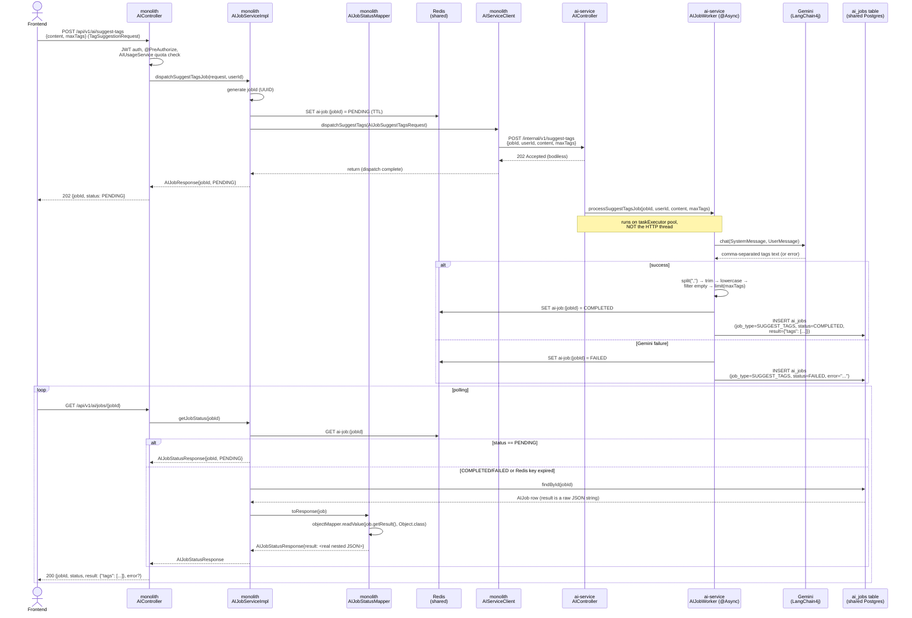

# Commit 55 — Async `/suggest-tags` Flow + `result` Serialization Fix

## Overview

This commit migrates `POST /api/v1/ai/suggest-tags` onto the same async
dispatch pattern proven by `/excerpt` (doc 54) — same `jobId`/Redis/`ai_jobs`
plumbing, different prompt and parsing logic. It also fixes a real bug found
while testing this endpoint: `AIJobStatusResponse.result` was typed `String`,
so Jackson serialized the AI-generated JSON as an **escaped string inside**
the response instead of a nested object. The fix (typing `result` as
`Object`, parsing the raw JSON before it reaches the DTO) benefits `/excerpt`
too, retroactively — nothing about doc 54's flow changes except that its
`result` field is now correctly shaped.

---

## Problem / Motivation

`/suggest-tags` was chosen as the second endpoint to migrate for the same
reason `/excerpt` was chosen first (doc 54): it's category-agnostic
(`{content, maxTags?}`, no `categoryId`), so it reuses 100% of the existing
async plumbing with zero new category-resolution logic. The only new work
is the prompt text and the response-parsing pipeline.

Separately, while verifying the result shape end-to-end, the response looked
like this:

```json
"result": "{\"excerpt\": \"Looking for a fast and reliable caching solution?...\"}"
```

instead of:

```json
"result": {"excerpt": "Looking for a fast and reliable caching solution?..."}
```

The cause: `AIJobStatusResponse.result` was declared `String`. `AIJob.result`
(the entity field, mapped to a `jsonb` column) is also a `String` — the raw
JSON text `blogcms-ai-service` wrote. Copying that raw string directly into
a `String`-typed response field means Jackson has no idea it's JSON — it just
serializes it as a string value, and JSON-encoding a string that itself
contains JSON produces exactly the double-escaped mess above.

---

## Decision

### Fix: `Object` field + parse before mapping, not a typed field per job type

`result`'s shape differs per job type (`{"excerpt": "..."}` vs
`{"tags": [...]}` vs, eventually, a full `GenerateOutlineResponse`-shaped
object for `/outline`). A single typed field can't represent all of them, and
adding a job-type-specific field to every response would defeat the point of
`AIJobStatusResponse` being one generic envelope for every job type. Typing
`result` as `Object` and parsing the raw JSON string into it (via
`ObjectMapper.readValue(json, Object.class)`) lets Jackson serialize whatever
structure is actually there — a map, a list, nested objects — without the
response DTO needing to know its shape in advance.

### New: `AIJobStatusMapper`

The parsing logic moved out of `AIJobServiceImpl` and into a new
`mapper/AIJobStatusMapper.java`, matching the project's existing
`PostMapper`/`CategoryMapper`/`UserMapper`/`TagMapper` convention
(`@Component`, constructor-injected, `toResponse(Entity)`). The one
difference from those mappers: this one needs `ObjectMapper` injected,
since converting `AIJob → AIJobStatusResponse` isn't a pure field copy —
`result` has to be parsed first. Keeping that in the mapper rather than
inline in the service keeps `AIJobServiceImpl` focused on orchestration
(Redis reads/writes, dispatch, fallback logic), not DTO-construction detail.

### `AIJobWorker`'s `writeCompleted`/`writeFailed` generalized with a `jobType` parameter

Doc 54's version hardcoded `"EXCERPT"`. Adding `suggest-tags` as a second job
type through the same two methods meant they needed to accept `jobType` as a
parameter instead — a small, mechanical change, but it's what makes every
future job type (outline, post, expand, image) reuse these same two methods
unchanged.

---

## Request Flow



---

## DTOs — what each one does and why it exists

Same three-class pattern as doc 54's excerpt table, applied to tag
suggestion. `AIJobResponse` and `AIJobStatusResponse` are **reused as-is** —
neither needed a suggest-tags-specific variant, which is exactly the point
of keeping them generic.

| DTO | Lives in | Direction | Shape | Why it exists |
|---|---|---|---|---|
| `TagSuggestionRequest` | monolith | FE → monolith | `{content, maxTags}` | Pre-existing public contract (doc 50), untouched |
| `AIJobSuggestTagsRequest` | monolith | monolith → AI service (**new**) | `{jobId, userId, content, maxTags}` | What `AIJobServiceImpl` builds — adds `jobId`/`userId`, same reasoning as `AIJobExcerptRequest` |
| `TagSuggestionDispatchRequest` | AI service | monolith → AI service (**new**) | `{jobId, userId, content, maxTags}` | Same JSON, received and deserialized on the AI-service side; `jobId`/`userId` nullable for standalone curl testing |
| `AIJobResponse` | monolith | monolith → FE (dispatch ack) | `{jobId, status}` | **Reused unchanged** from doc 54 |
| `AIJobStatusResponse` | monolith | monolith → FE (poll result) | `{jobId, status, result, error}` | **Reused, but `result`'s type just changed** from `String` to `Object` — see Decision above |

---

## Changes Made

### `blogcms-ai-service`

| File | Change | Why |
|---|---|---|
| `dto/TagSuggestionDispatchRequest.java` | **New** | Mirrors `ExcerptDispatchRequest`'s shape/nullability reasoning |
| `service/AIService.java` | **Modified** — added `suggestTags(String, int)` | Interface contract for the new capability |
| `service/impl/AIServiceImpl.java` | **Modified** — added `suggestTags()` + `TAG_SUGGESTION_SYSTEM_PROMPT` | Ported 1:1 from the monolith's `AIServiceImpl.suggestTags()` and `PromptTemplateService.getTagSuggestionSystemPrompt()` — verified word-for-word, not just "close enough" (see the excerpt prompt correction in doc 54's history for why that check matters) |
| `job/AIJobWorker.java` | **Modified** — added `processSuggestTagsJob(...)`; `writeCompleted`/`writeFailed` now take a `jobType` parameter instead of hardcoding `"EXCERPT"` | Generalizes the persistence-write methods so every future job type reuses them unchanged |
| `controller/AIController.java` | **Modified** — added `POST /internal/v1/suggest-tags` | Same dispatch shape as `/excerpt` |

### `blogcms` (monolith)

| File | Change | Why |
|---|---|---|
| `dto/ai/AIJobSuggestTagsRequest.java` | **New** | See DTO table above |
| `mapper/AIJobStatusMapper.java` | **New** | `AIJob → AIJobStatusResponse`, including the JSON-string-to-`Object` parse; matches the existing `PostMapper`/`CategoryMapper` convention |
| `dto/ai/AIJobStatusResponse.java` | **Modified** — `result: String` → `result: Object` | The serialization bug fix; benefits `/excerpt` too, not just `/suggest-tags` |
| `client/AIServiceClient.java` | **Modified** — added `dispatchSuggestTags(...)` | Same fire-and-forget pattern as `dispatchExcerpt` |
| `service/AIJobService.java` | **Modified** — added `dispatchSuggestTagsJob(...)` to the interface | |
| `service/impl/AIJobServiceImpl.java` | **Modified** — implemented `dispatchSuggestTagsJob(...)`; `getJobStatus()` now delegates the entity→DTO conversion to `AIJobStatusMapper` instead of building it inline | Keeps the service focused on orchestration; the mapping concern now has one owner |
| `controller/AIController.java` | **Modified** — `/suggest-tags` handler swaps to dispatch, returns `202` + `AIJobResponse`; dropped the now-unused `java.util.List` import | |

**Not touched**: `AIJobResponse`, `AIJobStatusController`, `AIJobRepository`, `entity/AIJob`, the `ai_jobs` migration — all already generic/sufficient from doc 54.

---

## Concepts Introduced

### Why a `String` field for JSON content breaks nested serialization

When a Java field is typed `String`, Jackson always treats its value as
opaque text — it has no way to know "this string happens to contain valid
JSON, please embed it as-is." Serializing a `String` that contains
`{"excerpt": "..."}` produces a JSON string literal with every `"` inside it
escaped to `\"`, because that's the only way to represent that raw text as a
valid JSON string value. The fix isn't a serialization setting — it's typing
the field as `Object` (or a `JsonNode`) so Jackson's tree/data-binding layer
handles it as structured JSON instead of text.

### Mapper classes can carry dependencies

CLAUDE.md describes mappers as "pure functions (no side effects, no database
calls)" — `AIJobStatusMapper` doesn't call a database or trigger any lazy
loading, but it does need `ObjectMapper` injected to do its one real job
(parsing JSON). This is consistent with how `PostMapper` already injects
`UserMapper`/`CategoryMapper`/`TagMapper` — a mapper being "pure" means no
side effects on what it's given, not that it can have zero dependencies.

---

## Testing Checklist

- [ ] `POST /api/v1/ai/suggest-tags` returns `202` with `{jobId, status: PENDING}`
- [ ] Polling with a real `GEMINI_API_KEY` returns `status: COMPLETED` with
  `result: {"tags": ["redis", "caching", ...]}` — a real nested array, not
  an escaped string
- [ ] `ai_jobs` row has `job_type = SUGGEST_TAGS`
- [ ] Re-poll an already-completed `/excerpt` job (doc 54) and confirm its
  `result` is now also properly nested, not escaped — this fix applies
  retroactively to every job type, not just suggest-tags
- [ ] With an invalid `GEMINI_API_KEY`, `status: FAILED` with the Gemini
  error message in `error`, `result: null`
- [ ] `/post` (still synchronous, still calling the monolith's old
  `AIServiceImpl.suggestTags()` internally) is unaffected

---

## What's Next

`/outline` — the first endpoint needing `categoryId → categoryName`
resolution on the monolith side, and the first that needs
`CategoryPromptTemplate`/`PromptTemplateService` actually ported to the AI
service (excerpt and suggest-tags each only needed one inline constant
prompt). See `plans/ai-service-implementation-progress.md`.
