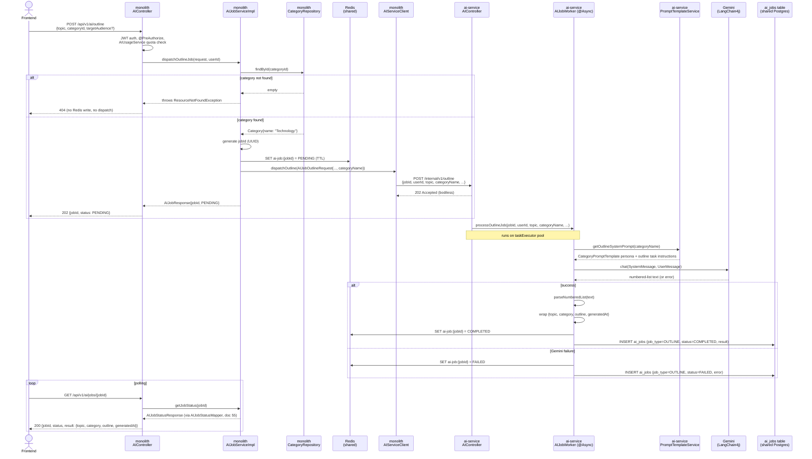

# Commit 56 — Async `/outline` + `/expand` Flow: Category Resolution Arrives

## Overview

This commit migrates `POST /api/v1/ai/outline` and `POST /api/v1/ai/expand`
onto the same async dispatch pattern proven by `/excerpt` and `/suggest-tags`
(docs 54, 55). Both are covered together because they share the one new
capability neither prior migration needed: **category resolution**.

This is also the commit where the real prompt-engineering layer
(`CategoryPromptTemplate`, `PromptTemplateService`) finally lands on
`blogcms-ai-service`, retiring the two inline prompt constants that were
standing in for it since the excerpt migration.

---

## Problem / Motivation

`/excerpt` and `/suggest-tags` are both category-agnostic — neither request
carries a `categoryId`, so neither needed to touch `CategoryRepository` or
build a category-aware system prompt. `/outline` and `/expand` are the first
two endpoints that do: both take a `categoryId` and use it to select a
writing persona (`CategoryPromptTemplate.fromCategoryName(...)`) — a
Technology outline should read differently from a Food outline.

Per the core service-boundary decision (`plans/ai-microservice-langchain4j.md`,
"The one decision that shapes everything else"), `blogcms-ai-service` never
gets direct Postgres access to blog entities. So the category resolution
step — `categoryId → Category → categoryName` — has to happen on the
**monolith** side, before the job is ever dispatched. This is the first
commit where that resolution logic actually gets written, rather than just
planned.

---

## Decision

### Where category resolution happens, and why it wasn't needed until now

`AIJobServiceImpl.dispatchOutlineJob()`/`dispatchExpandJob()` call a new
private `findCategory(Long categoryId)` helper — a straight port of
`AIServiceImpl.findCategory()`'s pattern from the monolith's old (still
partially in-use) implementation, using the exact same
`ResourceNotFoundException("Category", "id", categoryId)` shape already
established for job-not-found errors. This resolution runs **before** the
Redis `PENDING` write and before dispatch — an invalid `categoryId` fails
fast with a `404`, with no wasted Redis key or AI-service call.

### `PromptTemplateService` ported now, not deferred further

`getExcerptSystemPrompt()`/`getTagSuggestionSystemPrompt()` were inlined as
constants directly in the AI-service's `AIServiceImpl` during the excerpt
migration (doc 54), specifically because this class didn't exist yet at that
point and building the whole prompt-template package just for two
content-agnostic prompts would have been premature. Now that `/outline` and
`/expand` genuinely need `CategoryPromptTemplate`, the real service is built,
and — since it's the same file either way — `getExcerptSystemPrompt()`/
`getTagSuggestionSystemPrompt()` moved into it too, retiring the two local
constants. `AIServiceImpl.generateExcerpt()`/`suggestTags()` now call
`promptTemplateService.get...()` exactly like the monolith's original does.

`getPostSystemPrompt(categoryName)` was ported at the same time, ahead of
`/post`'s own migration — it's the same file, same enum lookup, zero
incremental risk, and saves a near-identical edit later.

### Where the final result shape gets built: `AIService` vs `AIJobWorker`

Same split established in doc 54/55: `AIServiceImpl.generateOutline(...)`
returns just `List<String>` (the parsed outline, matching what the
monolith's private `parseNumberedList` already produced) and
`expandContent(...)` returns just the expanded text `String`. Neither method
knows about `topic`/`category`/`generatedAt`/word-counts — that wrapping
happens in `AIJobWorker`, which already owns "shape the thing that gets
persisted to `ai_jobs`" for every job type. This keeps `AIServiceImpl`
answering exactly one question — "talk to Gemini, parse the response" — for
every method, not just some of them.

---

## Request Flow

Both endpoints follow the identical shape; the diagram below is `/outline`
specifically — `/expand` differs only in field names (`content`/`focusAreas`
instead of `topic`/`targetAudience`) and result shape.

---

## DTOs — what each one does and why it exists

Same three-class pattern as docs 54/55, applied twice (outline and expand).
`AIJobResponse`/`AIJobStatusResponse` are reused unchanged — no third
migration needed either of them to flex further than doc 55 already made
them.

| DTO | Lives in | Direction | Shape | Why it exists |
|---|---|---|---|---|
| `GenerateOutlineRequest` | monolith | FE → monolith | `{topic, categoryId, targetAudience?, additionalInstructions?}` | Pre-existing public contract (doc 49), untouched |
| `AIJobOutlineRequest` | monolith | monolith → AI service (**new**) | `{jobId, userId, topic, categoryName, targetAudience?, additionalInstructions?}` | `categoryId` is replaced with `categoryName` here — this is the field that changes shape, not just gains one, unlike excerpt/suggest-tags where the dispatch DTO was purely additive over the public one |
| `OutlineDispatchRequest` | AI service | monolith → AI service (**new**) | Same JSON as `AIJobOutlineRequest` | Received/deserialized on the AI-service side; `jobId`/`userId` nullable for standalone curl testing |
| `ExpandContentRequest` | monolith | FE → monolith | `{content, categoryId, focusAreas?}` | Pre-existing public contract (doc 49), untouched |
| `AIJobExpandRequest` | monolith | monolith → AI service (**new**) | `{jobId, userId, content, categoryName, focusAreas?}` | Same `categoryId → categoryName` shape change as outline |
| `ExpandDispatchRequest` | AI service | monolith → AI service (**new**) | Same JSON as `AIJobExpandRequest` | |
| `AIJobResponse` / `AIJobStatusResponse` | monolith | dispatch ack / poll result | unchanged | **Reused unchanged** from doc 55 |

---

## Changes Made

### `blogcms-ai-service`

| File | Change | Why |
|---|---|---|
| `ai/CategoryPromptTemplate.java` | **New** | Ported unchanged — already string-based (`fromCategoryName(String)`) |
| `ai/PromptTemplateService.java` | **New** | `getOutlineSystemPrompt`/`getExpandSystemPrompt`/`getPostSystemPrompt` (all take `categoryName: String`, not `Category`) + `getExcerptSystemPrompt`/`getTagSuggestionSystemPrompt` (moved here from `AIServiceImpl`'s local constants) |
| `dto/OutlineDispatchRequest.java`, `dto/ExpandDispatchRequest.java` | **New** | See DTO table |
| `service/AIService.java` | **Modified** — added `generateOutline(...)` → `List<String>`, `expandContent(...)` → `String` | |
| `service/impl/AIServiceImpl.java` | **Modified** — added both methods (ported `buildOutlineUserPrompt`, `parseNumberedList`); **removed** the two local prompt constants, now delegates to `PromptTemplateService` for all four prompts | Retires the excerpt-migration-era placeholder now that the real service exists |
| `job/AIJobWorker.java` | **Modified** — added `processOutlineJob(...)`, `processExpandJob(...)`, `countWords(...)` helper | Builds `{topic, category, outline, generatedAt}` and `{expandedContent, originalWordCount, expandedWordCount, generatedAt}` respectively — matches the monolith's original response shapes |
| `controller/AIController.java` | **Modified** — added `POST /internal/v1/outline`, `POST /internal/v1/expand` | |

### `blogcms` (monolith)

| File | Change | Why |
|---|---|---|
| `dto/ai/AIJobOutlineRequest.java`, `dto/ai/AIJobExpandRequest.java` | **New** | See DTO table |
| `client/AIServiceClient.java` | **Modified** — added `dispatchOutline(...)`, `dispatchExpand(...)` | Same fire-and-forget pattern as excerpt/suggest-tags |
| `service/AIJobService.java` | **Modified** — added `dispatchOutlineJob(...)`, `dispatchExpandJob(...)` to the interface | |
| `service/impl/AIJobServiceImpl.java` | **Modified** — implemented both; **first use of `CategoryRepository`** in this class, via a new `findCategory(Long)` helper | Category resolution is genuinely new work here, not a repeat of an existing pattern |
| `controller/AIController.java` | **Modified** — `/outline` and `/expand` handlers swap to dispatch pattern, return `202` + `AIJobResponse` instead of the full generated content | |

**Not touched**: `AIJobResponse`, `AIJobStatusResponse`, `AIJobStatusMapper`,
`AIJobStatusController`, `AIJobRepository`, `entity/AIJob`, the `ai_jobs`
migration — all already sufficient from docs 54/55.

---

## Concepts Introduced

### Fail-fast validation before any async work starts

`findCategory()` runs synchronously, on the request thread, **before** the
`jobId` is generated or the Redis `PENDING` key is written. An invalid
`categoryId` never produces an orphaned Redis key or a wasted AI-service
call — the `404` comes back immediately, same latency characteristics as
any other validation error. This is a deliberate ordering choice: category
resolution is cheap and synchronous (`local DB read`), so it happens before
anything that's actually async.

### Same DTO twice, different field, real change vs. purely additive

Doc 54/55 both had dispatch DTOs that were *strictly additive* over their
public counterparts — `AIJobExcerptRequest` had every field `ExcerptRequest`
has, plus `jobId`/`userId`. `AIJobOutlineRequest` is the first case where a
field's **type conceptually changes**, not just gets added to: the public
`GenerateOutlineRequest.categoryId: Long` becomes
`AIJobOutlineRequest.categoryName: String` — a different piece of
information entirely, derived from the original rather than copied. This is
the concrete shape of "the AI service never sees a categoryId" in practice.

---

## Testing Checklist

- [ ] `POST /api/v1/ai/outline` with a valid `categoryId` returns `202`
- [ ] `POST /api/v1/ai/outline` with an invalid `categoryId` returns `404`
  immediately — verify no `ai-job:*` Redis key was created for it
- [ ] Polling an outline job with a real `GEMINI_API_KEY` returns
  `result: {topic, category, outline: [...], generatedAt}` — `outline` is a
  real array, `category` matches the resolved category name
- [ ] Same for `/expand`: valid `categoryId` → `202`; invalid → `404`;
  completed result is `{expandedContent, originalWordCount,
  expandedWordCount, generatedAt}`
- [ ] `expandedWordCount` > `originalWordCount` on a real success
- [ ] Technology vs. Food `categoryId` produce noticeably different writing
  style in the generated outline/expansion (confirms `CategoryPromptTemplate`
  is actually being applied, not silently falling back to `DEFAULT`)
- [ ] `ai_jobs` rows show `job_type = OUTLINE` / `job_type = EXPAND`
  correctly
- [ ] `/post`, `/generate-image` (not yet migrated) are unaffected — still
  synchronous, still calling the monolith's old `AIServiceImpl` in-process

---

## What's Next

`/post` — needs a new `AIServiceImpl.generatePost(...)` on the AI-service
side that calls its own already-ported `generateExcerpt(...)`/
`suggestTags(...)` internally (same in-process composition pattern the
monolith's original `generatePost()` uses), plus `getPostSystemPrompt`
(already ported this commit, unused until now) and title extraction. This is
also the last endpoint keeping the monolith's old `AIServiceImpl` alive —
once it migrates, that class, `ImageGenerationServiceImpl`, the `ai/`
package, `AIConfig.java`, and the Spring AI dependency all become safe to
delete. `/generate-image` follows last. See
`plans/ai-service-implementation-progress.md`.
