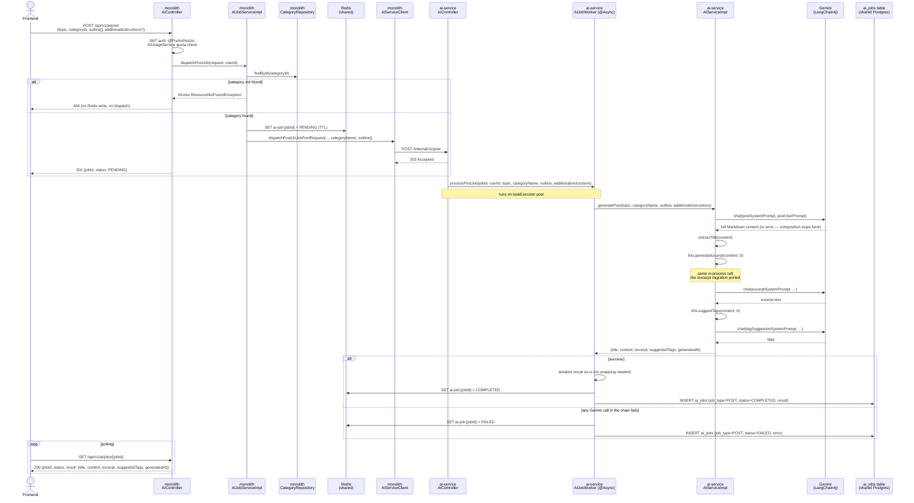

# Commit 57 — Async `/post` Flow: The Last Consumer of the Old `AIServiceImpl`

## Overview

This commit migrates `POST /api/v1/ai/post` onto the same async dispatch
pattern as the previous four endpoints. It's architecturally the most
involved of the five so far: `/post` doesn't just call Gemini once — it
generates the post body, extracts a title from it, then **internally calls
the AI-service's own already-ported `generateExcerpt()` and
`suggestTags()`** to fill out the rest of the response, mirroring exactly
what the monolith's original `AIServiceImpl.generatePost()` does (doc 50).

This is also the commit where the monolith's old `AIServiceImpl` loses its
last caller — see "What's Next" below.

---

## Problem / Motivation

Every earlier migration (excerpt, suggest-tags, outline, expand) made
exactly one call to Gemini per job. `/post` makes **three**: the main
content generation, then an excerpt call, then a tag-suggestion call — all
sequential, all in-process, because that's how the monolith's original
implementation composes them (doc 50's rationale still applies: a caller
invoking `/post` expects a complete, ready-to-use result, not three separate
round trips).

The question this migration had to answer directly (asked and confirmed
before writing any code): when `/post` becomes an async job, does the
composition call the monolith's old `AIServiceImpl.generateExcerpt()`, or
the AI-service's own already-ported version? It's the latter — the AI
service's `AIServiceImpl.generatePost()` calls `this.generateExcerpt(...)`
and `this.suggestTags(...)`, the same class, same in-process pattern, just
relocated to `blogcms-ai-service` entirely. The monolith's old
`AIServiceImpl` is never touched by this flow at all.

---

## Decision

### Where the three-call composition lives: `AIServiceImpl`, not `AIJobWorker`

Every prior migration returned "raw generation" from `AIServiceImpl` and let
`AIJobWorker` wrap it into the final persisted shape (topic/category/
generatedAt for outline; word counts for expand). `/post` breaks that
pattern on purpose: `AIServiceImpl.generatePost()` does the *entire*
composition — content generation, title extraction, the internal
`generateExcerpt`/`suggestTags` calls — **and returns the complete result
map itself, `generatedAt` included**. `AIJobWorker.processPostJob()` does
nothing but serialize whatever comes back.

This isn't an inconsistency with outline/expand — it's the same principle
applied correctly to a different shape of problem. The excerpt/outline/
expand "AIService returns raw generation, AIJobWorker shapes the result"
split exists because those methods answer exactly one question each and the
persisted shape needs one extra field (`generatedAt`, sometimes
`topic`/`category` or word counts) that only makes sense at the point of
persistence. `/post` isn't one question — the monolith's original
implementation already treats the excerpt/tags calls as part of *generating
a post*, and already builds the complete `GeneratePostResponse`, timestamp
included, in one place (doc 50). Splitting that composition across two
classes here would have been forcing a pattern onto a shape it doesn't fit,
not applying it consistently — so `generatePost()` returns
`Map<String, Object>` directly, matching the monolith's original structure
instead of a mechanically-applied "AIJobWorker always adds the timestamp"
rule.

An earlier version of this migration introduced a dedicated
`PostGenerationResult` record as an intermediate return type between
`AIServiceImpl` and `AIJobWorker`. It added a type with no counterpart in
the original codebase for no functional benefit over the `Map<String, Object>`
every other job type already uses — removed before this landed.

---

## Request Flow

---

## DTOs — what each one does and why it exists

Same pattern as docs 54–56. `AIJobPostRequest`/`PostDispatchRequest` follow
the "categoryId becomes categoryName" transformation established in doc 56
for outline/expand — `outline` is the one field that's passed through
completely unchanged (it's already the human-reviewed section list from an
earlier `/outline` call, doc 49's two-step workflow).

| DTO | Lives in | Direction | Shape | Why it exists |
|---|---|---|---|---|
| `GeneratePostRequest` | monolith | FE → monolith | `{topic, categoryId, outline[], additionalInstructions?}` | Pre-existing public contract (doc 49), untouched |
| `AIJobPostRequest` | monolith | monolith → AI service (**new**) | `{jobId, userId, topic, categoryName, outline[], additionalInstructions?}` | `categoryId → categoryName`, same transformation as outline/expand |
| `PostDispatchRequest` | AI service | monolith → AI service (**new**) | Same JSON as `AIJobPostRequest` | Received/deserialized on the AI-service side |
| `AIJobResponse` / `AIJobStatusResponse` | monolith | dispatch ack / poll result | unchanged | **Reused unchanged** |

---

## Changes Made

### `blogcms-ai-service`

| File | Change | Why |
|---|---|---|
| `dto/PostDispatchRequest.java` | **New** | See DTO table |
| `service/AIService.java` | **Modified** — added `generatePost(...)` → `Map<String, Object>` | |
| `service/impl/AIServiceImpl.java` | **Modified** — added `generatePost(...)` (ported `buildPostUserPrompt`, `extractTitle`; calls `this.generateExcerpt`/`this.suggestTags` internally; returns the complete result map, `generatedAt` included) | Full composition and result-shaping both live here, matching the monolith's original single-method approach |
| `job/AIJobWorker.java` | **Modified** — added `processPostJob(...)` | Just serializes whatever `generatePost()` returns — no wrapping needed here, unlike outline/expand |
| `controller/AIController.java` | **Modified** — added `POST /internal/v1/post` | |

### `blogcms` (monolith)

| File | Change | Why |
|---|---|---|
| `dto/ai/AIJobPostRequest.java` | **New** | See DTO table |
| `client/AIServiceClient.java` | **Modified** — added `dispatchPost(...)` | Same fire-and-forget pattern |
| `service/AIJobService.java` | **Modified** — added `dispatchPostJob(...)` | |
| `service/impl/AIJobServiceImpl.java` | **Modified** — implemented `dispatchPostJob(...)`, reusing the same `findCategory()` helper outline/expand already added | No new category-resolution code needed — the helper from doc 56 is reused as-is |
| `controller/AIController.java` | **Modified** — `/post` handler swaps to dispatch pattern; **removed the now-unused `AIService` field/import** | `/post` was the last handler in this controller still calling `aiService` directly |

**Not touched**: `AIJobResponse`, `AIJobStatusResponse`, `AIJobStatusMapper`, `AIJobStatusController`, entity/repository/migration.

---

## Concepts Introduced

### Same-class internal composition survives the service-boundary move unchanged

The monolith's `AIServiceImpl.generatePost()` calling `this.generateExcerpt(...)`
and the AI-service's `AIServiceImpl.generatePost()` calling `this.generateExcerpt(...)`
are structurally identical Java — same pattern, same reasoning, just running
in a different process now. This is worth naming explicitly because it's
easy to assume a service extraction changes composition patterns; here it
didn't need to, because both `generateExcerpt` and `generatePost` ended up
living in the same class on the same side of the boundary once the migration
was sequenced correctly (excerpt/suggest-tags before post, deliberately).

### A method's failure mode can depend on how far into its own composition it got

`/post`'s Gemini calls happen in sequence: content → excerpt → tags. If the
first call fails (as it does in every test run so far, using a placeholder
key), the job fails immediately and neither `generateExcerpt` nor
`suggestTags` ever run — confirmed in this migration's own test log (the
job failed within ~200ms, consistent with one HTTP round trip, not three).
This is worth knowing when debugging a `/post` failure in the future: a
fast failure means the content call itself failed; a slower failure means
content succeeded and one of the two follow-up calls failed instead.

---

## Testing Checklist

- [ ] `POST /api/v1/ai/post` with a valid `categoryId` and non-empty
  `outline[]` returns `202`
- [ ] Invalid `categoryId` → `404`, no Redis write, no dispatch (verified)
- [ ] Empty `outline[]` → `400` (Bean Validation `@NotEmpty`, rejected before
  the controller method even runs)
- [ ] Polling with a real `GEMINI_API_KEY` returns
  `result: {title, content, excerpt, suggestedTags: [...], generatedAt}` —
  all five fields populated, not just the main content
- [ ] `title` matches the `# H1` heading inside `content`
- [ ] `ai_jobs` row shows `job_type = POST`
- [ ] `/generate-image` (not yet migrated) is unaffected

---

## What's Next

**`/post` was the last remaining caller of the monolith's old
`AIServiceImpl`.** `AIController` no longer injects `AIService` at all — it
was removed from the controller in this commit since nothing calls it
anymore. This means, as of this commit:

- `service/AIService.java`, `service/impl/AIServiceImpl.java` (monolith)
- `ai/CategoryPromptTemplate.java`, `ai/PromptTemplateService.java` (monolith)

...have **zero remaining callers anywhere in the monolith** and are safe to
delete. This wasn't done as part of this commit — cleanup is being kept as
its own deliberate step per the migration plan ("delete only after every
endpoint that depends on it is migrated and verified"), and it's worth
doing as an explicit, reviewable commit rather than folding it silently into
this one.

**Not yet safe to delete**: `config/AIConfig.java` (the `ChatClient` bean) —
still used by `ImagePromptAgent` for `/generate-image`, which is the one
endpoint left. `ImageGenerationServiceImpl`, `ImagePromptAgent`, and the
Spring AI dependency in `pom.xml` all stay until that migration lands too.

`/generate-image` is next — the last endpoint, and the only one that's a
genuine new build rather than a port (LangChain4j's `GoogleAiGeminiImageModel`,
R2 upload from the AI service, possibly `langchain4j-agentic` for the
two-agent orchestration, per the earlier research). Full cleanup of the
monolith's old AI code follows immediately after.
