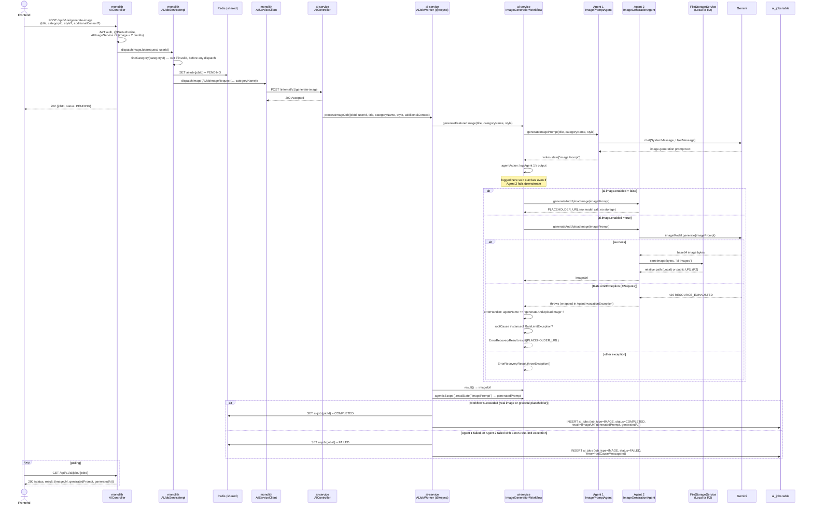

# Commit 58 — Async `/generate-image` Flow: Agentic Two-Agent Workflow

## Overview

This commit migrates `POST /api/v1/ai/generate-image` — the last of the six
AI endpoints — onto the async dispatch pattern, and is the only migration
in this series that's a genuine new build rather than a straight port. The
two-agent pipeline from dev-doc 51/52 (`ImagePromptAgent` → image model →
storage) is rebuilt using LangChain4j's `langchain4j-agentic` module
instead of hand-written orchestration, with a new `FileStorageService`
abstraction (mirroring the monolith's own `Local`/`R2` pattern) replacing
direct `S3Client` calls, and a purpose-built error-recovery path for
provider rate-limit/quota failures discovered while testing against a
free-tier Gemini key.

With this commit, `/post` (doc 57) is no longer the last consumer of the
monolith's old AI code — `/generate-image` was the other one, via
`ImageGenerationServiceImpl`/`ImagePromptAgent`. Full cleanup of the
monolith's legacy AI classes is the next step after this.

---

## Problem / Motivation

Every prior migration (docs 54–57) ported existing logic close to 1:1 —
same prompts, same parsing, same composition, just relocated behind the
async job plumbing. `/generate-image` is different: the underlying model
itself already changed once before this migration even started (dev-doc
51/52 documents Imagen 3; commit `ea042fd`, predating this whole
microservice effort, already moved the monolith onto Gemini's native image
model — "Nano Banana," `gemini-3.1-flash-image` — via a hand-rolled
`RestClient` POST and manual base64/JSON parsing, because Spring AI had no
abstraction for it).

Two things converged to make this the right endpoint to rebuild rather than
port: LangChain4j has a native `ImageModel` for exactly this model family
(confirmed against LangChain4j's docs earlier in this migration's planning —
`plans/ai-microservice-langchain4j.md`), removing the hand-rolled HTTP/JSON
code entirely; and LangChain4j's agentic module (`langchain4j-agentic`)
provides purpose-built primitives — `@Agent`, `AgenticServices`,
`AgenticScope` — for exactly the "output of one agent feeds the next"
shape dev-doc 51 already described as the "AI helping AI" pattern, built by
hand at the time because no framework support for it existed yet.

---

## Decision

### Declarative Agent 1, plain-Java Agent 2 — matching LangChain4j's own split

`ImagePromptAgent` is LLM-backed (a chat call), so it's a declarative
interface: `@SystemMessage`/`@UserMessage` (verbatim from dev-doc 52, only
the `{{title}}`/`{{categoryName}}`/`{{style}}` template variables changed
from string concatenation to LangChain4j's `{{}}` syntax) plus `@Agent`.
`ImageGenerationAgent` (the image model call + storage) is *not* purely
LLM-backed — it's a plain Java class with one `@Agent`-annotated method,
following the same "non-AI agent" pattern LangChain4j's own docs show (the
`ExchangeOperator` example: a `@Agent` method that calls a REST API, no
chat model involved). This mirrors exactly how dev-doc 52 split the two
agents in the first place — Agent 1 is prompt engineering, Agent 2 is
orchestration — just expressed through the framework's own vocabulary now
instead of hand-written classes calling each other.

### Typed workflow + `ResultWithAgenticScope`, not `UntypedAgent`

LangChain4j's simplest agentic pattern (`AgenticServices.sequenceBuilder()`
with no type parameter) returns an `UntypedAgent` taking a `Map<String,
Object>` and returning `Object` — no compile-time safety, and no way to
retrieve intermediate agent output without inspecting the map by hand.
`ImageGenerationWorkflow` instead uses the typed variant
(`sequenceBuilder(ImageGenerationWorkflow.class)`), which also requires
`extends AgenticScopeAccess` and a `ResultWithAgenticScope<String>` return
type — verified via LangChain4j's docs before committing to it (not
guessed) — specifically because `GenerateImageResponse` needs **both**
the final `imageUrl` *and* Agent 1's intermediate `generatedPrompt`, and
`ResultWithAgenticScope.agenticScope().readState("imagePrompt")` is the
only way to get the second value back out.

### `FileStorageService` — same interface/impl/`@Profile` pattern as the monolith

`ImageGenerationAgent` was originally written calling `S3Client` directly
(R2-only, no local option). That was corrected mid-build: this service now
has its own `FileStorageService` interface with `LocalFileStorageServiceImpl`
(`@Profile("!prod")`) and `R2FileStorageServiceImpl` (`@Profile("prod")`) —
structurally identical to the monolith's own file-storage split (dev-doc
28/53), including the same `!prod` (not literal `dev`) profile expression
for the same reason: this service also has no active profile by default,
and `@Profile("dev")` would leave zero `FileStorageService` beans on a
default run. `S3ClientConfig` was retroactively gated to `@Profile("prod")`
too, once `LocalFileStorageServiceImpl` existed as a real alternative — it
previously constructed unconditionally.

`ImageGenerationAgent` depends only on the `FileStorageService` interface —
it has no idea whether images end up on local disk or in R2. Local returns
a relative path; R2 returns a full public URL — same shape difference as
the monolith's two implementations, and for the same reason (R2 is served
directly by Cloudflare, not through this app).

### Error recovery: gracefully degrading on rate-limit failures, but only for Agent 2

Testing against a free-tier Gemini key surfaced a real gap: `AgentInvocationException`
wraps whatever actually failed (a `429 RateLimitException` in testing) behind
a generic "Failed to invoke agent method" message, and by default that
failure fails the whole job — even though a rate-limited *image* call is
functionally identical to `ai.image.enabled=false` (both mean "no real image
right now"). LangChain4j's agentic module has a purpose-built mechanism for
this — `.errorHandler(ErrorContext -> ErrorRecoveryResult)` on the sequence
builder, with three recovery modes (`throwException()`, `retry()`,
`result(Object)`), verified against the actual compiled
`ErrorRecoveryResult` class rather than assumed from docs alone.

The handler is deliberately scoped to `ImageGenerationAgent`'s own failure
only (`errorContext.agentName().equals("generateAndUploadImage")`), not
`ImagePromptAgent`'s. `ErrorRecoveryResult.result(...)` substitutes a value
as if the *specific failing agent* had returned it — it does not
short-circuit the whole sequence. Applying it to Agent 1's failure would
feed a placeholder URL string into Agent 2 as if it were the image prompt,
which is nonsense. Agent 2 is last in the sequence, so its substituted
result unambiguously becomes the workflow's final output — that's the only
case where blindly returning a fallback is safe. Agent 1 failures still
throw normally, verified live (a real `429` on Agent 1's chat-model quota
during testing still produced a clean `FAILED` job with the full error).

`AIJobWorker.processImageJob()` also gained a `rootCauseMessage()` helper
(walks the exception's cause chain to the deepest message) as a general
safety net for whatever `AgentInvocationException` wrapping still reaches
it unhandled — independent of the error handler, and useful for any future
agent, not just this one.

---

## Request Flow

---

## DTOs — what each one does and why it exists

Same three-class pattern as every prior migration.

| DTO | Lives in | Direction | Shape | Why it exists |
|---|---|---|---|---|
| `GenerateImageRequest` | monolith | FE → monolith | `{title, categoryId, style?, additionalContext?}` | Pre-existing public contract (dev-doc 51), untouched |
| `AIJobImageRequest` | monolith | monolith → AI service (**new**) | `{jobId, userId, title, categoryName, style?, additionalContext?}` | `categoryId → categoryName`, same transformation as outline/expand/post |
| `ImageDispatchRequest` | AI service | monolith → AI service (**new**) | Same JSON as `AIJobImageRequest` | Received/deserialized on the AI-service side |
| `AIJobResponse` / `AIJobStatusResponse` | monolith | dispatch ack / poll result | unchanged | **Reused unchanged** |

**Not carried over**: `additionalContext` is accepted in every request DTO
(matching dev-doc 51's original shape) but — same as the monolith's
original `ImagePromptAgent.generateImagePrompt(title, categoryName, style)`
— it was never actually wired into the prompt. Preserved as-is rather than
"fixed," since silently changing that behavior wasn't in scope for this
migration.

---

## Changes Made

### `blogcms-ai-service`

| File | Change | Why |
|---|---|---|
| `pom.xml` | **Modified** — added `langchain4j-agentic:1.18.1-beta28` (explicit version, not BOM-managed) and `software.amazon.awssdk:s3`/`bom` | Verified against `langchain4j-agentic`'s own POM before adding: its only dependency is `langchain4j:1.18.1`, the same stable line already in use — no version conflict, confirmed not guessed |
| `config/LangChain4jConfig.java` | **Modified** — added `ImageModel` bean (`GoogleAiGeminiImageModel`, model name matching the monolith's already-committed `gemini-3.1-flash-image`) | |
| `config/FileStorageConfig.java`, `service/FileStorageService.java`, `service/impl/LocalFileStorageServiceImpl.java`, `service/impl/R2FileStorageServiceImpl.java` | **New** | See Decision — mirrors the monolith's storage pattern |
| `config/R2Config.java`, `config/S3ClientConfig.java` | **New** | Ported from the monolith (dev-doc 53); `S3ClientConfig` gated `@Profile("prod")` |
| `ai/ImagePromptAgent.java` | **New** | Agent 1, declarative |
| `ai/ImageGenerationAgent.java` | **New** | Agent 2, plain Java `@Agent` method; `PLACEHOLDER_URL` is `public` for reuse in the error handler |
| `ai/ImageGenerationWorkflow.java` | **New** | Typed sequential workflow interface |
| `config/AgenticConfig.java` | **New** | Wires both agents, the logging step, and the error handler into the workflow bean |
| `dto/ImageDispatchRequest.java` | **New** | See DTO table |
| `job/AIJobWorker.java` | **Modified** — added `processImageJob(...)` and `rootCauseMessage(...)` | |
| `controller/AIController.java` | **Modified** — added `POST /internal/v1/generate-image` | |
| `application.properties`, `.env`/`.env.example`, `.gitignore` | **Modified** — added `file.upload-dir`, `r2.*`, `ai.image.enabled`/`AI_IMAGE_ENABLED`, R2 env vars, `uploads/` ignore rule | |

### `blogcms` (monolith)

| File | Change | Why |
|---|---|---|
| `dto/ai/AIJobImageRequest.java` | **New** | See DTO table |
| `client/AIServiceClient.java` | **Modified** — added `dispatchImage(...)` | |
| `service/AIJobService.java` / `impl/AIJobServiceImpl.java` | **Modified** — added `dispatchImageJob(...)`, reuses `findCategory()` | The 2-usage-credit charge in `AIController` is unchanged |
| `controller/AIController.java` | **Modified** — `/generate-image` handler dispatches now; `ImageGenerationService` field/import removed — this endpoint was its last caller | |

**Not touched**: `AIJobResponse`, `AIJobStatusResponse`, `AIJobStatusMapper`, `AIJobStatusController`, `AIJobRepository`, `entity/AIJob`, the `ai_jobs` migration.

---

## Concepts Introduced

### `AgenticScope` — shared state across a sequence, keyed by `outputKey`

Each agent in a `sequenceBuilder()` chain writes its return value into a
shared scope under the `outputKey` given when it was built
(`.outputKey("imagePrompt")` for Agent 1). Any later agent whose `@V`
parameter name matches that key receives it automatically — Agent 2's
`generateAndUploadImage(@V("imagePrompt") String imagePrompt)` needed no
manual wiring to receive Agent 1's output. This is the mechanism doc 51's
"AI helping AI" pattern was gesturing at conceptually before the framework
had explicit support for it.

### `agentAction` — a logging/inspection step that isn't really an agent

`AgenticServices.agentAction(Consumer<AgenticScope>)` lets a plain lambda
sit inside a sequence without doing any "real" agent work — used here
purely to log Agent 1's output between the two agents. This runs
unconditionally between Agent 1 succeeding and Agent 2 starting, which is
exactly why it's the right place to log: it fires even when Agent 2 then
fails.

### Error handler scoping — substitution vs short-circuiting

`ErrorRecoveryResult.result(value)` replaces *one agent's* output, not the
whole workflow's. For a sequence's last agent these are the same thing; for
any earlier agent they are not — recovering earlier in a chain requires
either retrying (fixing the state the failing agent needed) or accepting
that whatever gets substituted flows forward into every subsequent agent
exactly as if it had been real output. This distinction isn't obvious from
the API surface alone and had to be reasoned through explicitly before
wiring the handler, rather than being applied blindly to both agents.

---

## Testing Guide (and what this project's testing constraint actually is)

This project's Gemini key is a free tier without access to the
Nano-Banana image model family used here — real image generation is
expected to fail with a **quota/access error**, not produce an actual
image, until a paid key is available. That failure mode *is* the
correctness signal for this migration, not a blocker to work around:

- [ ] `POST /api/v1/ai/generate-image` with a valid `categoryId` returns `202`
- [ ] Invalid `categoryId` → `404`, no Redis write, no dispatch
- [ ] With `ai.image.enabled=false`: job completes with `result.imageUrl =
  "/images/placeholder-featured.png"` and a real, non-empty `generatedPrompt`
  (Agent 1 always runs)
- [ ] With `ai.image.enabled=true` and the image model unavailable/quota
  exhausted: **verified live** — job fails with the real Gemini `429`
  error surfaced in full via `rootCauseMessage()`, not a generic wrapper
  message
- [ ] Agent 1 failures (chat-model quota, verified live) still produce a
  clean `FAILED` — the error handler does not intercept these
- [ ] `ai_jobs` row shows `job_type = IMAGE`
- [ ] Once a working image model call is available: `result.imageUrl` is a
  real path/URL (relative under the default profile — local disk; full R2
  URL under `-Dspring-boot.run.profiles=prod`), and the Agent 1 output log
  line appears in the AI-service's logs
- [ ] Once a working call hits a **rate limit specifically on the image
  model** (not the chat model): job still completes as `COMPLETED` with
  the placeholder URL, not `FAILED` — this is the one path not yet
  exercised live, since the chat-model quota being exhausted blocks
  execution from ever reaching Agent 2 in current testing

---

## What's Next

All six AI endpoints are now migrated. Per the plan
(`plans/ai-service-implementation-progress.md`), the remaining step is
**cleanup**: delete the monolith's `AIServiceImpl`/`AIService`,
`ImageGenerationServiceImpl`/`ImageGenerationService`, the `ai/`
package (`CategoryPromptTemplate`, `PromptTemplateService`,
`ImagePromptAgent`), `config/AIConfig.java`, and the Spring AI dependency
from `pom.xml`/`application.properties`/`.env*` — all now have zero
remaining callers.
