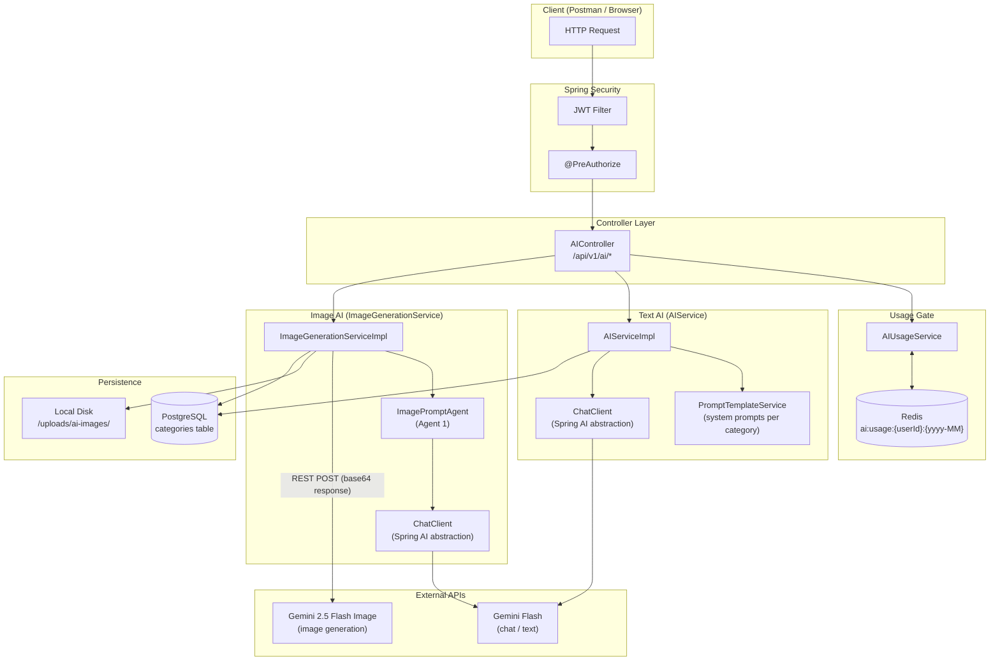

# Diagram 1 — Full Architecture Overview

This is the birds-eye view of the entire AI layer. It shows every class involved, what external system each one talks to, and how they depend on each other.

## Key Takeaways

| Concern | Where it lives |
|---|---|
| Auth & role enforcement | `@PreAuthorize` on each controller method |
| Monthly usage quota | `AIUsageService` → Redis (auto-TTL at month end) |
| Text generation (outline, post, excerpt, tags, expand) | `AIServiceImpl` via Spring AI `ChatClient` |
| Image prompt crafting | `ImagePromptAgent` (Agent 1) via `ChatClient` |
| Actual image generation | `ImageGenerationServiceImpl` (Agent 2) via REST |
| System prompts per blog category | `PromptTemplateService` |
| Category data | PostgreSQL `categories` table |
| Generated images | Local disk under `/uploads/ai-images/` |
