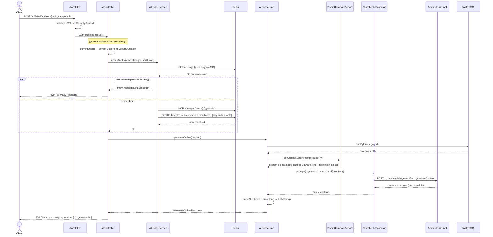

# Diagram 2 — End-to-End Request Lifecycle

This sequence diagram follows a single AI request (e.g. `POST /api/v1/ai/outline`) from the HTTP call all the way back to the JSON response. It shows exactly where JWT validation, usage checking, prompt assembly, and Gemini calls happen in order.

## Why the usage check happens in the controller, not the service

The `AIService` is a pure domain service — it knows nothing about who is calling it or whether they have quota remaining. Quota enforcement is an HTTP/security-layer concern that belongs alongside `@PreAuthorize`, not buried in business logic. This keeps `AIService` reusable and testable in isolation.
