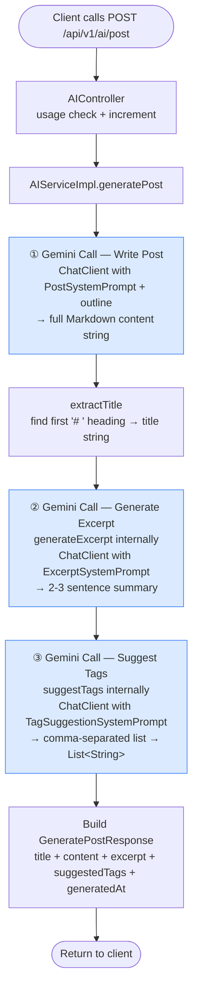

# Diagram 3 — `generatePost` Internal AI Call Chain

`POST /api/v1/ai/post` looks like one AI call from the outside, but `AIServiceImpl.generatePost()` internally chains **three sequential Gemini calls** before returning. This diagram makes that hidden fan-out visible.



## The three Gemini calls in code

```
generatePost()
│
├─ chatClient.prompt()...call()          ← Call ① — write the post body
│
├─ generateExcerpt(excerptRequest)
│   └─ chatClient.prompt()...call()     ← Call ② — summarise into excerpt
│
└─ suggestTags(tagRequest)
    └─ chatClient.prompt()...call()     ← Call ③ — extract tag list
```

`generateExcerpt` and `suggestTags` are public methods on `AIService`. `generatePost` reuses them internally — the same logic that handles the standalone `/excerpt` and `/suggest-tags` endpoints. This is **method reuse without code duplication**.

## Usage quota implication

The controller increments the usage counter **once** before calling `generatePost`. Even though three Gemini calls happen internally, only one usage credit is deducted. This is a deliberate product decision: the user requested one generation, the internal fan-out is an implementation detail.

Compare this to image generation (Diagram 4), where the controller explicitly increments **twice** because the two-agent structure is intentionally exposed as a cost signal.
