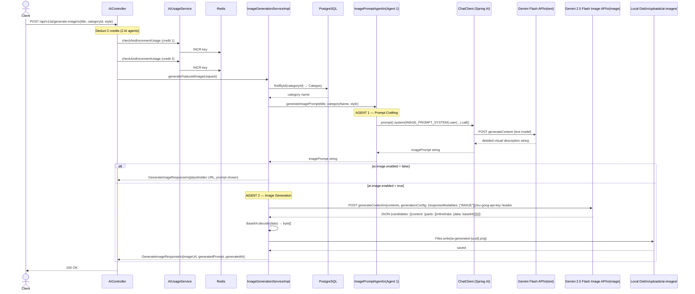

# Diagram 4 — Two-Agent Image Generation Pipeline

`POST /api/v1/ai/generate-image` uses a **two-agent pattern**: one agent crafts the image description (text), a second agent turns that description into pixels. This is why it costs 2 usage credits.

## Why two separate agents?

| Agent | Tool | Input | Output |
|---|---|---|---|
| Agent 1 — `ImagePromptAgent` | Gemini Flash (text) | Blog title + category + style preference | Detailed visual description string |
| Agent 2 — `ImageGenerationServiceImpl` | Gemini 2.5 Flash Image (image REST) | Visual description string | PNG file bytes |

Separating the agents gives control over the prompt. The Gemini image model produces better results when given rich, specific visual descriptions — not raw blog titles. Agent 1 bridges that gap. This is the **prompt-amplification pattern**: use a cheap text model to turn sparse input into rich input for an expensive generative model.

## The `ai.image.enabled` feature flag

The flag lets the app run in a demo or test environment where you don't want to consume image API quota. Agent 1 always runs (so the generated prompt is visible in the response), but Agent 2 is skipped and a placeholder URL is returned instead.
