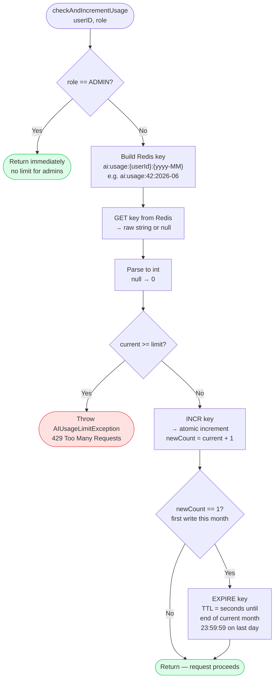
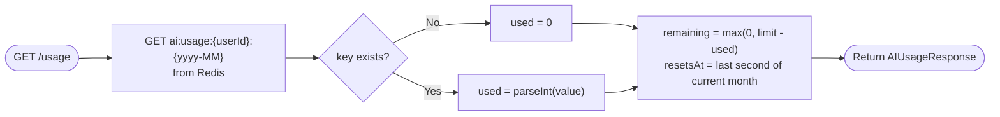

# Diagram 5 — Redis-Backed Monthly Rate Limiting

Every AI endpoint calls `AIUsageService.checkAndIncrementUsage()` before doing any AI work. This diagram walks through the full decision tree, including the Redis key structure and how the TTL auto-resets the counter at month end.



## Role-based limits

| Role | Monthly limit |
|---|---|
| `SUBSCRIBER` | 5 |
| `AUTHOR` | 50 |
| `ADMIN` | Unlimited (bypass) |

These are defined as a static `Map<Role, Integer>` constant in `AIUsageServiceImpl` — no database lookup needed.

## The Redis key design

```
ai:usage:{userId}:{yyyy-MM}
         ↑         ↑
         user ID   current year-month (YearMonth.now())

Example: ai:usage:42:2026-06
```

The month is baked into the key name, so a new month automatically gets a **new key starting at 0** — no cron job or manual reset needed. The TTL set on first write (`EXPIRE`) ensures the old key is cleaned up from Redis memory once the month ends.

## Why `INCR` instead of GET + SET?

Redis `INCR` is **atomic** — it reads and increments in a single operation. If two requests arrive simultaneously for the same user, there is no race condition where both read `4`, both compare `4 < 5`, both pass the check, and both write `5`. One of them will see `5` returned from `INCR` and the limit is honoured correctly.

## The `GET` before `INCR` — is it a race?

Yes, technically there is a small window between `GET` (check) and `INCR` (increment) where a concurrent request could slip through one extra call past the limit. For AI generation quotas this is acceptable — the consequence of a single over-limit call is minor. A stricter alternative is a Lua script that combines check + increment atomically, but that added complexity is not warranted here.

## Usage response (`GET /api/v1/ai/usage`)


