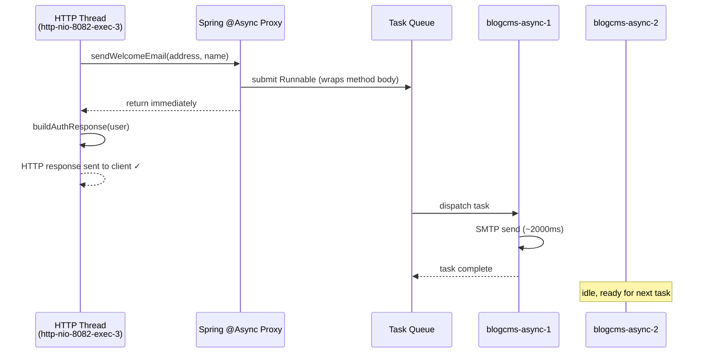
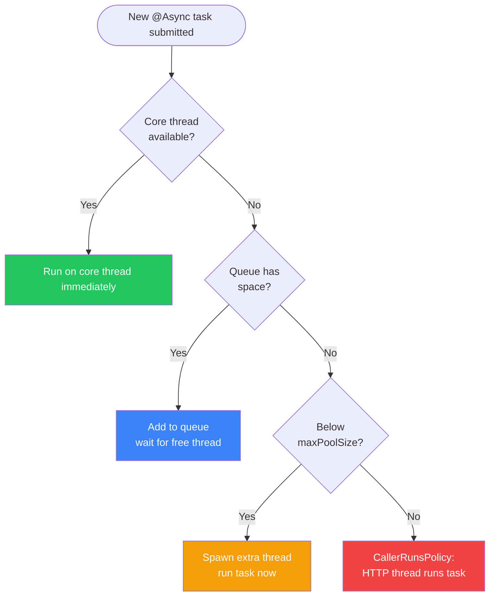
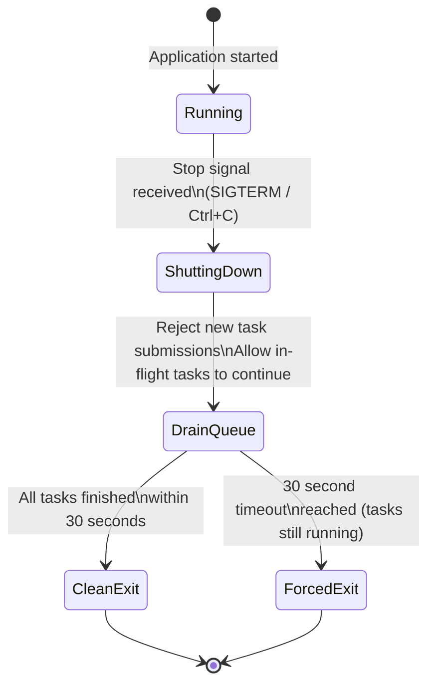
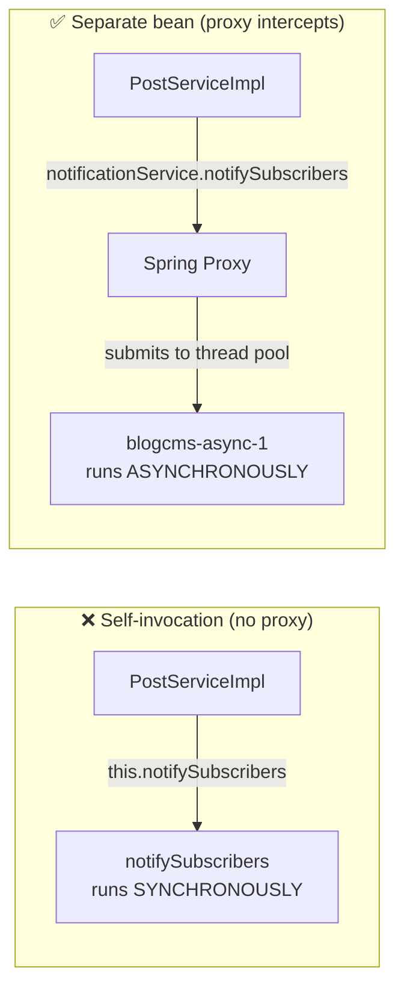

# Tutorial: Asynchronous Jobs in Spring Boot

This tutorial starts from zero. You do not need prior knowledge of threads or concurrency to follow along. By the end you will understand what `@Async` does, how to configure the thread pool behind it, and how to use it correctly in the Blog CMS codebase.

---

## 1. What is Asynchronous Execution?

### The restaurant kitchen analogy

Imagine a restaurant where there is only one chef and one waiter. When a customer orders a steak (which takes 15 minutes to cook), the waiter walks to the kitchen, stands at the pass, and waits. No other customers can be served until the steak is done. The restaurant can only serve one customer at a time.

This is **synchronous** execution: the person asking for something blocks and waits until the result is ready before doing anything else.

Now imagine the chef has two assistants. The waiter drops the order ticket at the kitchen and immediately goes back to take the next table's order. The assistant chefs work on the steak in the background. When it is ready, a bell rings and the waiter delivers it. Meanwhile the restaurant served four other tables.

This is **asynchronous** execution: the requester does not wait. The work happens in the background while the requester continues with other tasks.

In Spring Boot, the "waiter" is the HTTP request thread, the "kitchen assistants" are background threads in a thread pool, and `@Async` is the mechanism that routes work from one to the other.

---

## 2. The Problem with Synchronous Tasks

Consider what happens in `AuthServiceImpl.register()` when a new user signs up. After creating the user record in the database, the application should send a welcome email. If email sending is done synchronously:

```
POST /api/v1/auth/register
      │
      ▼
AuthController.register()          ← HTTP thread, clock starts
      │
      ▼
AuthServiceImpl.register()
  ├─ Save user to database          (5 ms)
  ├─ Send welcome email             (2,000 ms) ← SMTP round-trip
  └─ Return AuthResponse
      │
      ▼
HTTP response sent to client        ← 2,005 ms after request arrived
```

The client's browser or mobile app stares at a loading spinner for two seconds just because of an email. Every concurrent registration request occupies an HTTP thread for those two seconds. With Tomcat's default of 200 HTTP threads, you can handle at most 100 simultaneous registrations per second (200 threads / 2 seconds each) before new requests start queuing.

If the SMTP server is temporarily slow and email sending takes 10 seconds, the entire registration endpoint becomes unusable during that window.

The welcome email is a side effect — it does not change the outcome of registration. The user account is created regardless. Sending the email in the background fixes all of these problems without changing any observable behaviour from the client's perspective.

---

## 3. Spring's `@Async` in Action

### Step 1: Enable async processing

Place `@EnableAsync` on a `@Configuration` class. In this project it is on `AsyncConfig`:

```java
@Configuration
@EnableAsync
public class AsyncConfig implements AsyncConfigurer { ... }
```

`@EnableAsync` tells Spring to scan the application context for methods annotated with `@Async` and wrap the beans containing them in a proxy. Without this annotation, `@Async` is silently ignored — methods run synchronously with no error.

### Step 2: Write an async method

```java
@Service
@RequiredArgsConstructor
@Slf4j
public class EmailService {

    @Async
    public void sendWelcomeEmail(String toAddress, String userName) {
        log.info("Sending welcome email to {} on thread {}",
                toAddress, Thread.currentThread().getName());
        // ... SMTP logic here (takes ~2 seconds) ...
        log.info("Welcome email sent to {}", toAddress);
    }
}
```

Rules for `@Async` methods:

- The method must be `public`. Spring's AOP proxy cannot intercept non-public methods.
- The class containing the method must be a Spring-managed bean (`@Service`, `@Component`, etc.).
- The method must be called through the Spring-managed proxy, not through `this` (see Section 11).

### Step 3: Call the async method

```java
@Service
@RequiredArgsConstructor
public class AuthServiceImpl implements AuthService {

    private final UserService userService;
    private final PasswordEncoder passwordEncoder;
    private final JwtUtil jwtUtil;
    private final EmailService emailService; // inject the async service

    @Override
    @Transactional
    public AuthResponse register(RegisterRequest request) {
        // ... create and save user ...

        // This returns immediately. Email is sent on a background thread.
        emailService.sendWelcomeEmail(user.getEmail(), user.getName());

        return buildAuthResponse(user);
    }
}
```

From `AuthServiceImpl`'s perspective, `sendWelcomeEmail` returns instantly. Spring routes the method body to a background thread from the pool. The HTTP response goes back to the client while the email is still being sent.

---

## 4. Understanding the Thread Pool

Here is what happens when `emailService.sendWelcomeEmail(...)` is called:



The HTTP thread and the email thread now run in parallel. The HTTP thread finishes in ~5 ms. The email thread finishes ~2,000 ms later with no impact on the HTTP response time.

---

## 5. Configuring the Thread Pool

The thread pool in `AsyncConfig` is governed by four properties. Here is what each one controls with concrete numbers.

### `corePoolSize` (default: 4)

The number of threads that are **always alive**, even when there is no work. Think of these as the full-time kitchen staff who are always clocked in.

When a task arrives and a core thread is idle, the task runs immediately. When all core threads are busy, the task goes into the queue.

```
Scenario: Blog CMS at normal load — 2-3 background tasks per second
  → 4 core threads handle all of it with room to spare
  → No extra threads ever created
  → Queue stays empty
```

### `queueCapacity` (default: 200)

The number of tasks that can wait in line before extra threads are created. Think of this as the order tickets clipped to the kitchen wheel.

New threads beyond the core count are created **only after the queue is full**. This is counterintuitive for many developers — the queue fills first, then threads grow. The rationale: threads are expensive to create; queuing is cheap.

```
Scenario: Blog CMS traffic spike — 50 tasks arrive simultaneously
  → 4 core threads grab 4 tasks immediately
  → Remaining 46 tasks wait in the queue (queue: 46/200)
  → No extra threads needed; queue absorbs the burst
```

### `maxPoolSize` (default: 16)

The ceiling on total threads, including core threads. Extra threads are created when the queue is full.

```
Scenario: Extreme spike — 220 tasks arrive simultaneously
  → 4 core threads start running
  → 200 tasks fill the queue
  → 16 extra threads created (4 core + 12 extra = 16 max)
  → Task 221: queue full, max threads reached → CallerRunsPolicy activates
```

### How tasks flow through the pool



### `threadNamePrefix` (default: `blogcms-async-`)

Threads are named `blogcms-async-1`, `blogcms-async-2`, etc. This makes background threads immediately identifiable in:
- Log files: you can filter logs by thread name
- Thread dumps (`jstack`): you can spot stuck async threads instantly
- APM tools (Datadog, New Relic): you can separate async task metrics from HTTP request metrics

---

## 6. Rejection Policies Explained

When the queue is full **and** all threads are at `maxPoolSize`, any new task must be handled by a rejection policy. The JDK provides four built-in policies.

| Policy | Class | Behaviour | Use when |
|---|---|---|---|
| `AbortPolicy` | `ThreadPoolExecutor.AbortPolicy` | Throws `RejectedExecutionException`. Task is dropped. | You want the caller to explicitly handle overload. Suitable for tasks with retry logic. |
| `DiscardPolicy` | `ThreadPoolExecutor.DiscardPolicy` | Silently drops the task. No exception, no log. | Truly fire-and-forget analytics where occasional drops are acceptable and silence is preferred. |
| `DiscardOldestPolicy` | `ThreadPoolExecutor.DiscardOldestPolicy` | Drops the oldest waiting task from the queue head to make room. | Unusual. Tasks that expire (e.g., real-time notifications) where newer tasks are more valuable than older ones. |
| `CallerRunsPolicy` | `ThreadPoolExecutor.CallerRunsPolicy` | The thread that submitted the task runs it synchronously. | **This project's choice.** Creates back-pressure. The caller slows down rather than losing work. |

The Blog CMS uses `CallerRunsPolicy` because losing an async task (a welcome email, a view count increment, an image processing job) is worse than slowing down the HTTP thread temporarily. The trade-off: under extreme load, some HTTP requests will take longer. The upside: no silent data loss.

---

## 7. Return Types: `void` vs `Future` vs `CompletableFuture`

`@Async` methods can return three types. Choose based on whether the caller needs the result.

### `void` — fire and forget

```java
@Async
public void sendWelcomeEmail(String toAddress, String name) {
    // runs in background, caller gets nothing back
}
```

Use when: the caller does not need the result and does not need to know if it succeeded.

Caution: if an exception is thrown inside a `void` `@Async` method, it disappears silently unless you configure an `AsyncUncaughtExceptionHandler` (see Section 8).

### `Future<T>` — blocking result retrieval

```java
@Async
public Future<String> processImageAsync(MultipartFile file) {
    String url = fileStorageService.store(file);
    return new AsyncResult<>(url); // Spring's implementation of Future
}

// In the caller:
Future<String> future = imageService.processImageAsync(file);
// ... do other work ...
String imageUrl = future.get(); // blocks here until result is ready
```

Use when: the caller needs the result but can do other work while waiting.

`AsyncResult` is Spring's concrete implementation of `Future`. The `future.get()` call blocks the caller's thread until the async method finishes, so this is only useful if the caller genuinely has other work to do between submission and retrieval.

### `CompletableFuture<T>` — non-blocking chaining (recommended)

```java
@Async
public CompletableFuture<String> processImageAsync(MultipartFile file) {
    String url = fileStorageService.store(file);
    return CompletableFuture.completedFuture(url);
}

// In the caller:
imageService.processImageAsync(file)
    .thenAccept(url -> post.setFeaturedImageUrl(url))
    .exceptionally(ex -> { log.error("Image processing failed", ex); return null; });
```

Use when: you want to chain callbacks without blocking any thread. `CompletableFuture` is the modern Java approach (introduced in Java 8, significantly improved in Java 9–21). It integrates cleanly with Spring WebFlux and virtual threads.

**Summary table:**

| Return type | Caller blocks? | Exception handling | Recommendation |
|---|---|---|---|
| `void` | No | Requires `AsyncUncaughtExceptionHandler` | Simple fire-and-forget |
| `Future<T>` | Yes, at `.get()` | Wrapped in `ExecutionException` at `.get()` | When result is needed, legacy code |
| `CompletableFuture<T>` | No (unless you call `.get()`) | Via `.exceptionally()` / `.handle()` | Modern approach, preferred |

---

## 8. Error Handling in `@Async` Methods

### The silent failure problem

When a `void` `@Async` method throws an unchecked exception, the exception is caught by the Spring proxy and... discarded. There is no caller waiting for the result, so there is nowhere to propagate it. This means a broken welcome email method will fail silently for every new user registration, and you will never know unless you check your logs very carefully.

### `AsyncUncaughtExceptionHandler`

Spring provides a hook for this: implement `getAsyncUncaughtExceptionHandler()` from `AsyncConfigurer`.

Add this to `AsyncConfig`:

```java
@Override
public AsyncUncaughtExceptionHandler getAsyncUncaughtExceptionHandler() {
    return (throwable, method, params) -> {
        log.error(
            "Unhandled exception in @Async method {}.{}() with params {}",
            method.getDeclaringClass().getSimpleName(),
            method.getName(),
            Arrays.toString(params),
            throwable
        );
        // Optionally: send an alert to Slack, PagerDuty, Sentry, etc.
    };
}
```

Now every unhandled exception from any `void @Async` method is logged with the method name, class, parameters, and full stack trace. Nothing is silently swallowed.

### Exceptions from `CompletableFuture` methods

For methods that return `CompletableFuture`, exceptions are automatically captured in the `CompletableFuture`'s failure state and surfaced to whoever calls `.get()`, `.join()`, or chains `.exceptionally()`. No special handler is needed, but you must make sure the caller handles the exceptional case.

---

## 9. Graceful Shutdown

### What happens without graceful shutdown

Suppose a background thread is halfway through processing an uploaded image when the application receives a stop signal (from a deployment, a Kubernetes pod restart, or Ctrl+C in development). Without graceful shutdown, the JVM exits immediately. The image file might be partially written. The database record pointing to it might be committed or not, depending on timing. The next startup finds corrupted state.

### How `setWaitForTasksToCompleteOnShutdown(true)` helps

```java
executor.setWaitForTasksToCompleteOnShutdown(true);
executor.setAwaitTerminationSeconds(30);
```

When the Spring application context begins shutting down:

1. The executor stops accepting new tasks.
2. It drains the queue and waits for all in-flight tasks to finish.
3. If tasks do not finish within 30 seconds, the executor gives up and the JVM proceeds to exit (to prevent a stuck task from blocking a deployment indefinitely).



This pairs with Spring Boot's built-in graceful HTTP shutdown (`server.shutdown=graceful`). Together they ensure: no new requests are accepted, existing requests finish, background tasks finish, then the JVM exits cleanly.

---

## 10. Practical Examples for the Blog CMS

### (a) Sending a welcome email on registration

This is the canonical async use case. The user should not wait for the SMTP round-trip.

```java
// In a new EmailService:
@Service
@Slf4j
public class EmailService {

    @Async
    public void sendWelcomeEmail(String toAddress, String userName) {
        log.info("Sending welcome email to {} [thread: {}]",
                toAddress, Thread.currentThread().getName());
        try {
            // JavaMailSender.send(...) — omitted for brevity
            log.info("Welcome email delivered to {}", toAddress);
        } catch (MailException e) {
            // Log the error; AsyncUncaughtExceptionHandler will also catch
            // unhandled exceptions thrown from void @Async methods
            log.error("Failed to send welcome email to {}", toAddress, e);
        }
    }
}

// In AuthServiceImpl.register():
emailService.sendWelcomeEmail(user.getEmail(), user.getName());
// returns immediately; HTTP response is not delayed
```

### (b) Processing an uploaded image in the background

`FileStorageService` stores the file synchronously, but thumbnail generation or image compression can be deferred.

```java
@Service
@Slf4j
public class ImageProcessingService {

    private final FileStorageService fileStorageService;

    @Async
    public CompletableFuture<String> generateThumbnailAsync(String originalPath) {
        log.info("Generating thumbnail for {} [thread: {}]",
                originalPath, Thread.currentThread().getName());
        try {
            // resize image, write thumbnail file
            String thumbnailPath = originalPath.replace(".", "-thumb.");
            // ... image processing logic ...
            return CompletableFuture.completedFuture(thumbnailPath);
        } catch (Exception e) {
            return CompletableFuture.failedFuture(e);
        }
    }
}

// In PostServiceImpl.uploadFeaturedImage() — after storing the original:
imageProcessingService.generateThumbnailAsync(storedPath)
    .thenAccept(thumbPath -> log.info("Thumbnail ready: {}", thumbPath))
    .exceptionally(ex -> {
        log.warn("Thumbnail generation failed, continuing without it", ex);
        return null;
    });
```

### (c) Logging post views asynchronously

`PostRepository` already has an atomic view count increment via `@Modifying @Query`. That database write is fast, but it still occupies the HTTP thread. Under high read traffic (many concurrent readers on popular posts), even a fast write can be a bottleneck. Moving it to a background thread decouples read latency from write latency.

```java
// A thin async wrapper service:
@Service
@Slf4j
public class PostAnalyticsService {

    private final PostRepository postRepository;

    @Async
    public void recordView(Long postId) {
        try {
            postRepository.incrementViewCount(postId);
        } catch (Exception e) {
            // A missed view count is acceptable — don't let analytics
            // failures surface to the reader
            log.warn("Failed to record view for post {}", postId, e);
        }
    }
}

// In PostServiceImpl.getPostById() — after fetching the post:
postAnalyticsService.recordView(postId);
// view count write happens in background; reader sees post immediately
```

---

## 11. Common Pitfalls

### Pitfall 1: Self-invocation (the most common mistake)

```java
@Service
public class PostServiceImpl implements PostService {

    // BROKEN — will NOT run asynchronously
    public void createPost(CreatePostRequest request, User author) {
        // ...
        this.notifySubscribers(post); // direct call bypasses the proxy
    }

    @Async
    public void notifySubscribers(Post post) { ... }
}
```

Spring's `@Async` works via a proxy. When `PostServiceImpl` calls `this.notifySubscribers(...)`, it calls the real object directly, skipping the proxy entirely. The `@Async` annotation is invisible.

**Fix:** Extract the `@Async` method into a separate Spring bean:

```java
@Service
public class NotificationService {
    @Async
    public void notifySubscribers(Post post) { ... }
}

@Service
@RequiredArgsConstructor
public class PostServiceImpl implements PostService {
    private final NotificationService notificationService;

    public void createPost(...) {
        // ...
        notificationService.notifySubscribers(post); // goes through proxy ✓
    }
}
```



### Pitfall 2: `@Async` on private methods

```java
@Async // BROKEN — proxy cannot intercept private methods
private void sendEmail(String address) { ... }
```

Spring's proxy only intercepts `public` methods. Private methods are invisible to the proxy. No error is thrown — the method just runs synchronously.

**Fix:** Always make `@Async` methods `public`.

### Pitfall 3: Losing MDC (Mapped Diagnostic Context) across threads

If you use SLF4J's `MDC` to carry a correlation ID or request ID through your logs, that context is stored in a `ThreadLocal` — it is specific to the current thread. When work is handed off to a pool thread, the MDC context is empty on the new thread.

```java
// In HTTP thread:
MDC.put("requestId", "abc-123");
emailService.sendWelcomeEmail(address, name);

// In background thread (emailService):
log.info("Sending email..."); // MDC is empty — requestId is missing from this log line
```

**Fix:** Configure a `TaskDecorator` on the executor that captures the MDC from the submitting thread and restores it on the worker thread:

```java
executor.setTaskDecorator(runnable -> {
    Map<String, String> callerMdc = MDC.getCopyOfContextMap();
    return () -> {
        if (callerMdc != null) MDC.setContextMap(callerMdc);
        try { runnable.run(); } finally { MDC.clear(); }
    };
});
```

This is not yet configured in this project but is the correct approach for production log correlation.

### Pitfall 4: `@Async` and `@Transactional` on the same method

```java
@Async
@Transactional // DANGEROUS combination
public void expensiveWrite(Long postId) { ... }
```

The transaction is opened on the background thread, not the caller's thread. This is usually intended, but it means the caller cannot include this method in its own transaction. If `expensiveWrite` needs to roll back together with the caller's transaction, `@Async` defeats that entirely — the background thread has its own separate transaction.

**Rule:** If a method must participate in the caller's transaction, do not make it `@Async`. Async and transactional participation are mutually exclusive.

---

## 12. Quick Reference Card

### Annotations

| Annotation | Where it goes | What it does |
|---|---|---|
| `@EnableAsync` | `@Configuration` class | Activates Spring's async AOP infrastructure |
| `@Async` | Public method of a Spring bean | Routes the method body to the configured executor |

### `AsyncConfig` properties

| Property key | Default | What it controls |
|---|---|---|
| `async.core-pool-size` | `4` | Always-on threads |
| `async.max-pool-size` | `16` | Burst ceiling (threads beyond core count) |
| `async.queue-capacity` | `200` | Tasks queued before max threads are created |
| `async.thread-name-prefix` | `blogcms-async-` | Thread name in logs and thread dumps |

### Return type cheat-sheet

| Return type | Async? | Caller blocks? | Exception visibility |
|---|---|---|---|
| `void` | Yes | No | Lost unless `AsyncUncaughtExceptionHandler` configured |
| `Future<T>` | Yes | Only at `.get()` | Wrapped in `ExecutionException` |
| `CompletableFuture<T>` | Yes | No (by default) | Via `.exceptionally()` |

### Rejection policy cheat-sheet

| Policy | On overload | Right for this project? |
|---|---|---|
| `AbortPolicy` | Throws exception, drops task | No — exceptions propagate to unexpected callers |
| `DiscardPolicy` | Silently drops task | No — silent data loss |
| `DiscardOldestPolicy` | Drops oldest queued task | No — still loses work |
| `CallerRunsPolicy` | Caller's thread runs the task | Yes — back-pressure, no lost work |

### Gotchas at a glance

| Gotcha | Symptom | Fix |
|---|---|---|
| Self-invocation | `@Async` method runs synchronously | Extract method to a separate Spring bean |
| Private method | `@Async` ignored silently | Make the method `public` |
| Lost MDC | Correlation IDs missing from background logs | Configure a `TaskDecorator` on the executor |
| `@Async` + same-transaction expectation | Data inconsistency | Never use `@Async` if the method must be in the caller's transaction |
| Missing `@EnableAsync` | All `@Async` methods run synchronously | Add `@EnableAsync` to a `@Configuration` class |
| Missing `executor.initialize()` | `NullPointerException` on first task | Always call `initialize()` before returning the executor |
