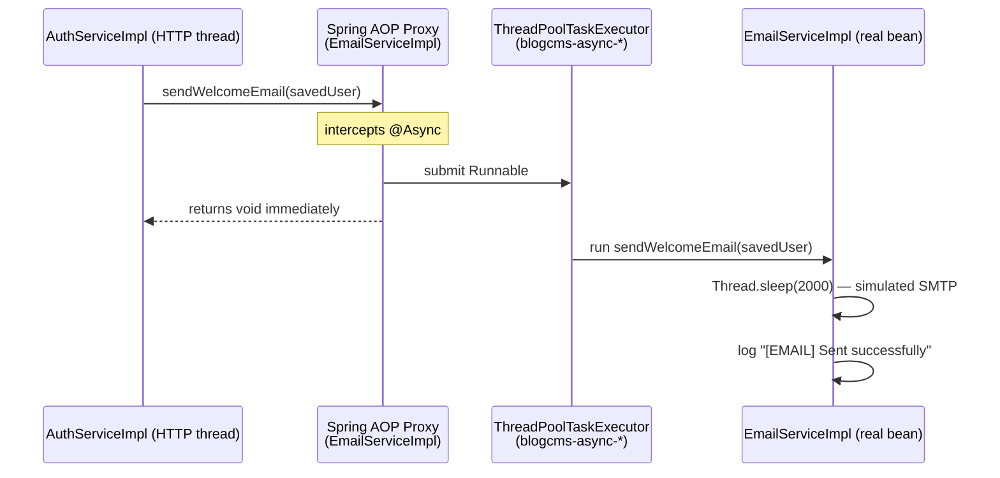
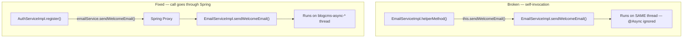

# Background Jobs in Spring Boot — `@Async` Deep Dive

This tutorial uses the Blog CMS project as a concrete example. Every code snippet
references real classes in `src/main/java/com/studylink/blogcms/`.

---

## 1. What `@Async` Does Under the Hood

### The AOP proxy mechanism

When Spring sees `@EnableAsync` on a configuration class (see `AsyncConfig.java`),
it activates an aspect that wraps every bean whose methods carry `@Async` in a
**proxy object**.  The proxy intercepts the method call, places the method body on
a thread pool, and returns immediately to the caller.



The caller (the HTTP request thread handling `POST /api/v1/auth/register`) gets
its response back in milliseconds.  The 2-second simulated delay happens on a
`blogcms-async-*` background thread.

### What "proxy" means in practice

Spring creates a subclass of `EmailServiceImpl` at startup (or a JDK dynamic proxy
if the class implements an interface — and it does, via `EmailService`).  Every
call that goes through the Spring container goes through this proxy.

The proxy logic for `@Async` is roughly:

```java
// pseudo-code — what the generated proxy does
public void sendWelcomeEmail(User user) {
    taskExecutor.submit(() -> super.sendWelcomeEmail(user));
}
```

---

## 2. Why Self-Invocation Breaks `@Async`

Because the proxy lives *outside* the bean, a call from one method to another
method **inside the same class** bypasses the proxy entirely — the JVM calls
`this.someMethod()`, not `proxy.someMethod()`.



In this project `AuthServiceImpl` holds a reference to the `EmailService`
**interface**, so every call passes through the proxy — the correct path.

If `EmailServiceImpl` ever needed to call one of its own `@Async` methods it
would need to inject itself via `@Autowired EmailService self` — a code smell
that usually indicates the logic belongs in a separate service.

---

## 3. Return Types

`@Async` supports three return types.

### `void` — fire-and-forget

Used in `EmailServiceImpl`.  The caller submits the task and never checks the
result.

```java
// EmailServiceImpl.java
@Override
@Async("taskExecutor")
public void sendWelcomeEmail(User user) {
    // runs on blogcms-async-* thread
    simulateSend(...);
}
```

### `Future<T>` — blocking result

The caller can block with `future.get()`:

```java
@Async("taskExecutor")
public Future<String> buildDigestContent(User user) {
    // ... expensive computation
    return new AsyncResult<>("digest html");
}

// caller:
Future<String> f = emailService.buildDigestContent(user);
String html = f.get(); // blocks until done
```

### `CompletableFuture<T>` — non-blocking composition

Preferred over `Future` for modern code because it supports `.thenApply()`,
`.thenCompose()`, `.exceptionally()` chains without blocking:

```java
@Async("taskExecutor")
public CompletableFuture<String> buildDigestContentAsync(User user) {
    return CompletableFuture.completedFuture("digest html");
}

// caller (non-blocking):
emailService.buildDigestContentAsync(user)
    .thenAccept(html -> log.info("Digest ready: {}", html));
```

---

## 4. Fire-and-Forget vs Waiting for the Result

| Use case | Pattern | Example in this project |
|---|---|---|
| Notification email after registration | fire-and-forget (`void`) | `sendWelcomeEmail` in `AuthServiceImpl` |
| Generate a PDF report that must be attached to a response | wait for result (`CompletableFuture`) | — (not yet implemented) |
| Fan-out to multiple recipients, then aggregate errors | wait for result (`CompletableFuture.allOf`) | — |

**Rule of thumb:** if the HTTP response does not depend on the outcome of the
background task, use `void`.  If the user needs the result — even just a
confirmation that it worked — use `CompletableFuture`.

Sending a welcome email clearly does not affect the registration response, so
`void` is the right choice here.

---

## 5. Error Handling

### The silent-swallow problem with `void` methods

When an `@Async void` method throws an unchecked exception the exception has
nowhere to go — the caller is already gone.  Spring will pass it to an
`AsyncUncaughtExceptionHandler`, but the default implementation just logs at
`ERROR` level with a generic message.

`EmailServiceImpl` avoids this by catching `Exception` (including
`InterruptedException`) inside every method and logging the full stack trace
before returning:

```java
@Override
@Async("taskExecutor")
public void sendWelcomeEmail(User user) {
    try {
        // ... build and send
    } catch (Exception e) {
        // Logged here — never re-thrown.
        // If we re-threw, the exception would vanish silently.
        log.error("[EMAIL] Failed to send WELCOME email to {}: {}",
                user.getEmail(), e.getMessage(), e);
    }
}
```

### Registering a global `AsyncUncaughtExceptionHandler`

For any `@Async void` method that does NOT catch internally, you can register a
handler in `AsyncConfig`:

```java
// AsyncConfig.java — optional addition
@Override
public AsyncUncaughtExceptionHandler getAsyncUncaughtExceptionHandler() {
    return (throwable, method, params) ->
        log.error("Unhandled async exception in {}: {}", method.getName(), throwable.getMessage(), throwable);
}
```

This is the safety net.  The per-method `try/catch` inside `EmailServiceImpl` is
the first line of defence.

### `CompletableFuture` error handling

With `CompletableFuture`, exceptions propagate normally via `.exceptionally()` or
`.handle()`:

```java
emailService.buildDigestContentAsync(user)
    .exceptionally(ex -> {
        log.error("Digest failed", ex);
        return "fallback content";
    });
```

---

## 6. Testing Async Methods

Because the method returns immediately, a plain JUnit assertion immediately after
the call will run before the background thread finishes.

### Option A — `CountDownLatch`

```java
@SpringBootTest
class EmailServiceImplTest {

    @Autowired
    private EmailService emailService;

    @Test
    void sendWelcomeEmail_logsSuccessMessage() throws InterruptedException {
        CountDownLatch latch = new CountDownLatch(1);
        // replace simulateSend with a spy that counts down after completion
        // ... set up spy ...

        User user = User.builder().id(1L).email("a@b.com").name("Alice").build();
        emailService.sendWelcomeEmail(user);

        boolean completed = latch.await(5, TimeUnit.SECONDS);
        assertTrue(completed, "Email task did not finish within 5 seconds");
    }
}
```

### Option B — Awaitility (recommended)

[Awaitility](https://github.com/awaitility/awaitility) is a fluent DSL for
polling assertions:

```java
// pom.xml dependency:
// <dependency>
//   <groupId>org.awaitility</groupId>
//   <artifactId>awaitility</artifactId>
//   <scope>test</scope>
// </dependency>

@SpringBootTest
class EmailServiceImplTest {

    @Autowired
    private EmailService emailService;

    @Test
    void sendWelcomeEmail_completesWithinFiveSeconds() {
        AtomicBoolean called = new AtomicBoolean(false);
        // spy or mock to set `called = true` on completion ...

        User user = User.builder().id(1L).email("a@b.com").name("Alice").build();
        emailService.sendWelcomeEmail(user);

        Awaitility.await()
            .atMost(5, TimeUnit.SECONDS)
            .untilTrue(called);
    }
}
```

### Disabling async in tests

Annotating the test class with `@SpringBootTest` loads the real `AsyncConfig`.
If you want synchronous execution in tests (useful for pure unit tests), replace
the executor with `SyncTaskExecutor`:

```java
@TestConfiguration
public class SyncAsyncConfig {
    @Bean(name = "taskExecutor")
    public Executor taskExecutor() {
        return new SyncTaskExecutor(); // runs on caller thread
    }
}
```

---

## 7. Why Simulate Before Real SMTP

During early development, connecting to a real SMTP server introduces several
pain points:

| Problem | Impact |
|---|---|
| Network dependency | Tests fail on CI if SMTP is unavailable |
| Rate limits | Dev/test cycles trigger provider throttling |
| Accidental sends to real users | Seeded dev data emails go to real addresses |
| Slow feedback loop | Round-trip to external server adds seconds per test |

The `Thread.sleep(2000)` + structured log approach in `EmailServiceImpl` mirrors
the *shape* of real async email (latency, failure paths, thread identity) without
any of the external dependencies.

When the project is ready for production email:

1. Add `spring-boot-starter-mail` to `pom.xml`
2. Create a `SmtpEmailServiceImpl` that implements `EmailService`
3. Swap the active implementation with `@Profile("prod")` on the new impl and
   `@Profile("!prod")` on the stub — no callers change at all.

---

## 8. Common Pitfalls

| Pitfall | What happens | Fix |
|---|---|---|
| `@Async` on a `private` method | Spring AOP cannot intercept private methods — annotation is silently ignored, method runs synchronously | Make the method at least `package-private` or move it to a separate bean |
| Self-invocation (`this.method()`) | Bypasses the proxy — method runs synchronously on the caller's thread | Inject the bean into itself, or move the logic to a different service |
| `@Async` + `@Transactional` on the same method | The async proxy and transaction proxy fight; transaction context is lost on the background thread | Keep them separate: the `@Transactional` caller completes, then the `@Async` email fires |
| Missing `@EnableAsync` | All `@Async` annotations are silently ignored | Add `@EnableAsync` to a `@Configuration` class — see `AsyncConfig.java` |
| Not specifying executor name | Without `@Async("taskExecutor")` Spring falls back to a `SimpleAsyncTaskExecutor` that creates a **new thread per call** — no pooling | Always name your executor: `@Async("taskExecutor")` |
| Re-throwing from `void @Async` | Exception is swallowed by framework after reaching the uncaught-exception handler | Catch internally and log, as done in every method of `EmailServiceImpl` |
| No graceful shutdown | Background threads are killed mid-send when the JVM exits | Set `setWaitForTasksToCompleteOnShutdown(true)` and `setAwaitTerminationSeconds(30)` — already done in `AsyncConfig` |
