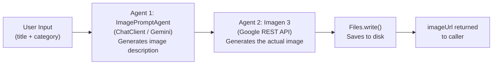

# Spring AI Tutorial — Blog CMS Week 7

This tutorial walks you through integrating AI into a real Spring Boot 4.x application, step by step.
Each part maps to a commit in the project so you can follow the code as you read.

---

## Part 1: Introduction to Spring AI

### What is Spring AI?

Spring AI is an official Spring project that provides a portable, vendor-neutral abstraction over
large language model (LLM) providers. Instead of writing provider-specific HTTP calls, you work
with consistent interfaces — `ChatClient`, `ChatModel`, `ImageModel` — and swap providers by
changing a dependency and a few properties.

Think of it like Spring Data: you write `repository.save(entity)` and Spring Data handles whether
the underlying store is PostgreSQL, MongoDB, or Redis. Spring AI does the same for AI providers.

### Why use Spring AI instead of calling the API directly?

| Direct API call | Spring AI |
|---|---|
| Manual HTTP client setup | Auto-configured beans |
| Provider-specific request/response models | Unified `Prompt` / `ChatResponse` types |
| Re-implement retry, timeout, error handling | Built into the framework |
| Switch providers = rewrite code | Switch providers = change dependency + properties |
| No Spring integration | Full integration with `@Configuration`, `@Bean`, profiles |

For a teaching project, Spring AI also means less boilerplate — you focus on the feature, not the
HTTP plumbing.

### Supported providers

Spring AI supports (among others):
- **Google Gemini** — via direct API key (what we use) or Vertex AI
- **OpenAI** (GPT-4o, GPT-4, etc.)
- **Anthropic** (Claude)
- **Ollama** — run open-source models locally (Llama 3, Mistral, etc.)
- **Azure OpenAI**, **Amazon Bedrock**, **Mistral AI**

Switching between them is a one-line dependency change — the application code stays the same.

### Key abstractions

| Abstraction | What it does |
|---|---|
| `ChatClient` | High-level fluent API — the main entry point you'll use day-to-day |
| `ChatModel` | Low-level interface `ChatClient` delegates to — rarely used directly |
| `Prompt` | Wraps one or more `Message` objects (system + user + assistant turns) |
| `ChatResponse` | Holds the model's reply plus metadata (tokens used, finish reason, etc.) |
| `ChatClient.Builder` | Auto-configured by Spring Boot — inject it to build a `ChatClient` |

---

## Part 2: Google Gemini Setup

### Why not Vertex AI?

Google offers two ways to call Gemini:

| | Google AI Studio | Vertex AI |
|---|---|---|
| Auth | API key (env var) | GCP project + `gcloud` CLI + Application Default Credentials |
| Setup time | 2 minutes | 30+ minutes |
| Free tier | Yes (1,500 req/day) | Yes (with billing account) |
| Production ready | Yes | Yes (enterprise IAM, audit logging) |

For this teaching project we use **Google AI Studio** — one API key, works everywhere,
no `gcloud` CLI needed. In a large enterprise you'd switch to Vertex AI for IAM controls
and audit logging, but the Spring AI code is identical either way.

### Getting your API key (important — read carefully)

> **Note (June 2026):** Google changed their API key format. New keys start with `AQ.Ab...`
> (called Authorization keys). The old `AIza...` format (Standard keys) is being phased out
> by September 2026. Both formats work the same way in API calls — just use whatever
> AI Studio gives you.

1. Go to [Google AI Studio](https://aistudio.google.com/app/apikey)
2. Sign in with a **personal Google account** (not a GCP workspace account if you can avoid it)
3. Click **"Create API key"** → **"Create API key in new project"**
    - ⚠️ Choose **"new project"** — do NOT pick an existing GCP project that has billing enabled.
      If you use a billing-enabled project, the free tier quota is set to `0` and every call
      returns `429 RESOURCE_EXHAUSTED`.
4. Copy the key and store it somewhere safe — you won't see it in full again

### Free tier limits (as of June 2026)

- **Gemini 2.5 Flash**: 1,500 requests/day, 1 million tokens/minute — plenty for development

### Common quota pitfall — `limit: 0`

If you see this error:
```
429: Quota exceeded for metric: generate_content_free_tier_requests, limit: 0
```

It means your API key is tied to a **GCP project with billing enabled**. The fix:
1. Go to [AI Studio](https://aistudio.google.com) → Dashboard → Projects
2. Create a **brand new project** (not imported from GCP Console)
3. Create a new API key in that project
4. Update `GEMINI_API_KEY` in your IntelliJ run config

### Model names change — always check

Google deprecates Gemini models over time. If you see:
```
404: This model models/gemini-X.Y-flash is no longer available
```

Go to [AI Studio Models](https://aistudio.google.com) or the
[Gemini API docs](https://ai.google.dev/gemini-api/docs/models) to find the current model name
and update `spring.ai.openai.chat.options.model` in `application.properties`.

As of June 2026: use `gemini-2.5-flash`.

### Setting the API key — never hardcode it

```properties
# Wrong — key committed to git
spring.ai.openai.api-key=AQ.Ab8RN6JxMJ...

# Right — read from environment variable
spring.ai.openai.api-key=${GEMINI_API_KEY:your-gemini-api-key}
```

The `${GEMINI_API_KEY:fallback}` syntax: read from the `GEMINI_API_KEY` env var; if not set,
use the fallback string (which will fail gracefully at request time, not at startup).

Set it in IntelliJ: **Run → Edit Configurations → Environment variables → `GEMINI_API_KEY=...`**

After updating the env var, always do a **full Stop → Start** in IntelliJ. Hot reload does not
re-read environment variables.

### Security: what NOT to do

- Never commit an API key to git (add `.env` to `.gitignore`)
- Never log it (`log.info("key={}", apiKey)`)
- Rotate the key immediately if it leaks — Google's auth keys have fast-acting leak detection

---

## Part 3: Spring AI Configuration

### Spring Boot 4.x compatibility — use Spring AI 2.0.0

> **Critical:** Spring AI 1.0.0 is NOT compatible with Spring Boot 4.x (Spring Framework 7.x).
> Spring Boot 4.x introduced breaking changes to `HttpHeaders` and removed
> `RestClientAutoConfiguration`. Spring AI 2.0.0 (released June 2026) restored compatibility.
> Always use Spring AI 2.0.0+ with Spring Boot 4.x.

| Spring Boot version | Spring AI version |
|---|---|
| 3.3.x / 3.4.x | Spring AI 1.0.x ✅ |
| 4.0.x+ | Spring AI 2.0.0+ ✅ |
| 4.0.x+ | Spring AI 1.0.x ❌ (startup crash) |

### The dependency

We use `spring-ai-starter-model-openai` pointed at Gemini's OpenAI-compatible endpoint.
Spring AI 2.0.0 has no dedicated Gemini API-key starter — but Gemini exposes an
OpenAI-compatible REST API, so the OpenAI starter works without any GCP setup.

```xml
<properties>
    <spring-ai.version>2.0.0</spring-ai.version>
</properties>

<dependencyManagement>
    <dependencies>
        <dependency>
            <groupId>org.springframework.ai</groupId>
            <artifactId>spring-ai-bom</artifactId>
            <version>${spring-ai.version}</version>
            <type>pom</type>
            <scope>import</scope>
        </dependency>
    </dependencies>
</dependencyManagement>

<dependency>
    <groupId>org.springframework.ai</groupId>
    <artifactId>spring-ai-starter-model-openai</artifactId>
</dependency>
```

The BOM (Bill of Materials) pins every Spring AI module to a compatible version so you never
have to manage individual version numbers.

### Why use the OpenAI starter for Gemini?

Google's Gemini API is compatible with the OpenAI REST spec at this endpoint:
```
https://generativelanguage.googleapis.com/v1beta/openai
```

This means the same `spring-ai-starter-model-openai` that talks to OpenAI's GPT models can
talk to Gemini — just by pointing `base-url` at Google's endpoint. The `ChatClient` API in
your application code is completely identical. If you ever want to switch to actual OpenAI,
you change two properties and nothing else.

### ChatClient vs ChatModel

`ChatModel` is the low-level interface — it takes a `Prompt` and returns a `ChatResponse`.
`ChatClient` wraps `ChatModel` with a fluent builder API and adds useful features like
default system prompts, advisors (for RAG, memory, etc.), and method chaining.

**Always inject `ChatClient`, not `ChatModel`**, unless you need access to raw response metadata.

### ChatClient.Builder pattern

Spring Boot auto-configures a `ChatClient.Builder` bean when a provider starter is on the
classpath. You inject the builder, configure defaults, and call `.build()`:

```java
@Bean
public ChatClient chatClient(ChatClient.Builder builder) {
    return builder.build();
}
```

Options set in `application.properties` are automatically picked up by the auto-configured
builder — you don't need to set them in code. This is the recommended pattern: keep all
tuneable values (model name, temperature, token limit) in properties, not in Java code.

### Configuration reference

```properties
# Point the OpenAI starter at Gemini's OpenAI-compatible endpoint
spring.ai.openai.api-key=${GEMINI_API_KEY:your-gemini-api-key}
spring.ai.openai.base-url=https://generativelanguage.googleapis.com/v1beta/openai
spring.ai.openai.chat.options.model=gemini-2.5-flash
spring.ai.openai.chat.options.temperature=0.7
spring.ai.openai.chat.options.max-tokens=4096
```

**Temperature** controls creativity vs. determinism:
- `0.0` — deterministic, same output every time (good for classification, data extraction)
- `0.7` — balanced (good for blog writing — creative but coherent)
- `1.0+` — highly creative / unpredictable (good for brainstorming)

**max-tokens** caps the response length. 4096 is enough for a full blog post section.
For short tasks (tag suggestions, excerpts) you could use 256 to save quota.

---

## Part 4: Testing the Setup

### The test endpoint

`GET /api/v1/ai/test` (ADMIN only) sends a fixed prompt and returns the response:

```java
String reply = chatClient.prompt()
        .user("Reply with exactly one sentence: 'Spring AI with Gemini is working correctly.'")
        .call()
        .content();
```

Breaking this down:
- `.prompt()` — starts building a new request
- `.user("...")` — sets the user message (what you'd type in a chat)
- `.call()` — sends the request synchronously and waits for the full response
- `.content()` — extracts the text string from the `ChatResponse`

### Manual verification steps

1. Set `GEMINI_API_KEY` in IntelliJ run config
2. **Full Stop → Start** the app (env vars are not picked up by hot reload)
3. Login as ADMIN to get a JWT token:
   ```bash
   curl -X POST http://localhost:8082/api/v1/auth/login \
     -H "Content-Type: application/json" \
     -d '{"email":"admin@blog.com","password":"Password123!"}'
   ```
4. Call the test endpoint:
   ```bash
   curl -H "Authorization: Bearer <token>" http://localhost:8082/api/v1/ai/test
   ```
5. Expected response:
   ```json
   { "message": "Spring AI with Gemini is working correctly." }
   ```

### Handling common errors

| Error | Cause | Fix |
|---|---|---|
| `404: model no longer available` | Gemini deprecated the model | Update `spring.ai.openai.chat.options.model` to `gemini-2.5-flash` |
| `429: limit: 0` | API key tied to a billing-enabled GCP project | Create a new key in a fresh AI Studio project |
| `429: rate limit hit` | Actual free tier rate limit | Wait 1 minute and retry |
| `500` on endpoint call | App running stale build | Full Stop → Start in IntelliJ |
| `401 Unauthorized` from Gemini | Wrong or missing API key | Check `GEMINI_API_KEY` env var value |
| App won't start | Spring AI 1.0.0 on Spring Boot 4.x | Use Spring AI BOM `2.0.0` |

### Logging AI requests

Add to `application.properties` to see the full request/response in logs (dev only):
```properties
logging.level.org.springframework.ai=DEBUG
```

---

*Parts 5–7 below were added in Commit #55.*

---

## Part 5: Prompt Engineering Basics

### What is a system prompt vs a user prompt?

Every call to a chat model involves two distinct messages:

| Message type | Who sets it | What it does |
|---|---|---|
| **System prompt** | Your application code | Establishes the AI's persona, rules, and output format |
| **User prompt** | The human (or your code on their behalf) | The actual question or instruction for this specific request |

Think of it like hiring a contractor. The system prompt is the job description ("you are a technical writer, always use Markdown, never give investment advice"). The user prompt is the specific task ("write a section on Redis eviction policies"). The contractor reads the job description once, then handles each task within those rules.

In Spring AI:

```java
chatClient.prompt()
    .system("You are a technical writer. Use Markdown. Be precise.")   // persona + rules
    .user("Explain Redis eviction policies with code examples.")        // specific task
    .call()
    .content();
```

### Why system prompts matter for consistency

Without a system prompt, the model defaults to a generic assistant mode — it may write in plain text instead of Markdown, switch tone randomly, or hallucinate technical details. A good system prompt locks in:

- **Role** — who the AI is pretending to be
- **Format** — Markdown, plain text, JSON, numbered list
- **Tone** — formal/informal, beginner-friendly/expert-level
- **Constraints** — what to avoid, length limits, disclaimers

The same user prompt gives dramatically different output depending on the system prompt. This is why a blog about Redis written by a "technical writer" looks nothing like one written by a "casual blogger."

### Components of a good system prompt

A high-quality system prompt has four parts:

**1. Role definition** — "You are a culinary writer and food critic." This triggers the model's internal representation of what that role sounds like, which influences word choice, structure, and confidence level.

**2. Guidelines** — specific rules for this role. "Include ingredient lists. Mention dietary considerations." These override the model's defaults. Be explicit — the model will not infer rules you leave implicit.

**3. Output format specification** — "Format: Markdown with clear sections." Without this, the model decides the format itself, and it may change between calls. Pinning the format makes downstream parsing reliable.

**4. Tone and audience** — "Tone: Warm, appetizing. Audience: Home cooks." These two lines change vocabulary, sentence length, and assumed knowledge level. "Home cooks" gets simpler explanations than "Michelin-starred chefs."

### Temperature and creativity control

Temperature controls how creative (random) vs predictable the model's output is:

| Temperature | Behaviour | Good for |
|---|---|---|
| 0.0–0.2 | Nearly deterministic — same input → same output | Parsing, extraction, classification |
| 0.5–0.7 | Balanced — coherent but varied | Blog writing, summaries |
| 0.9–1.0 | Highly creative — may be unpredictable | Brainstorming, poetry |

In `application.properties`:

```properties
spring.ai.openai.chat.options.temperature=0.7
```

For blog content generation, 0.7 is the sweet spot — creative enough to be interesting, stable enough to be publishable.

---

## Part 6: Category-based Prompts

### Why different categories need different prompts

A blog about Redis caching and a blog about sourdough bread require completely different writing styles. A technology post benefits from code blocks and technical precision. A food post benefits from sensory language and a warm tone. Using a single generic system prompt for both would produce mediocre output for both.

Category-based prompts solve this by selecting the appropriate persona before every AI call. The user does not need to think about this — they just pick a category, and the system prompt adapts automatically.

### How it works in this project

The `CategoryPromptTemplate` enum maps each category name to a system prompt:

```java
public enum CategoryPromptTemplate {

    TECHNOLOGY("""
            You are a technical content writer specializing in software development.
            Guidelines:
            - Use code examples where relevant
            - Explain concepts clearly for developers
            ...
            """),

    FOOD("""
            You are a culinary writer and food critic.
            Guidelines:
            - Focus on flavors, textures, and aromas
            ...
            """),

    DEFAULT("""
            You are a professional content writer.
            ...
            """);

    private final String systemPrompt;

    public static CategoryPromptTemplate fromCategoryName(String categoryName) {
        // Case-insensitive match, falls back to DEFAULT
        String upper = categoryName.trim().toUpperCase();
        for (CategoryPromptTemplate t : values()) {
            if (t.name().equals(upper)) return t;
        }
        return DEFAULT;
    }
}
```

The `PromptTemplateService` then composes the full system prompt by combining the category base prompt with a task-specific instruction block:

```java
@Service
public class PromptTemplateService {

    public String getOutlineSystemPrompt(Category category) {
        return basePrompt(category) + """

                TASK: Generate a blog post outline.
                Output format:
                - Return a numbered list of sections
                - Include 5-8 sections
                - Start with introduction, end with conclusion
                """;
    }

    private String basePrompt(Category category) {
        return CategoryPromptTemplate.fromCategoryName(category.getName()).getSystemPrompt();
    }
}
```

This separation of concerns is deliberate:
- `CategoryPromptTemplate` owns the *who the AI is*
- `PromptTemplateService` owns the *what the AI should do right now*

Each AI feature (outline, full post, expand, excerpt, tags) gets its own method in `PromptTemplateService`, all sharing the same category base.

### Mapping categories to writing styles

The categories in this project follow a simple naming convention — the `Category.name` field in the database is matched case-insensitively against the enum names. If a category named "Technology" exists in the DB, `CategoryPromptTemplate.fromCategoryName("Technology")` returns `TECHNOLOGY`.

Categories that don't match any enum value fall back to `DEFAULT`. This means you can add new categories to the database without touching the enum — they just use the generic professional writer persona until you add a dedicated entry.

### Extending for new categories

To add a new category (e.g., HEALTH):

1. Add an entry to `CategoryPromptTemplate`:

```java
HEALTH("""
        You are a health and wellness journalist.
        Guidelines:
        - Cite reputable sources when making health claims
        - Avoid diagnosing or prescribing
        - Use plain language accessible to non-medical readers
        ...
        """),
```

2. Add the category to the database via a Flyway migration (if it is a new seeded category). No other code changes needed — `PromptTemplateService` picks it up automatically via `fromCategoryName`.

### Testing prompts for quality

The fastest way to test a prompt is to call the `/api/v1/ai/test` endpoint while temporarily changing the system prompt. For more systematic testing:

1. Write the prompt in AI Studio's prompt playground first — iterate there where feedback is instant
2. Port the refined prompt into the enum
3. Call the real endpoint with a known topic and inspect the output
4. Adjust temperature if the output is too repetitive (raise) or too chaotic (lower)

---

## Part 7: Prompt Best Practices

### 1. Be specific and clear

Vague prompts produce vague output. Compare:

```
# Vague
"Write about Redis."

# Specific
"Write a blog post about Redis eviction policies for developers who already understand caching basics. 
 Include a code example showing LRU configuration in Spring Boot."
```

The second prompt constrains audience (developers with caching basics), topic (eviction policies), and required content (LRU + Spring Boot code). Every constraint narrows the output toward what you actually want.

### 2. Specify output format explicitly

If you need to parse the AI's response programmatically, the format specification is critical:

```
# For outline parsing (numbered list)
"Return a numbered list of section headings. Example: 1. Introduction  2. Core Concepts"

# For tag parsing (comma-separated)
"Return tags as a comma-separated list only. No extra text. Example: redis, caching, spring-boot"
```

Without explicit format instructions, the model may add preamble ("Sure! Here are some tags:"), bullet points, or markdown that breaks your parser.

### 3. Provide examples when needed

Few-shot examples are powerful when format matters:

```
"Suggest tags. Return only a comma-separated list.
 Example input: A post about Redis caching in Spring Boot
 Example output: redis, caching, spring-boot, java, performance"
```

The model learns the pattern from the example and applies it consistently. This is especially useful for tag normalization (lowercase, no spaces) where the model's default may vary.

### 4. Set constraints and limitations

Constraints prevent the model from going out of bounds:

```
"Maximum 2-3 sentences. Do not include markdown. No headers."  ← for excerpts
"Total length: 800-1500 words."                                ← for full posts
"Avoid specific investment advice."                            ← for finance posts
```

Without length constraints, the model will write as much as it feels like. Without content constraints, it may cross into territory you don't want (legal disclaimers, medical advice, etc.).

### 5. Iterate and improve based on results

Prompts are not write-once. The first version almost always has gaps. The improvement cycle:

1. Generate 5–10 samples with your current prompt
2. Identify the most common failure modes ("the outline always has 3 sections instead of 5–8")
3. Add a constraint that addresses the failure ("Include exactly 5–8 sections. If you include fewer, the output is considered incomplete.")
4. Re-generate and compare

The prompts in `CategoryPromptTemplate` were iterated several times. Treat them as living configuration, not finished code.

---

*Parts 8–10 below were added in Commit #56.*

---

## Part 8: Building the AI Service

### Service layer architecture

The AI service follows the same layered pattern as every other service in this project:

```
AIController (commit 59)
    → AIService (interface)
        → AIServiceImpl
            → ChatClient          (Spring AI)
            → PromptTemplateService  (commit 55)
            → CategoryRepository  (existing)
```

`AIService` is an interface so the controller depends on the contract, not the implementation.
If you later want a mock implementation for tests, or a caching wrapper, you can swap it in
without touching the controller.

`AIServiceImpl` has three injected dependencies:
- `ChatClient` — the Spring AI entry point for sending prompts to Gemini
- `PromptTemplateService` — returns the right system prompt for a given category + task
- `CategoryRepository` — loads the `Category` entity so we can pass it to `PromptTemplateService`

### The `ChatClient.prompt()` fluent API

Every AI call in this project follows this chain:

```java
String response = chatClient.prompt()    // 1. start a request builder
    .system(systemPrompt)                // 2. set the system prompt (who the AI is + task rules)
    .user(userPrompt)                    // 3. set the user message (the specific input)
    .call()                              // 4. send synchronously — blocks until Gemini responds
    .content();                          // 5. extract the text content from the response
```

Each step in the chain is optional except `.call()` and `.content()`. If you omit `.system()`,
the model uses no system prompt (fine for simple tasks). If you omit `.user()`, the model has
nothing to respond to (usually a mistake).

`.call()` is **synchronous** — the calling thread blocks until the response arrives. For blog
generation this is fine (the user is waiting for AI content). For background jobs, use
`.stream()` instead.

### System prompt vs user prompt in code

```java
// System prompt — comes from PromptTemplateService, varies by category
String systemPrompt = promptTemplateService.getOutlineSystemPrompt(category);

// User prompt — built from the user's request fields
String userPrompt = buildOutlineUserPrompt(request);

String response = chatClient.prompt()
    .system(systemPrompt)
    .user(userPrompt)
    .call()
    .content();
```

`buildOutlineUserPrompt` is a private helper that assembles the user message from the
request DTO fields:

```java
private String buildOutlineUserPrompt(GenerateOutlineRequest request) {
    StringBuilder prompt = new StringBuilder();
    prompt.append("Create a blog post outline for the topic: ").append(request.getTopic());

    if (request.getTargetAudience() != null && !request.getTargetAudience().isBlank()) {
        prompt.append("\nTarget audience: ").append(request.getTargetAudience());
    }
    if (request.getAdditionalInstructions() != null) {
        prompt.append("\nAdditional requirements: ").append(request.getAdditionalInstructions());
    }

    return prompt.toString();
}
```

Optional fields are only appended if they are non-null and non-blank. Appending `"Target
audience: null"` to a prompt is worse than omitting the line entirely — it confuses the model.

---

## Part 9: Outline Generation

### Request and Response DTOs

`GenerateOutlineRequest` carries what the user provides:

```java
public class GenerateOutlineRequest {
    @NotBlank  private String topic;         // required — the blog subject
    @NotNull   private Long categoryId;      // required — determines the AI persona
               private String targetAudience;        // optional — "beginners", "experts"
               private String additionalInstructions; // optional — any special requirements
}
```

`GenerateOutlineResponse` carries what the service returns:

```java
public class GenerateOutlineResponse {
    private String topic;           // echoed back so clients know what was generated
    private String category;        // the resolved category name
    private List<String> outline;   // the parsed section headings
    private String generatedAt;     // ISO timestamp for display/audit
}
```

Note that `outline` is `List<String>`, not the raw AI response string. The service parses
the AI output before returning — the controller never sees raw Gemini text.

### Parsing numbered lists from AI

The system prompt instructs Gemini to return a numbered list like:

```
1. Introduction to Redis Caching
2. How the LRU Eviction Algorithm Works
3. Configuring Redis in Spring Boot
4. Cache-Aside Pattern
5. Monitoring Cache Hit Rates
6. Conclusion
```

`parseNumberedList` extracts only the section text, stripping the numbers:

```java
private List<String> parseNumberedList(String response) {
    return Arrays.stream(response.split("\n"))
            .map(String::trim)
            .filter(line -> !line.isEmpty())
            .filter(line -> line.matches("^\\d+[.)].+"))  // matches "1." or "1)"
            .map(line -> line.replaceFirst("^\\d+[.)]\\s*", ""))
            .toList();
}
```

The regex `^\\d+[.)].+` matches lines that start with one or more digits followed by `.` or `)`.
This handles both `1.` and `1)` formats that Gemini might produce. Lines that are preamble
("Here is your outline:") or blank are filtered out.

### Handling edge cases

- **Empty response**: `parseNumberedList` returns an empty list. The controller returns an
  empty outline — the client can retry rather than crashing.
- **Wrong format** (Gemini returns prose instead of a list): the filter discards all lines,
  returning an empty list. The system prompt constrains format, but AI output is not
  100% guaranteed — defensive parsing is safer than regex exceptions.
- **Category not found**: throws `ResourceNotFoundException` which the
  `GlobalExceptionHandler` maps to a `404` response.

---

## Part 10: Full Post Generation

### Using a user-provided outline

Unlike outline generation, post generation takes the **outline as an input**. The flow is:

1. User calls `POST /api/v1/ai/outline` → gets a `List<String>` back
2. User reviews/edits the outline in the frontend
3. User calls `POST /api/v1/ai/post` with the (possibly edited) outline

This two-step flow is intentional: the outline is a checkpoint where the human can steer the
AI before committing to a full 1000-word generation. It also makes the AI more reliable —
"follow this exact structure" produces better output than "write whatever you think fits."

`buildPostUserPrompt` renders the outline as a numbered list in the user message:

```java
private String buildPostUserPrompt(GeneratePostRequest request) {
    StringBuilder prompt = new StringBuilder();
    prompt.append("Write a complete blog post about: ").append(request.getTopic());
    prompt.append("\n\nFollow this outline:\n");

    for (int i = 0; i < request.getOutline().size(); i++) {
        prompt.append(i + 1).append(". ").append(request.getOutline().get(i)).append("\n");
    }
    // ...
}
```

### Extracting the title from Markdown

The system prompt instructs Gemini to include an H1 title (`# Title`). `extractTitle`
finds the first line starting with `# `:

```java
private String extractTitle(String content) {
    return Arrays.stream(content.split("\n"))
            .filter(line -> line.startsWith("# "))
            .findFirst()
            .map(line -> line.substring(2).trim())
            .orElse("Untitled Post");
}
```

`line.substring(2)` strips the `# ` prefix (the `#` and the space). If Gemini omits the
H1 (it occasionally does despite instructions), the method falls back to `"Untitled Post"`
rather than throwing — the content is still usable, just needs a title from the user.

### Stub fields for excerpt and tags

`GeneratePostResponse` includes `excerpt` and `suggestedTags` but both are empty in this
commit (`""` and `List.of()`). These will be filled by real AI calls in commit 57 when
`expandContent`, `generateExcerpt`, and `suggestTags` are added to `AIService`. The fields
are present now so the response DTO shape does not change between commits.

---

*Parts 11–13 below were added in Commit #57.*

---

## Part 11: Content Enhancement — Expand

### The expand use case

After a post is generated, authors often want to deepen specific sections. The expand feature
takes a draft (or a single section) and asks Gemini to grow it to roughly 2× its current
length while preserving the original structure and tone.

This is different from "rewrite" — the AI is instructed not to change the core message,
only to add more detail, examples, and explanations.

### How `expandContent` works

```java
@Override
public ExpandContentResponse expandContent(ExpandContentRequest request) {
    Category category = findCategory(request.getCategoryId());

    StringBuilder userPrompt = new StringBuilder("Expand and improve the following content:\n\n");
    userPrompt.append(request.getContent());

    if (request.getFocusAreas() != null && !request.getFocusAreas().isBlank()) {
        userPrompt.append("\n\nFocus on: ").append(request.getFocusAreas());
    }

    String expandedContent = chatClient.prompt()
            .system(promptTemplateService.getExpandSystemPrompt(category))
            .user(userPrompt.toString())
            .call()
            .content();

    return ExpandContentResponse.builder()
            .expandedContent(expandedContent)
            .originalWordCount(countWords(request.getContent()))
            .expandedWordCount(countWords(expandedContent))
            .generatedAt(LocalDateTime.now().toString())
            .build();
}
```

The optional `focusAreas` field lets the author steer the expansion: "add more code examples"
or "explain the LRU algorithm in more depth." Without it, the model expands everything evenly.

### Word count tracking

`ExpandContentResponse` includes `originalWordCount` and `expandedWordCount`. These are
computed by splitting on whitespace:

```java
private int countWords(String content) {
    if (content == null || content.isBlank()) return 0;
    return content.split("\\s+").length;
}
```

This is a simple approximation — Markdown headers, code blocks, and punctuation all count
as "words." It is accurate enough to show the author that expansion happened (e.g. 300 → 620
words) without requiring a proper NLP tokenizer.

### Maintaining tone while expanding

The category-aware system prompt from `getExpandSystemPrompt` is the key to tone
preservation. A Technology post is expanded with technical precision; a Food post is
expanded with sensory language. The expand instruction appended by `PromptTemplateService`
adds: "Maintain the original message and tone. Do not change the core structure."

---

## Part 12: Excerpt Generation

### Why auto-generate excerpts?

An excerpt is the 2–3 sentence preview shown on post listing pages and in meta descriptions.
Writing a good excerpt manually is easy to forget and often done poorly under deadline
pressure. AI can do it consistently and immediately after post generation.

### How `generateExcerpt` works

```java
@Override
public String generateExcerpt(ExcerptRequest request) {
    int maxLength = request.getMaxLength() > 0 ? request.getMaxLength() : 200;

    String userPrompt = String.format(
            "Create an excerpt (max %d characters) for this blog post:\n\n%s",
            maxLength, request.getContent());

    return chatClient.prompt()
            .system(promptTemplateService.getExcerptSystemPrompt())
            .user(userPrompt)
            .call()
            .content()
            .trim();
}
```

`maxLength` defaults to 200 characters if not provided — a sensible meta-description length.
The length constraint is embedded in the user prompt itself (`"max %d characters"`), not just
the system prompt, because constraints repeated in the user message are more reliably followed.

Note that `getExcerptSystemPrompt()` takes no category — the excerpt persona ("content
summarizer") is content-agnostic. The AI reads the full post and summarizes regardless of
category.

### Integration with `generatePost`

After commit 57, `generatePost` calls `generateExcerpt` automatically:

```java
ExcerptRequest excerptRequest = new ExcerptRequest();
excerptRequest.setContent(content);
String excerpt = generateExcerpt(excerptRequest);
```

This means every full post generation now returns a ready-to-use excerpt in the response,
without the caller needing to make a separate API call.

---

## Part 13: Tag Suggestion

### AI-powered content categorisation

Tags are important for discoverability but tedious to choose consistently. The tag suggestion
feature reads the generated content and returns 3–5 relevant tags as a comma-separated list.

```java
@Override
public List<String> suggestTags(TagSuggestionRequest request) {
    int maxTags = request.getMaxTags() > 0 ? request.getMaxTags() : 5;

    String userPrompt = String.format(
            "Suggest %d relevant tags for this blog post:\n\n%s",
            maxTags, request.getContent());

    String response = chatClient.prompt()
            .system(promptTemplateService.getTagSuggestionSystemPrompt())
            .user(userPrompt)
            .call()
            .content();

    return Arrays.stream(response.split(","))
            .map(String::trim)
            .map(String::toLowerCase)
            .filter(tag -> !tag.isEmpty())
            .limit(maxTags)
            .toList();
}
```

### Parsing list responses

The system prompt instructs Gemini to return `"redis, caching, spring-boot, java, performance"`.
The parser:

1. **Splits on `,`** — handles the comma-separated format
2. **Trims whitespace** — removes spaces around each tag
3. **Lowercases** — normalises `Redis` and `redis` to the same tag
4. **Filters empty strings** — handles trailing commas
5. **Limits to `maxTags`** — the model occasionally returns more than requested

### Tag normalisation

`.map(String::toLowerCase)` is the only normalisation applied here. In a production system
you might also: strip special characters (`#`, `@`), replace spaces with hyphens for
URL-safe tags, or deduplicate against existing tags in the database. Those steps belong in
`TagService`, not `AIServiceImpl` — the AI service returns raw suggestions, and the tag
service decides which ones to create or link.

---

*Parts 14–17 below were added in Commit #58.*

---

## Part 14: Multi-Agent Architecture

### What is multi-agent AI?

A multi-agent system is a pipeline where the output of one AI model becomes the input of
another. Each "agent" is a focused, single-purpose AI call. The pipeline orchestrates them
in sequence (or in parallel).

In this commit, the pipeline has two agents:



### When to use multiple agents

Use a multi-agent approach when:

- The problem has **distinct sub-tasks** that benefit from different models or different
  prompts (text reasoning vs. image generation)
- An intermediate result needs **human or programmatic review** before the next step
  (outline → review → post)
- A task is **too complex for one prompt** — splitting it into focused sub-tasks produces
  better quality than one mega-prompt

Do NOT use multiple agents when a single prompt can do the job — each agent call adds
latency and cost.

### Agent communication: output of one is input of the next

```java
// Agent 1 output
String imagePrompt = imagePromptAgent.generateImagePrompt(title, category, style);

// imagePrompt is passed directly as Agent 2's input
String imageUrl = callImagenAndSave(imagePrompt);
```

The contract between agents is a plain `String`. Agent 1 is responsible for producing a
prompt that Agent 2 can consume. If Agent 1 produces a poor prompt, Agent 2 generates a
poor image — so the system prompt in `ImagePromptAgent` is carefully crafted to produce
Imagen-3-friendly descriptions.

---

## Part 15: Image Prompt Agent

### Why a separate agent for generating the prompt?

Imagen 3 takes a text prompt and generates an image. The quality of the image depends
entirely on the quality of the prompt. A generic prompt like "blog about Redis" produces
a generic, often irrelevant image. A well-crafted prompt like:

> "A modern server room with glowing blue LED lights, abstract data flow visualisation,
> dark tech aesthetic, minimalist photography style, 16:9 aspect ratio, no text"

...produces a professional, on-brand featured image.

Rather than asking the user to write image prompts (a skill most blog authors don't have),
`ImagePromptAgent` uses Gemini to translate a blog title and category into a high-quality
Imagen prompt. This is the "AI helping AI" pattern.

### ImagePromptAgent implementation

```java
@Component
@RequiredArgsConstructor
public class ImagePromptAgent {

    private final ChatClient chatClient;

    private static final String SYSTEM_PROMPT = """
            You are an expert at creating image generation prompts for blog featured images.
            Guidelines:
            - Describe visual elements clearly (objects, scene, lighting, colors)
            - Include the artistic style (photorealistic, illustration, minimalist, etc.)
            - Avoid text or words in the image (AI struggles with rendering text accurately)
            - Keep it professional and appropriate for a blog
            Output: Return only the image prompt — no preamble, no explanation.
            """;

    public String generateImagePrompt(String title, String categoryName, String style) {
        String userPrompt = String.format("""
                Blog Title: %s
                Category: %s
                Preferred Style: %s
                Generate a detailed prompt for the featured image.
                """, title, categoryName, style != null ? style : "modern and professional");

        return chatClient.prompt()
                .system(SYSTEM_PROMPT)
                .user(userPrompt)
                .call()
                .content()
                .trim();
    }
}
```

Key prompt engineering choices:
- **"Output: Return only the image prompt — no preamble"** — Gemini tends to add "Sure!
  Here is your prompt:". Without this instruction, Agent 2 would receive that preamble as
  part of the image prompt, confusing Imagen 3.
- **"Avoid text or words in the image"** — AI image models consistently produce garbled,
  unreadable text in images. This constraint steers the model toward purely visual elements.
- **Style parameter** — lets the caller specify "minimalist", "photorealistic", "watercolor"
  etc. Defaults to "modern and professional" if not provided.

---

## Part 16: Imagen 3 Integration

### Why not use Spring AI's ImageModel?

Spring AI has an `ImageModel` abstraction, but it is wired to DALL-E (OpenAI) or Vertex AI
Imagen (requires GCP project + ADC). Neither works with our existing `GEMINI_API_KEY` setup.

Imagen 3 is available via Google AI Studio's native REST API — a completely different
endpoint from the OpenAI-compatible one we use for chat. We call it directly with Spring's
`RestClient`:

```
POST https://generativelanguage.googleapis.com/v1beta/models/imagen-3.0-generate-002:predict
x-goog-api-key: {GEMINI_API_KEY}

{
  "instances": [{ "prompt": "A modern server room with glowing blue LED lights..." }],
  "parameters": { "sampleCount": 1, "aspectRatio": "16:9" }
}
```

Response:
```json
{
  "predictions": [{
    "bytesBase64Encoded": "<base64-encoded PNG>",
    "mimeType": "image/png"
  }]
}
```

### RestClient — Spring's modern HTTP client

`RestClient` was introduced in Spring 6.1 (Spring Boot 3.2+) as a fluent, synchronous
replacement for `RestTemplate`:

```java
Map<String, Object> response = restClient.post()
        .uri(IMAGEN_BASE_URL)
        .header("x-goog-api-key", geminiApiKey)
        .header("Content-Type", "application/json")
        .body(requestBody)
        .retrieve()
        .body(Map.class);
```

`.retrieve()` executes the request. `.body(Map.class)` deserialises the JSON response into
a `Map<String, Object>` using Jackson — no need to define a response DTO for a one-off call.

### Saving the image bytes

Imagen 3 returns the image as a base64-encoded string. We decode and write it directly
to disk under `uploads/ai-images/`:

```java
byte[] imageBytes = Base64.getDecoder().decode(base64Image);

String fileName = "ai-generated-" + UUID.randomUUID() + ".png";
Path targetPath = aiImagesDir.resolve(fileName);
Files.write(targetPath, imageBytes);

return "/uploads/ai-images/" + fileName;
```

`Files.write()` is used here instead of `FileStorageService.storeFile()` because
`storeFile()` accepts `MultipartFile` (user-uploaded files). AI-generated images come as
raw `byte[]` — a different input type. Writing directly keeps both paths clean.

### The `ai.image.enabled` toggle

```java
@Value("${ai.image.enabled:true}")
private boolean imageEnabled;
```

When `ai.image.enabled=false`, the service skips the Imagen 3 call and returns a
placeholder URL. Agent 1 (the prompt generator) still runs — so the `generatedPrompt`
field always contains a real AI-crafted description even when the image is a placeholder.
This is useful for development and CI where you don't want to consume Imagen 3 quota.

---

## Part 17: Orchestrating Agents

### Sequential agent execution

`ImageGenerationServiceImpl.generateFeaturedImage` orchestrates both agents:

```java
@Override
public GenerateImageResponse generateFeaturedImage(GenerateImageRequest request) {
    Category category = findCategory(request.getCategoryId());

    // Agent 1 — text AI (Gemini) generates the image description
    String imagePrompt = imagePromptAgent.generateImagePrompt(
            request.getTitle(), category.getName(), request.getStyle());

    if (!imageEnabled) {
        return GenerateImageResponse.builder()
                .imageUrl(PLACEHOLDER_URL)
                .generatedPrompt(imagePrompt)
                .generatedAt(LocalDateTime.now().toString())
                .build();
    }

    // Agent 2 — image AI (Imagen 3) generates the actual image
    String imageUrl = callImagenAndSave(imagePrompt);

    return GenerateImageResponse.builder()
            .imageUrl(imageUrl)
            .generatedPrompt(imagePrompt)
            .generatedAt(LocalDateTime.now().toString())
            .build();
}
```

The orchestrator is responsible for:
1. **Data setup** — loading the category so Agent 1 knows the context
2. **Calling Agent 1** — getting the image prompt
3. **Deciding whether to run Agent 2** — based on the `ai.image.enabled` property
4. **Calling Agent 2** — passing Agent 1's output as Agent 2's input
5. **Assembling the response** — combining results from both agents

Neither agent knows about the other. `ImagePromptAgent` returns a `String`. The orchestrator
decides what to do with it. This separation means you can swap Imagen 3 for DALL-E or
Stable Diffusion without touching `ImagePromptAgent`.

### Logging and debugging multi-agent flows

Each agent logs at the start and end of its work:

```
INFO  ImagePromptAgent        — Agent 1 — generating image prompt for: 'Redis Caching in Spring Boot'
INFO  ImagePromptAgent        — Agent 1 — generated prompt: A modern server room with...
INFO  ImageGenerationServiceImpl — Agent 2 — calling Imagen 3 for prompt: A modern server room...
INFO  ImageGenerationServiceImpl — Saved AI-generated image: /uploads/ai-images/ai-generated-uuid.png (142580 bytes)
```

With these logs, you can trace exactly which agent ran, what it produced, and how long it
took — essential when debugging why an image looks wrong or why the pipeline is slow.

---

*Next: Part 18 — Usage Tracking (added in Commit #59)*
